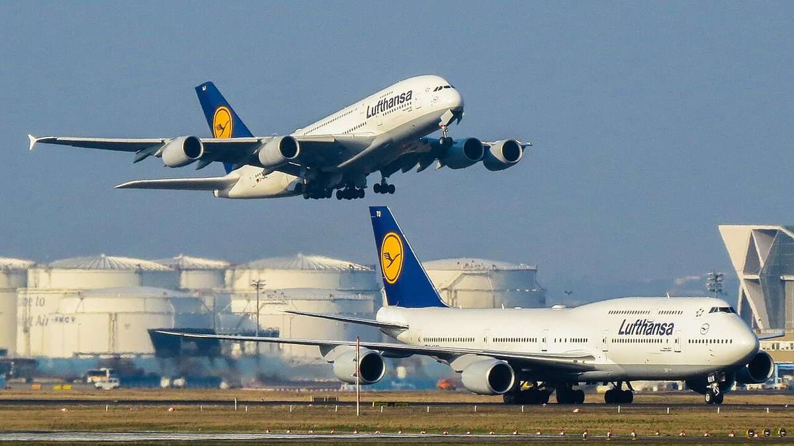
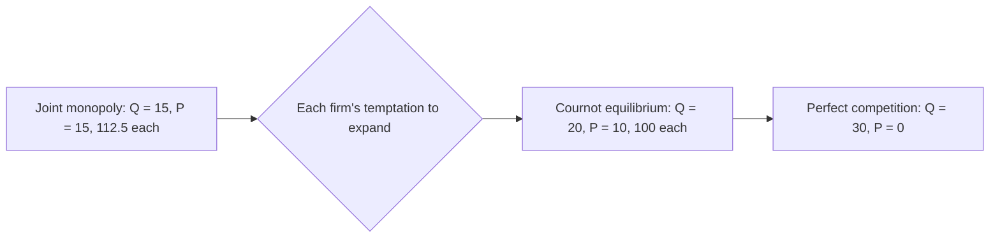

# Oligopoly

**Prerequisites:** [Monopoly](04-monopoly.md), [Economies of scale](../04-producer-theory/08-economies-of-scale.md).

*An Airbus A380 and a Boeing 747: two firms dominate the market for large passenger jets. Credit: Kiefer. from Frankfurt, Germany. License: [CC BY-SA 2.0](https://creativecommons.org/licenses/by-sa/2.0). Source: [File:Lufthansa Airbus A380 and Boeing 747 (16431502906).jpg](https://commons.wikimedia.org/wiki/File:Lufthansa_Airbus_A380_and_Boeing_747_(16431502906).jpg).*

An **oligopoly** is a market dominated by a few firms. Large passenger jets (Airbus and Boeing), Canadian wireless carriers (Rogers, Bell and Telus hold most of the market), Canadian banking (the "Big Five"), soft drinks, commercial aircraft engines and search engines are oligopolies. The defining feature is **strategic interdependence**: each firm's best decision depends on what its rivals do, and each knows it. That makes oligopoly the most complex market structure, and it is why economists use game theory to study it.

## Features

1. **A few large firms** account for most of the market. Concentration is often measured by the share of the largest four firms (the four-firm concentration ratio) or by the **Herfindahl-Hirschman Index** (HHI), the sum of squared market shares. A market with four firms of 25 percent each has HHI = 4 × 25² = 2,500. A pure monopoly has 10,000.
2. **Barriers to entry**: economies of scale, high fixed costs, control of distribution networks, brand loyalty, regulation (such as spectrum licences).
3. **Products** may be identical (steel, cement, oil) or differentiated (cars, smartphones, breakfast cereals).
4. **Interdependence**: a price cut by one firm takes customers from the others, who may respond.

## The basic tension: cooperate or compete?

Oligopolists face a tension. Collectively they would earn the most by acting like a single monopolist: restricting output and raising prices. But each firm individually has an incentive to cheat: to undercut the agreed price or produce more and grab market share. If all firms do that, the outcome moves toward the competitive result.

**Worked example.** Two firms, A and B, sell identical bottled water in a town. Demand is P = 30 − Q, where Q is total output (thousand bottles). Marginal cost is zero, to keep the arithmetic simple.

- **If they act as a joint monopoly**: MR = 30 − 2Q = 0, so Q = 15, P = 15. Total profit = 225. Split equally: **112.5 each**, with each producing 7.5.
- **If A cheats** and produces 10 while B sticks to 7.5: Q = 17.5, P = 12.50. A earns 125, B earns 93.75. Cheating pays for A.
- **If both produce 10**: Q = 20, P = 10, each earns **100**. Both are worse off than with cooperation.
- **Under perfect competition** (P = MC = 0): profits are zero.

The outcome when both firms independently choose output to maximise their own profit, taking the other's output as given, is the **Cournot equilibrium**: here each produces 10 and earns 100. It lies between monopoly and competition. See [Cournot, Bertrand and Stackelberg](13-cournot-bertrand-and-stackelberg.md).

## Collusion and cartels

Firms that explicitly agree to fix prices or divide markets form a **cartel**. OPEC, founded in 1960, is the best-known international example: its members coordinate oil production targets. Cartels are illegal in most countries' domestic markets. In Canada, the **Competition Act** makes price-fixing agreements between competitors a criminal offence. A notable Canadian case is the bread price-fixing scheme that Loblaw and George Weston disclosed in 2017, under the Competition Bureau's immunity programme, after admitting participation in an industry-wide arrangement running from about 2001 to 2015.

Cartels are unstable: each member has an incentive to cheat by producing more than its quota. OPEC's history shows repeated episodes of members exceeding quotas. The logic of cheating is the [prisoner's dilemma](12-prisoners-dilemma-and-cartels.md).

## Tacit collusion and price leadership

Even without an explicit agreement, firms can sometimes coordinate on high prices. One firm, often the largest, may act as a **price leader**, and others follow its price changes. Repeated interaction lets firms punish defectors, making cooperation sustainable, as explained in [repeated games and strategic moves](14-repeated-games-and-strategic-moves.md). Tacit collusion is generally not illegal, which makes it a challenge for competition authorities.

## The kinked demand curve

An older theory, proposed independently in 1939 by Paul Sweezy and by R. L. Hall and C. J. Hitch, tried to explain why oligopoly prices seem "sticky". It supposes that if one firm raises its price, rivals will not follow (so it loses many customers: demand is elastic above the current price), but if it cuts its price, rivals will match (so it gains few: demand is inelastic below). The resulting demand curve has a kink at the current price, and the firm has little reason to change price. The theory explains rigidity but not how the price was set in the first place, and empirical support is mixed, notably from George Stigler's 1947 study. It is mainly of historical interest today.

## Why oligopoly needs game theory

In monopoly and perfect competition, a firm can treat its environment as given. In oligopoly, it cannot: the best price for Coca-Cola depends on Pepsi's price, which depends on what Pepsi expects Coca-Cola to do. Analysing such interdependent decisions is exactly what **game theory** was built for. The next lessons introduce it.

## Key ideas

- Oligopoly: a few firms, barriers to entry, strategic interdependence.
- Concentration is measured by concentration ratios or the HHI.
- Joint profits are highest under collusion, but each firm is tempted to cheat.
- Cartels are illegal in most domestic markets and tend to be unstable.
- Oligopoly outcomes usually lie between monopoly and competition; game theory analyses them.

## Where this leads

- Next: [game theory basics](10-game-theory-basics.md).
- Glossary: [oligopoly](../glossary/oligopoly.md), [cartel](../glossary/cartel.md), [Herfindahl-Hirschman Index](../glossary/herfindahl-hirschman-index.md), [price leadership](../glossary/price-leadership.md).
