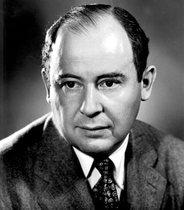
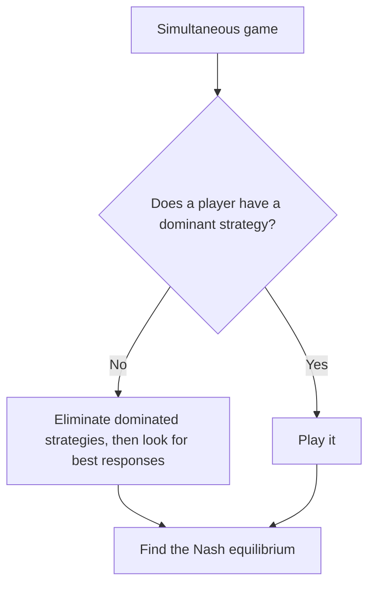

# Game theory basics

**Prerequisites:** [[oligopoly|Oligopoly]], [[choice-and-trade-offs|Choice and trade-offs]].

*John von Neumann (1903–1957), who with Oskar Morgenstern founded game theory in 1944. Credit: wikispaces. License: [CC BY-SA 3.0](https://creativecommons.org/licenses/by-sa/3.0). Source: [File:John von Neumann.jpg](https://commons.wikimedia.org/wiki/File:John_von_Neumann.jpg).*

**Game theory** is the study of strategic decision-making: situations in which the outcome for each participant depends on the choices of others. It was founded as a field by the mathematician John von Neumann and the economist Oskar Morgenstern in *Theory of Games and Economic Behavior* (1944), although earlier writers, including Antoine Augustin Cournot in 1838, had analysed strategic situations. Today game theory is used across economics, political science, biology, computer science and philosophy.

## The elements of a game

Every game has:

1. **Players**: the decision-makers (firms, governments, individuals).
2. **Strategies**: the options available to each player. A strategy is a complete plan of action.
3. **Payoffs**: what each player gets for every combination of strategies, measured in profit, utility or some other value.
4. **Information**: what each player knows when choosing, including whether they can see others' moves.

Games can be **simultaneous** (players choose at the same time, or without seeing each other's choices, like sealed bids) or **sequential** (players take turns and can see earlier moves, like chess). They can be played **once** or **repeated**.

## The payoff matrix

A simultaneous two-player game with a few strategies is shown in a **payoff matrix**. Two coffee chains, Alpha and Beta, each choose whether to set a **high** or **low** price. Profits (thousands of dollars a week) are shown as (Alpha, Beta):

| | Beta: High | Beta: Low |
|---|---|---|
| **Alpha: High** | (50, 50) | (20, 70) |
| **Alpha: Low** | (70, 20) | (30, 30) |

If both price high, they share a profitable market. If one prices low while the other prices high, the low-pricer steals customers. If both price low, they split a less profitable market.

## Dominant strategies

A **dominant strategy** is one that gives a player a higher payoff than any other strategy, **whatever** the other players do.

Look at Alpha's options:

- If Beta plays High, Alpha gets 50 from High and 70 from Low. Low is better.
- If Beta plays Low, Alpha gets 20 from High and 30 from Low. Low is better.

Low is better for Alpha either way: it is a **dominant strategy**. By symmetry, Low is dominant for Beta too. So both choose Low and earn 30 each, even though both would earn 50 if both chose High. This particular structure is the **prisoner's dilemma**, discussed in [[prisoners-dilemma-and-cartels|the prisoner's dilemma and cartels]].

## Dominated strategies

A strategy is **dominated** if another strategy always does better. A rational player never plays a dominated strategy. Sometimes a game can be solved by **iterated elimination of dominated strategies**: remove dominated strategies for one player, which may make some of the other player's strategies dominated, and so on.

## Not every game has a dominant strategy

Consider two firms deciding which technology standard to adopt, A or B. They gain from compatibility:

| | Firm 2: A | Firm 2: B |
|---|---|---|
| **Firm 1: A** | (10, 10) | (0, 0) |
| **Firm 1: B** | (0, 0) | (8, 8) |

Neither firm has a dominant strategy: the best choice depends on what the other does. This is a **coordination game**. There are two stable outcomes, both choosing A or both choosing B. The history of video formats (VHS and Betamax in the 1970s and 1980s) and plug standards shows real coordination problems. To find predictions in such games, economists use the concept of [[nash-equilibrium|Nash equilibrium]].

## Sequential games and backward induction

In sequential games, players move in turn. They are drawn as **game trees**, and solved by **backward induction**: start at the end, work out what the last mover will do, then work backward to the first move.

**Example: entry deterrence.** An entrant decides whether to enter a market. If it enters, the incumbent decides whether to fight (a price war) or accommodate.

- Stay out: entrant 0, incumbent 100.
- Enter, incumbent accommodates: entrant 30, incumbent 50.
- Enter, incumbent fights: entrant −10, incumbent 20.

Backward induction: if the entrant enters, the incumbent compares 50 (accommodate) with 20 (fight) and accommodates. Knowing this, the entrant compares 30 (enter) with 0 (stay out) and enters. The incumbent's threat to fight is **not credible**: once entry has happened, fighting hurts the incumbent. This idea of credibility, formalised by Reinhard Selten as **subgame perfection** in 1965, is developed in [[repeated-games-and-strategic-moves|repeated games and strategic moves]].

## Game theory beyond economics

Game theory explains arms races, climate negotiations (each country benefits if others cut emissions), evolutionary biology (John Maynard Smith's evolutionarily stable strategies), auction design, and the design of matching markets for medical residents and kidney exchanges, for which Alvin Roth and Lloyd Shapley received the 2012 Nobel memorial prize.

## Key ideas

- Game theory studies strategic interaction: players, strategies, payoffs, information.
- Simultaneous games use payoff matrices; sequential games use game trees.
- A dominant strategy is best regardless of others' choices; rational players never play dominated strategies.
- Coordination games have several stable outcomes and no dominant strategy.
- Sequential games are solved by backward induction; non-credible threats are ignored.

## Where this leads

- Next: [[nash-equilibrium|Nash equilibrium]].
- Glossary: [[g:game-theory|game theory]], [[g:dominant-strategy|dominant strategy]], [[g:payoff-matrix|payoff matrix]], [[g:backward-induction|backward induction]].
