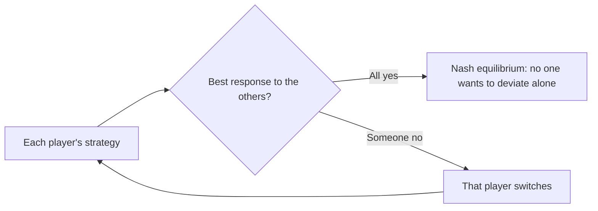

# Nash equilibrium

**Prerequisites:** [[game-theory-basics|Game theory basics]].

*John Forbes Nash Jr. in 2006. Credit: Elke Wetzig (Elya). License: [CC BY-SA 3.0](http://creativecommons.org/licenses/by-sa/3.0/). Source: [File:John f nash 20061102 2.jpg](https://commons.wikimedia.org/wiki/File:John_f_nash_20061102_2.jpg).*

Most games do not have dominant strategies, so we need a more general idea of what rational players will do. The central concept is the **Nash equilibrium**, introduced by the American mathematician John Forbes Nash Jr. in a one-page paper in 1950 and his doctoral thesis at Princeton the same year. It is the most widely used solution concept in game theory.

## Definition

A **Nash equilibrium** is a combination of strategies, one for each player, such that **no player can improve their payoff by changing their own strategy, given the strategies of the others**.

Put differently, each player's strategy is a **best response** to the others' strategies. Nobody regrets their choice once they see what everyone else did. A Nash equilibrium is a self-enforcing outcome: if everyone expects it, no one wants to deviate.

## Finding Nash equilibria: the best-response method

For each player and each strategy of the opponent, mark the player's best response. Any cell where both players are best-responding is a Nash equilibrium.

**The coffee price game** from the previous lesson:

| | Beta: High | Beta: Low |
|---|---|---|
| **Alpha: High** | (50, 50) | (20, **70**) |
| **Alpha: Low** | (**70**, 20) | (**30**, **30**) |

Bold payoffs are best responses. Only (Low, Low) has both bold: it is the unique Nash equilibrium. When each player has a dominant strategy, the combination of dominant strategies is always a Nash equilibrium.

**The technology standards game:**

| | Firm 2: A | Firm 2: B |
|---|---|---|
| **Firm 1: A** | (**10**, **10**) | (0, 0) |
| **Firm 1: B** | (0, 0) | (**8**, **8**) |

Two Nash equilibria: (A, A) and (B, B). Theory alone does not say which will happen. History, conventions, communication or a first mover can determine which one players coordinate on. Thomas Schelling, in *The Strategy of Conflict* (1960), called the conventions that help people coordinate **focal points**: in his classic informal experiment, people asked to meet a stranger in New York with no means of communication often chose Grand Central Station at noon.

## Mixed strategies

Some games have no equilibrium in **pure** strategies (choosing one option for certain). In **matching pennies**, two players each show heads or tails; one wins if the coins match, the other if they differ. Whatever one player does, the other wants to switch. The equilibrium is for each to randomise 50-50: a **mixed strategy**. Nash proved that every finite game has at least one Nash equilibrium if mixed strategies are allowed. Real examples of mixing include penalty kicks in football. A 2003 study by Ignacio Palacios-Huerta of professional penalty kicks found that kickers and goalkeepers chose sides in proportions close to the mixed-strategy equilibrium predictions.

## Nash equilibrium need not be efficient

The coffee game shows that a Nash equilibrium can leave everyone worse off than another outcome. (High, High) gives both players 50, but it is not an equilibrium: each would deviate to Low. Nash equilibrium is a prediction about stable behaviour, not a statement that the outcome is good. This gap between individual rationality and collective benefit lies behind cartels' instability, overfishing, arms races and many other problems in [[prisoners-dilemma-and-cartels|the prisoner's dilemma]] and [[common-resources|common resources]].

## Nash equilibrium in markets

Many market models are Nash equilibria:

- In the **Cournot model**, each firm chooses output as a best response to rivals' output.
- In the **Bertrand model**, each firm chooses price as a best response to rivals' prices.
- Even **perfect competition** can be seen as a Nash equilibrium in which each tiny firm's best response is to produce where price equals marginal cost.

These are developed in [[cournot-bertrand-and-stackelberg|Cournot, Bertrand and Stackelberg]].

## Refinements and critiques

When games have many Nash equilibria, economists use **refinements** to rule out implausible ones. Reinhard Selten's **subgame perfect equilibrium** rules out non-credible threats in sequential games. John Harsanyi extended game theory to situations where players have private information (**Bayesian games**). Nash, Selten and Harsanyi shared the 1994 Nobel memorial prize.

Critics note that Nash equilibrium assumes players are rational and expect others to be rational too. In experiments, play in novel games often departs from Nash predictions at first and moves toward them with experience. Models of **level-k thinking**, where people reason only a few steps about what others will do, and **learning** models describe this better in some settings. See [[bounded-rationality|bounded rationality]].

## Key ideas

- A Nash equilibrium is a set of strategies in which each player's choice is a best response to the others'.
- Find it by marking best responses; cells where all players best-respond are equilibria.
- Games can have one, several, or (in pure strategies) no equilibria; mixed strategies guarantee existence.
- Nash equilibria need not be efficient.
- Refinements such as subgame perfection handle credibility and private information.

## Where this leads

- Next: [[prisoners-dilemma-and-cartels|the prisoner's dilemma and cartels]].
- Related: [[john-nash|John Nash]].
- Glossary: [[g:nash-equilibrium|Nash equilibrium]], [[g:best-response|best response]], [[g:mixed-strategy|mixed strategy]], [[g:focal-point|focal point]].
