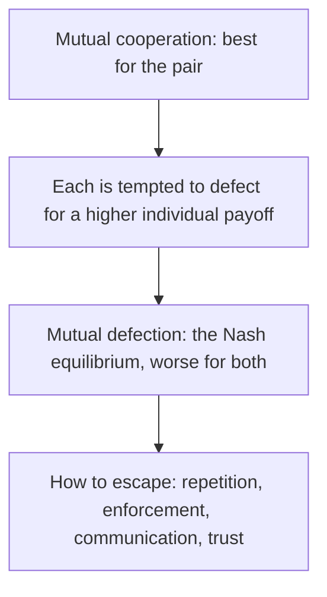

# The prisoner's dilemma and cartels

**Prerequisites:** [[nash-equilibrium|Nash equilibrium]], [[oligopoly|Oligopoly]].

*OPEC headquarters in Vienna; the oil cartel's members face the temptation to produce above their quotas. Credit: Gary Todd from Xinzheng, China. License: [CC0](http://creativecommons.org/publicdomain/zero/1.0/deed.en). Source: [File:Vienna OPEC Headquarters (9812748993).jpg](https://commons.wikimedia.org/wiki/File:Vienna_OPEC_Headquarters_(9812748993).jpg).*

The **prisoner's dilemma** is the most famous game in game theory. It shows how individually rational choices can lead to an outcome that is worse for everyone. It explains why cartels are unstable, why arms races happen, why fisheries get overfished, and why cooperation, even when everyone would benefit, is hard to achieve.

## The original story

The game was devised in 1950 by Merrill Flood and Melvin Dresher at the RAND Corporation. The mathematician Albert Tucker gave it the name and the story of two prisoners while presenting it to a group of psychologists at Stanford.

Two suspects are arrested for a crime and held in separate cells. The prosecutor lacks evidence for the main charge and offers each the same deal:

- If you confess and your partner stays silent, you go free and your partner gets 10 years.
- If both confess, both get 5 years.
- If both stay silent, both get 1 year on a lesser charge.

Payoffs in years of prison (lower is better), as (Prisoner 1, Prisoner 2):

| | P2: Silent | P2: Confess |
|---|---|---|
| **P1: Silent** | (1, 1) | (10, 0) |
| **P1: Confess** | (0, 10) | (5, 5) |

## The logic

Consider Prisoner 1:

- If P2 stays silent, confessing gives 0 years instead of 1. Confess.
- If P2 confesses, confessing gives 5 years instead of 10. Confess.

**Confessing is a dominant strategy.** The same holds for Prisoner 2. So the Nash equilibrium is (Confess, Confess): 5 years each. Yet if both stayed silent, each would serve only 1 year. Each prisoner, by pursuing their own interest, makes both worse off.

The defining structure: each player has a dominant strategy to **defect**, but mutual defection is worse for both than mutual **cooperation**.

## Cartels as prisoner's dilemmas

Return to the two bottled-water firms from [[oligopoly|oligopoly]], now choosing between keeping to a cartel quota (7.5 thousand bottles each) or cheating (10 thousand). With demand P = 30 − Q and zero cost, profits are:

| | B: Keep quota | B: Cheat |
|---|---|---|
| **A: Keep quota** | (112.5, 112.5) | (93.75, 125) |
| **A: Cheat** | (125, 93.75) | (100, 100) |

Cheating is a dominant strategy for each: if the other keeps the quota, cheating raises profit from 112.5 to 125; if the other cheats, cheating raises profit from 93.75 to 100. The Nash equilibrium is mutual cheating, with profits of 100 each. The cartel unravels.

This is why cartels need ways to detect and punish cheating, and why they often fail. OPEC members have repeatedly produced above their quotas, and international commodity agreements for coffee, tin and rubber collapsed at various points in the 20th century. It is also why competition authorities offer **leniency programmes**: the first cartel member to confess and cooperate receives immunity. This deliberately turns the cartel into a literal prisoner's dilemma. Canada's Competition Bureau runs such an immunity and leniency programme, and leniency applications are a major source of cartel detection in many jurisdictions.

## Other prisoner's dilemmas

- **Advertising wars.** Two firms might both be better off not advertising, but each advertises to avoid losing customers to the other. When the US banned television cigarette advertising from 1971, some economists noted that the ban may have helped the tobacco companies by ending costly advertising competition.
- **Arms races.** Each country prefers to arm whatever the other does; both end up spending heavily and no safer.
- **Climate change.** Each country benefits from others' emissions cuts while bearing the cost of its own. See [[public-goods|public goods]].
- **Overfishing and the commons.** Each fishing fleet catches as much as possible; the stock collapses. See [[common-resources|common resources]].
- **Doping in sport**, **grade inflation**, **traffic congestion** and many other situations share the structure.

## Escaping the dilemma

Cooperation is possible when the game changes:

1. **Repetition.** If the game is played many times with no known end, the threat of future punishment can sustain cooperation now. See [[repeated-games-and-strategic-moves|repeated games]].
2. **Binding agreements and enforcement.** Contracts, laws and regulations can change payoffs so that cooperation becomes individually rational. Governments do this when they mandate fishing quotas or emissions limits.
3. **Communication and trust.** In experiments, allowing players to talk increases cooperation, even though promises are not binding.
4. **Social norms and preferences.** People who care about fairness or reputation, or feel guilt at betraying a partner, do not have the payoffs of the pure game. Experiments find that many people cooperate in one-shot dilemmas more often than the theory predicts, especially at first. See [[social-preferences-and-fairness|social preferences and fairness]].
5. **Changing the players' institutions.** Elinor Ostrom documented how communities manage common resources through locally designed rules, monitoring and graduated sanctions. See [[elinor-ostrom|Elinor Ostrom]].

## Key ideas

- In the prisoner's dilemma, each player's dominant strategy is to defect, but mutual defection is worse for all than mutual cooperation.
- Nash equilibrium need not be efficient.
- Cartels are prisoner's dilemmas: each member is tempted to cheat, so cartels tend to collapse.
- Leniency programmes exploit the dilemma to uncover cartels.
- Repetition, enforcement, communication, norms and institutions can sustain cooperation.

## Where this leads

- Next: [[cournot-bertrand-and-stackelberg|Cournot, Bertrand and Stackelberg]].
- Related: [[common-resources|common resources]], [[public-goods|public goods]].
- Glossary: [[g:prisoners-dilemma|prisoner's dilemma]], [[g:cartel|cartel]], [[g:dominant-strategy|dominant strategy]].
