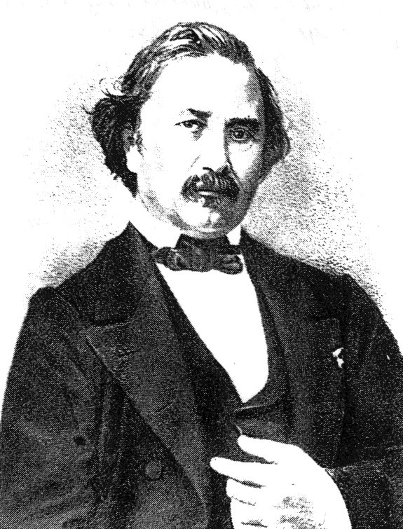
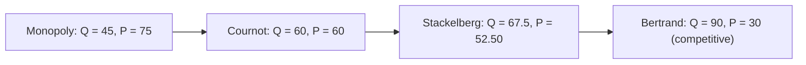

# Cournot, Bertrand and Stackelberg

**Prerequisites:** [Nash equilibrium](11-nash-equilibrium.md), [Oligopoly](09-oligopoly.md).

*Joseph Bertrand (1822–1900), the French mathematician who argued in 1883 that firms compete on price. Credit: The original uploader was Kelson at French Wikipedia. License: Public domain. Source: [File:Joseph bertrand.jpg](https://commons.wikimedia.org/wiki/File:Joseph_bertrand.jpg).*

How exactly do oligopolists compete? Three classic models give different answers depending on what firms choose (quantities or prices) and when they choose it (simultaneously or in sequence). Each is a Nash equilibrium of a different game, and comparing them shows how much the details of competition matter.

Throughout, use the same setting: two firms sell an identical product. Market demand is **P = 120 − Q**, where Q = q1 + q2. Each firm has a constant marginal cost of **30** and no fixed costs.

For reference:

- **Monopoly**: MR = 120 − 2Q = 30, so Q = 45, P = 75, profit 2,025.
- **Perfect competition**: P = MC = 30, Q = 90, profit 0.

## Cournot: competing in quantities

Antoine Augustin Cournot, a French mathematician, published the first formal model of oligopoly in *Researches into the Mathematical Principles of the Theory of Wealth* (1838). Firms choose **quantities** simultaneously; the price is whatever clears the market.

Firm 1 takes firm 2's output as given. Its revenue is (120 − q1 − q2) × q1, so its marginal revenue is 120 − 2q1 − q2. Setting MR = MC:

120 − 2q1 − q2 = 30, so **q1 = 45 − q2/2**.

This is firm 1's **best-response function** (or reaction function): its best output for each output of firm 2. By symmetry, q2 = 45 − q1/2. Solving both together gives the Nash equilibrium:

- **q1 = q2 = 30**, Q = 60, **P = 60**.
- Each firm's profit = (60 − 30) × 30 = **900**; total 1,800.

The Cournot outcome lies between monopoly (Q = 45) and competition (Q = 90). As the number of firms grows, the Cournot equilibrium approaches the competitive outcome: with n identical firms, total output is n/(n+1) of the competitive quantity. With 2 firms, 2/3 of 90 = 60. With 9 firms, 9/10 of 90 = 81.

## Bertrand: competing in prices

In 1883, the French mathematician Joseph Bertrand criticised Cournot, arguing that firms choose **prices**, not quantities. In his model, firms set prices simultaneously and buyers purchase from the cheaper firm (splitting equally if prices are equal).

Suppose firm 2 charges 50. Firm 1 can charge 49.99 and capture the whole market. Firm 2 then undercuts to 49.98, and so on. Any price above marginal cost invites undercutting. The only Nash equilibrium is:

- **P = MC = 30**, Q = 90, **profits zero**.

Just two firms are enough to reach the competitive outcome. This striking result is called the **Bertrand paradox**.

## Resolving the paradox

Real duopolies rarely price at marginal cost. The Bertrand result relies on assumptions that often fail:

- **Capacity constraints.** If a firm cannot serve the whole market, undercutting gains less. David Kreps and José Scheinkman showed in 1983 that when firms first choose capacities and then compete in prices, the outcome can be the Cournot one.
- **Product differentiation.** If products differ, a small price cut does not capture all customers, and prices stay above marginal cost.
- **Repeated interaction.** Firms meeting repeatedly can sustain higher prices through implicit threats (see [repeated games](14-repeated-games-and-strategic-moves.md)).

Which model fits depends on the industry. Where capacity is costly to adjust and set in advance (steel, cement, oil refining), Cournot often fits better. Where capacity is flexible and products are similar (some online retail, software), Bertrand-like price competition is more relevant.

## Stackelberg: one firm moves first

In 1934, the German economist Heinrich von Stackelberg analysed a sequential version of Cournot competition. A **leader** chooses its quantity first; the **follower** observes it and responds.

The follower's best response is the same as in Cournot: q2 = 45 − q1/2. The leader knows this and builds it into its own decision. Its price is 120 − q1 − (45 − q1/2) = 75 − q1/2, so its revenue is (75 − q1/2) × q1 and its marginal revenue is 75 − q1. Setting this equal to 30:

- **Leader: q1 = 45.**
- Follower: q2 = 45 − 22.5 = **22.5**.
- Q = 67.5, **P = 52.50**.
- Leader's profit = (52.50 − 30) × 45 = **1,012.50**; follower's = 22.50 × 22.5 = **506.25**.

The leader produces more and earns more than in Cournot (900); the follower produces less and earns less. Moving first is an advantage because the leader **commits** to a large output, and the follower's best response is to accommodate. This shows the value of credible commitment, a theme of the next lesson. Total output (67.5) is higher than Cournot's, and price lower, so consumers benefit.

## Summary table

| Model | Total Q | Price | Total profit |
|---|---|---|---|
| Monopoly or perfect cartel | 45 | 75 | 2,025 |
| Cournot | 60 | 60 | 1,800 |
| Stackelberg | 67.5 | 52.50 | 1,518.75 |
| Bertrand (identical products) | 90 | 30 | 0 |
| Perfect competition | 90 | 30 | 0 |

## Key ideas

- Cournot: firms choose quantities simultaneously; outcome lies between monopoly and competition.
- With more Cournot firms, output approaches the competitive level.
- Bertrand: firms choose prices simultaneously; with identical products, price falls to marginal cost.
- Capacity limits, differentiation and repetition explain why real prices exceed MC.
- Stackelberg: a first-mover leader commits to higher output and earns more.

## Where this leads

- Next: [repeated games and strategic moves](14-repeated-games-and-strategic-moves.md).
- Glossary: [Cournot competition](../glossary/cournot-competition.md), [Bertrand competition](../glossary/bertrand-competition.md), [Stackelberg competition](../glossary/stackelberg-competition.md), [best response](../glossary/best-response.md).
