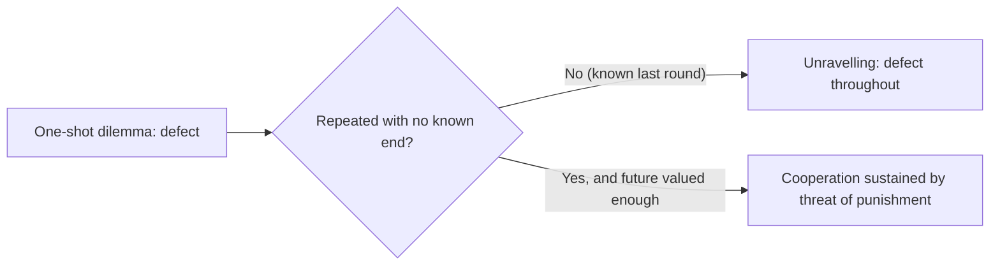

# Repeated games and strategic moves

**Prerequisites:** [[prisoners-dilemma-and-cartels|The prisoner's dilemma and cartels]], [[cournot-bertrand-and-stackelberg|Cournot, Bertrand and Stackelberg]].

*Thomas Schelling (1921–2016), who analysed commitment, threats and focal points in The Strategy of Conflict (1960). Credit: New America. License: [CC BY 2.0](https://creativecommons.org/licenses/by/2.0). Source: [File:Thomas C. Schelling.jpg](https://commons.wikimedia.org/wiki/File:Thomas_C._Schelling.jpg).*

In a one-shot prisoner's dilemma, defection is the only rational choice. But firms, countries and neighbours usually interact again and again. Repetition changes the game: the shadow of the future can make cooperation rational. This lesson also covers **strategic moves**, such as commitments, threats and promises, through which players reshape the games they play.

## Finitely repeated games

Suppose the coffee-pricing prisoner's dilemma is played exactly 10 times, and both players know it. In round 10, there is no future to protect, so both defect. Knowing that, in round 9 there is no reason to cooperate either, since round 10's defection is already certain. Reasoning backward, both defect in every round. This **unravelling** argument, by backward induction, says known finite repetition does not help.

In experiments, however, people often cooperate for many rounds and defect only near the end. Models in which players are uncertain whether their opponent is fully rational (by David Kreps, Paul Milgrom, John Roberts and Robert Wilson in 1982) show that cooperation can be sustained for most of a finitely repeated game.

## Infinitely repeated games

If the game has no known end, or continues with some probability each round, cooperation can be an equilibrium. Consider the **grim trigger** strategy: cooperate as long as the other player has always cooperated; defect forever after any defection.

Using the payoffs from [[game-theory-basics|game theory basics]] (cooperate-cooperate 50 each, defect when the other cooperates 70, mutual defection 30), with a discount factor δ per round (how much a player values next round's payoff compared with this round's):

- **Cooperating forever** yields 50 + 50δ + 50δ² + ... = 50 / (1 − δ).
- **Defecting now** yields 70 today, then 30 forever: 70 + 30δ / (1 − δ).

Cooperation is better if 50/(1 − δ) ≥ 70 + 30δ/(1 − δ). Multiplying through by (1 − δ): 50 ≥ 70(1 − δ) + 30δ = 70 − 40δ, so **δ ≥ 0.5**.

If players care enough about the future (δ at least 0.5), the threat of losing future cooperation outweighs the one-time gain from cheating. The general result that many outcomes, including full cooperation, can be sustained in infinitely repeated games is known as the **folk theorem**, so called because it was widely known among game theorists before anyone published it.

This explains why tacit collusion is more likely when firms interact frequently, when markets are stable, when there are few firms, and when cheating is easy to detect. It also explains why reputation matters for businesses that rely on repeat customers.

## Axelrod's tournaments

In 1980, the political scientist Robert Axelrod invited game theorists to submit computer programs to play a repeated prisoner's dilemma against each other. The winner, submitted by the psychologist Anatol Rapoport, was the simplest: **tit-for-tat**. It cooperates in the first round and then copies whatever the opponent did last round. Tit-for-tat also won a second, larger tournament. Axelrod's *The Evolution of Cooperation* (1984) argued that successful strategies share four traits: they are **nice** (never defect first), **retaliatory** (punish defection), **forgiving** (return to cooperation after the other does) and **clear** (easy for opponents to understand). Later research found that in noisy environments, where moves are sometimes misread, more forgiving variants can do better.

## Strategic moves: commitment, threats and promises

Thomas Schelling, in *The Strategy of Conflict* (1960), showed that players can gain by **limiting their own options**. A strategic move changes the game in your favour by changing what others expect you to do.

- **Commitment.** A Stackelberg leader gains by committing to a large output before its rival decides. Commitment must be credible, which often means irreversible: a firm that builds a large factory has committed to producing a lot.
- **Threats.** "If you enter my market, I will start a price war." A threat is credible only if carrying it out would be in your interest when the time comes, or if you have arranged in advance to have no choice. As shown in the entry game in [[game-theory-basics|game theory basics]], many threats are not credible.
- **Promises.** "If you keep prices high, I will too." Promises need credibility as well.

Ways to make moves credible include building reputation, signing contracts, investing in irreversible capacity, delegating to agents with different incentives, and "burning bridges". Schelling's famous examples include a general who burns the bridge behind his army so it cannot retreat, making its threat to fight to the end credible.

## Business examples

- **Most-favoured-customer clauses**, promising customers a refund if the firm later cuts prices for others, make price cuts costly and can soften competition.
- **Price-matching guarantees** ("we'll match any competitor's price") sound competitive but remove a rival's gain from undercutting, which can sustain high prices.
- **Excess capacity** can deter entry by making a threat to flood the market credible.

Competition authorities scrutinise such practices because they can facilitate collusion.

## Key ideas

- With a known final round, backward induction predicts defection throughout; experiments show more cooperation.
- With no known end, cooperation can be sustained if players value the future enough (folk theorem).
- Tit-for-tat performed strongly in Axelrod's tournaments: nice, retaliatory, forgiving, clear.
- Strategic moves (commitment, threats, promises) work only if credible.
- Many business practices act as commitment devices that can soften competition.

## Where this leads

- Next: [[competition-policy|competition policy]].
- Glossary: [[g:tit-for-tat|tit-for-tat]], [[g:folk-theorem|folk theorem]], [[g:credible-commitment|credible commitment]].
