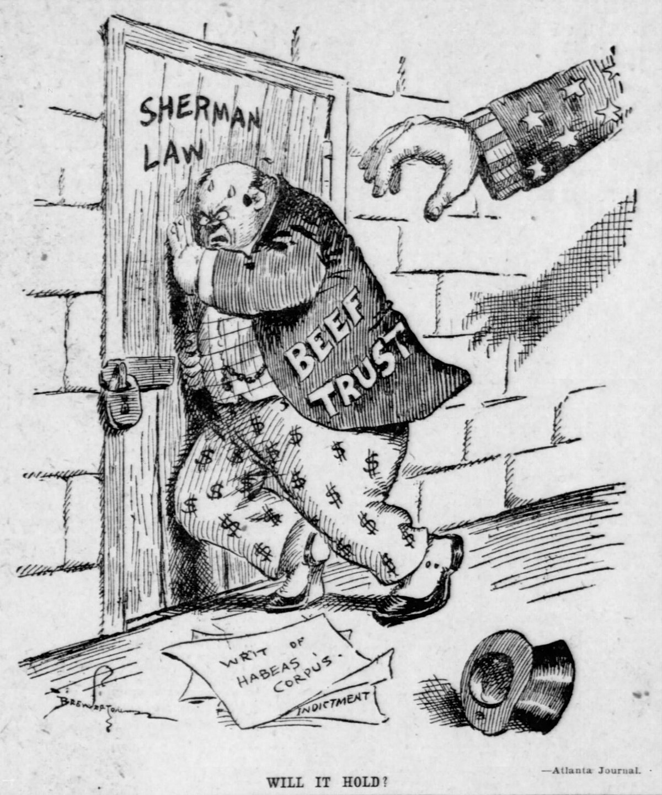
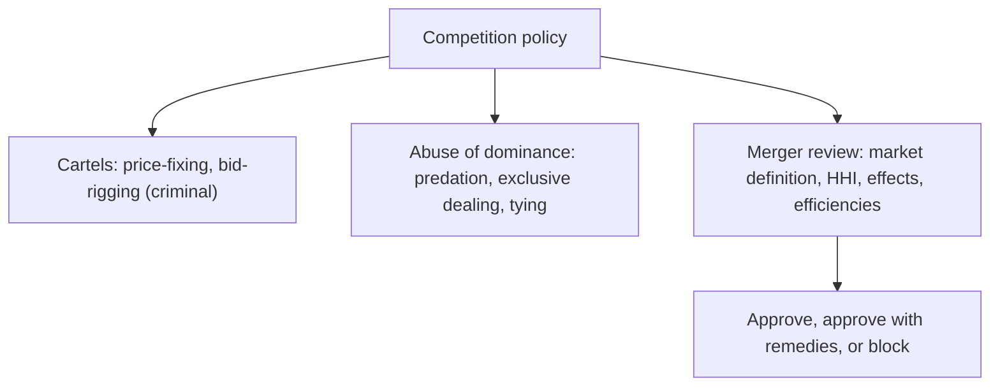

# Competition policy

**Prerequisites:** [[monopoly-pricing-and-deadweight-loss|Monopoly pricing and deadweight loss]], [[prisoners-dilemma-and-cartels|The prisoner's dilemma and cartels]].

*A 1911 cartoon depicting the trusts' opposition to the Sherman Antitrust Act, the 1890 law used to break up Standard Oil that year. Credit: Unknown authorUnknown author. License: Public domain. Source: [File:Sherman Antitrust Act 09 21 1911.jpg](https://commons.wikimedia.org/wiki/File:Sherman_Antitrust_Act_09_21_1911.jpg).*

If monopoly and collusion reduce total surplus, what should governments do? **Competition policy**, called **antitrust** in the United States, is the body of law and enforcement that aims to keep markets competitive. It targets three main problems: agreements between competitors, abuse of dominant positions, and mergers that substantially lessen competition.

## Origins

Modern competition law began in North America. **Canada's** first competition statute, the Act for the Prevention and Suppression of Combinations formed in Restraint of Trade, was passed in **1889**, a year before the **US Sherman Antitrust Act of 1890**. The Sherman Act prohibited contracts and conspiracies in restraint of trade and monopolisation. It was used in 1911 to break up John D. Rockefeller's **Standard Oil** into 34 companies. The **Clayton Act** (1914) added rules on mergers and certain business practices, and created private rights to sue. The European Union's competition rules date from the 1957 Treaty of Rome.

In Canada, the current law is the **Competition Act** (1986), enforced by the **Competition Bureau**, with civil cases decided by the Competition Tribunal and criminal cases in the courts. The Act was amended significantly in 2022, 2023 and 2024, including changes to merger review and abuse of dominance provisions.

## Three main targets

**1. Cartels and agreements between competitors.** Price-fixing, bid-rigging, market allocation and output restriction among competitors are treated most severely: in Canada and the United States they are criminal offences. Enforcement relies heavily on **leniency programmes**, which exploit the [[prisoners-dilemma-and-cartels|prisoner's dilemma]] by offering immunity to the first cartel member to confess.

**2. Abuse of dominance (monopolisation).** Having a large market share is not illegal. Using it to exclude rivals unfairly can be. Examples of potentially abusive conduct include predatory pricing (pricing below cost to drive out rivals and then raising prices), exclusive dealing contracts that foreclose competitors, tying (requiring customers who buy one product to buy another), and refusing access to essential facilities. Many of these practices can also have legitimate business reasons, so cases often turn on detailed evidence about effects.

**3. Mergers.** Mergers can lower costs through economies of scale, but they can also create or strengthen market power. Authorities review large mergers in advance. A **horizontal merger** (between competitors) raises the most concern; **vertical mergers** (between a firm and its supplier or customer) and **conglomerate mergers** (between firms in unrelated markets) raise different issues.

## Tools of analysis

- **Market definition.** Which products and regions compete with each other? The **hypothetical monopolist test** asks whether a single firm controlling a set of products could profitably impose a small but significant non-transitory increase in price (SSNIP), typically 5 percent. If customers would switch away in large numbers, the market is defined more broadly. This uses [[other-elasticities|cross-price elasticities]].
- **Concentration measures.** The **Herfindahl-Hirschman Index** (HHI), the sum of squared market shares, is widely used. US merger guidelines (2023) treat markets with HHI above 1,800 as highly concentrated and presume that mergers raising HHI by more than 100 in such markets are likely to substantially lessen competition.
- **Unilateral and coordinated effects.** A merger may let the merged firm raise prices on its own (unilateral effects), or may make tacit collusion among remaining firms easier (coordinated effects).
- **Efficiencies.** Cost savings from a merger may offset harm to consumers. Canada historically had a distinctive **efficiencies defence** that allowed mergers producing efficiency gains greater than their anti-competitive effects; the 2023 amendments repealed it.

**HHI example.** A market has four firms with shares of 40, 30, 20 and 10 percent. HHI = 1,600 + 900 + 400 + 100 = **3,000**. If the two smallest merge (combined 30 percent), the new HHI = 1,600 + 900 + 900 = **3,400**, an increase of 400 in an already highly concentrated market. Authorities would scrutinise such a merger closely.

## Schools of thought

Competition policy has been shaped by competing views:

- The **Harvard school** (associated with Joe Bain and others from the 1950s) emphasised a link from market structure to firm conduct to performance: concentrated markets tend to produce high prices and profits, which justified active enforcement against concentration.
- The **Chicago school** (Aaron Director, Robert Bork, Richard Posner and others) argued from the 1960s and 1970s that many practices previously condemned, such as vertical restraints and even high market shares, often reflect efficiency, and that the goal of antitrust should be **consumer welfare**, usually measured by prices and output. Bork's *The Antitrust Paradox* (1978) was highly influential.
- **Post-Chicago** economics used game theory to show that some practices Chicago scholars considered harmless can be anticompetitive under certain conditions.
- More recently, a movement sometimes called **neo-Brandeisian** (after US Supreme Court Justice Louis Brandeis), associated with scholars such as Lina Khan and Tim Wu, has argued that competition policy should also consider the political and economic power of very large firms, effects on workers and suppliers, and dynamic harms in digital markets. Critics argue this risks making enforcement less predictable and less focused on consumers.

## Digital platforms

Large technology platforms raise new questions: services that are free to users, strong network effects, data as a competitive asset, and platforms that both run a marketplace and compete on it. Governments have responded with lawsuits and with new regulation, such as the European Union's Digital Markets Act (2022). How well traditional tools fit these markets is one of the liveliest debates in the field.

## Key ideas

- Competition policy targets cartels, abuse of dominance and anticompetitive mergers.
- Canada's 1889 law preceded the US Sherman Act of 1890; Canada's current law is the Competition Act.
- Analysis uses market definition, the HHI, unilateral and coordinated effects, and efficiencies.
- Harvard, Chicago, post-Chicago and neo-Brandeisian schools differ on goals and methods.
- Digital platforms pose new challenges.

## Where this leads

- Next section: [[derived-demand|factor markets]].
- Related branch: [[path:economics/finance/05-regulation/01-why-markets-are-regulated.md|why markets are regulated]] in the finance course.
- Glossary: [[g:antitrust|antitrust]], [[g:herfindahl-hirschman-index|Herfindahl-Hirschman Index]], [[g:predatory-pricing|predatory pricing]], [[g:merger|merger]].
