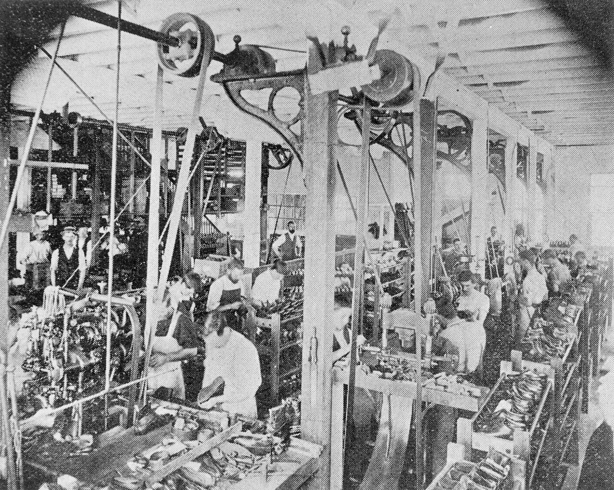
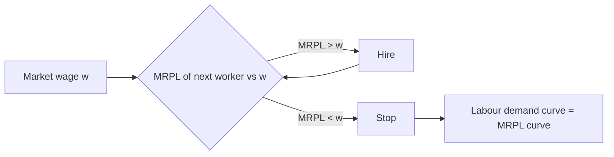

# Labour demand

**Prerequisites:** [[derived-demand|Derived demand and factor markets]], [[diminishing-marginal-returns|Diminishing marginal returns]].

*Workers in a boot-making factory in South Brisbane, 1900. Credit: Contributor(s): Queenslander (Brisbane, Qld.: 1866-1939). License: Public domain. Source: [File:Workers in a boot making factory, South Brisbane, 1900.jpg](https://commons.wikimedia.org/wiki/File:Workers_in_a_boot_making_factory,_South_Brisbane,_1900.jpg).*

How many workers will a firm hire? The answer comes from marginal analysis: keep hiring as long as the next worker adds more to revenue than to cost. This lesson derives the firm's demand curve for labour and examines what shifts it.

## The hiring rule

A firm in a competitive labour market can hire as many workers as it wants at the going wage, w. Hiring one more worker costs w. It adds the worker's **marginal revenue product of labour** (MRPL):

**MRPL = MPL × MR**

For a firm selling in a competitive product market, MR = P, so MRPL = MPL × P (the value of the marginal product).

**Hire workers until MRPL = w.**

If MRPL > w, the next worker adds more revenue than cost: hire. If MRPL < w, the last worker cost more than they brought in: hire fewer.

## Worked example

An apple orchard sells apples at 2 dollars a kilogram in a competitive market. Its production with a fixed amount of land and equipment:

| Pickers | Kg per day | MPL (kg) | MRPL ($) |
|---|---|---|---|
| 1 | 100 | 100 | 200 |
| 2 | 190 | 90 | 180 |
| 3 | 270 | 80 | 160 |
| 4 | 340 | 70 | 140 |
| 5 | 400 | 60 | 120 |
| 6 | 450 | 50 | 100 |
| 7 | 490 | 40 | 80 |

If the daily wage is 130, the orchard hires **4 pickers**: the 4th adds 140 (more than 130), the 5th would add only 120. If the wage falls to 110, it hires 5. If the wage rises to 150, it hires 3.

The MRPL column **is the firm's labour demand curve**: at each wage, the firm hires the number of workers whose MRPL equals that wage. It slopes down because of diminishing marginal returns.

## Firms with market power in the product market

If the firm has market power in its product market (it faces a downward-sloping demand curve), then MR is less than P. Its MRPL = MPL × MR is lower than MPL × P. Such a firm hires fewer workers than a competitive firm with the same technology, because selling more output requires cutting prices. This is the labour-market reflection of monopoly's output restriction.

## What shifts labour demand

1. **Output price.** If apples rise to 3 dollars, every worker's MRPL rises by half, and the orchard hires more at any wage. Derived demand follows product demand.
2. **Productivity.** Better technology, more capital or a more skilled workforce raise MPL and shift labour demand right. Over the long run, rising productivity is the main reason real wages have risen.
3. **Prices of other inputs.** If machines that **substitute** for workers become cheaper, labour demand may fall; if inputs that **complement** workers become cheaper, labour demand may rise.
4. **Number of firms** in the industry.

## Technology: substitute or complement?

Whether technology helps or hurts workers depends on whether it substitutes for or complements their skills. Mechanical harvesters replaced many farm labourers. Spreadsheets reduced demand for clerks doing hand calculations but raised the productivity, and demand, for analysts who use them. Research by David Autor, Frank Levy and Richard Murnane (2003) argued that computers substitute for **routine** tasks that follow explicit rules, and complement **non-routine** tasks requiring problem-solving or interpersonal skills. This helps explain **job polarisation**: growth in high-skill and some low-skill service jobs, with a squeeze on middle-skill routine jobs in many rich countries since the 1980s. How artificial intelligence will affect the balance is an open and actively studied question.

## Market labour demand

The market demand for a type of labour is the sum of firms' demands. But adding up is not quite as simple as for goods: if all orchards hire more pickers, apple output rises, apple prices fall, and each orchard's MRPL falls. So market labour demand is somewhat less elastic than the simple sum of individual demands would suggest.

## Marginal productivity and pay

The theory predicts that in competitive markets, workers are paid their marginal revenue product. Several qualifications apply:

- If employers have wage-setting power (**monopsony**), they pay less than MRPL. See [[monopsony-and-unions|monopsony and unions]].
- Individual marginal products are hard to measure in teams, which is why firms use other pay systems, such as salaries, bonuses and promotions.
- Pay can differ for reasons unrelated to productivity, such as discrimination, discussed in [[wage-determination|wage determination]].

## Key ideas

- A firm hires workers until the marginal revenue product of labour equals the wage.
- MRPL = MPL × MR; with competitive product markets, MRPL = MPL × P.
- The labour demand curve is the downward-sloping MRPL curve.
- Labour demand shifts with output prices, productivity and the prices of other inputs.
- Technology can substitute for or complement labour, with uneven effects across skills.

## Where this leads

- Next: [[labour-supply|labour supply]].
- Glossary: [[g:marginal-revenue-product|marginal revenue product]], [[g:labour-demand|labour demand]], [[g:job-polarisation|job polarisation]].
