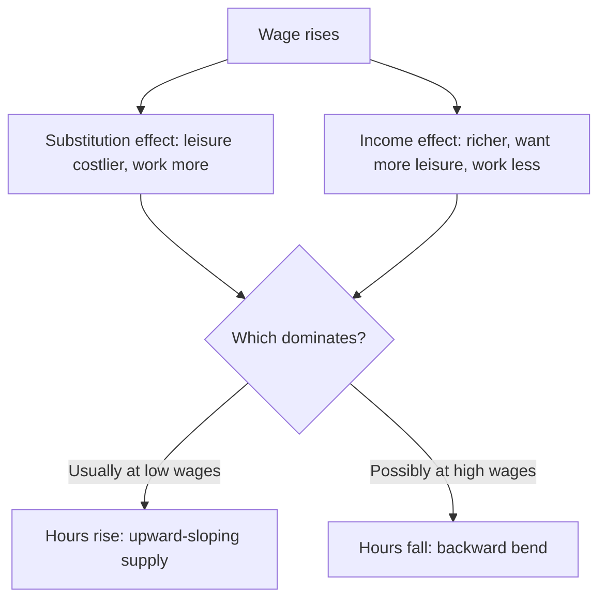

# Labour supply

**Prerequisites:** [Income and substitution effects](../03-consumer-theory/08-income-and-substitution-effects.md), [The budget constraint](../03-consumer-theory/05-budget-constraint.md).

*Commuting to work by bicycle: every hour of paid work is an hour not spent on leisure, family or rest. Credit: Petar Milošević. License: [CC BY-SA 4.0](https://creativecommons.org/licenses/by-sa/4.0). Source: [File:Commuting by bicycle.jpg](https://commons.wikimedia.org/wiki/File:Commuting_by_bicycle.jpg).*

The supply of labour comes from people deciding how much to work. Unlike most supply decisions, it involves giving up something everyone values: time. Economists model it as a choice between **income** (which buys goods) and **leisure** (all time not spent in paid work, including rest, family, study and unpaid household work). The model produces a surprising result: higher wages do not always mean more hours worked.

## The labour-leisure choice

Imagine a worker with 16 waking hours a day to divide between paid work and leisure. If the wage is w per hour, each hour of leisure costs w in forgone income. The wage is the **price of leisure**, its opportunity cost.

The worker's budget constraint: income = w × (16 − leisure hours) + any non-labour income.

**Example.** At a wage of 20, the worker could earn up to 320 a day by working 16 hours, or take 16 hours of leisure and earn nothing. Each hour of leisure costs 20. The worker chooses the point on this budget line that reaches the highest indifference curve between income and leisure, exactly as in [optimal choice](../03-consumer-theory/06-optimal-choice.md).

## What happens when wages rise?

A wage increase has two effects that pull in opposite directions:

- **Substitution effect**: leisure becomes more expensive. Each hour off now costs more in forgone pay. The worker substitutes toward work. **More hours.**
- **Income effect**: the worker is richer. If leisure is a normal good, they want more of it. **Fewer hours.**

At low wages, the substitution effect usually dominates: a raise makes work more attractive, and hours rise. At high wages, the income effect may dominate: a well-paid professional might use a raise to take more holidays. The result can be a **backward-bending labour supply curve**: hours rise with the wage up to a point, then fall.

## Worked example

Kim earns 15 an hour and works 40 hours a week (income 600). Her wage rises to 20.

- If she kept working 40 hours, she would earn 800.
- **Substitution effect**: each hour off now costs 20 instead of 15. Holding her well-being constant, she would work more, say 44 hours.
- **Income effect**: she is richer; at 40 hours she gets 200 more a week. She may decide to buy some extra leisure, say 3 hours.
- **Net**: 44 − 3 = 41 hours. Here the substitution effect wins narrowly.

If instead she were earning 100 an hour and her wage rose to 130, she might cut her hours, since she can maintain a high income working less.

## Evidence

Labour economists distinguish:

- **Intensive margin**: how many hours employed people work.
- **Extensive margin**: whether people work at all (labour force participation).

Studies generally find that hours worked by prime-age men respond little to wage changes (small elasticities), while participation decisions, especially of second earners in households, respond more. Historically, as real wages rose over the 20th century, average weekly hours in rich countries fell, consistent with a strong income effect over the long run. Economists debate the size of these elasticities because they matter for tax policy: the more labour supply responds to after-tax wages, the larger the deadweight loss of income taxes (see [deadweight loss](../02-supply-and-demand/14-deadweight-loss.md)).

## Taxes, benefits and kinks

Real budget constraints between income and leisure have kinks. Income taxes reduce the after-tax wage. Benefits that are withdrawn as earnings rise create high **effective marginal tax rates**: if a household loses 50 cents of benefits for each extra dollar earned and also pays income tax, the reward for working more can be small. Such "welfare traps" have motivated reforms such as earned income tax credits, which supplement earnings of low-income workers. Canada's version is the Canada Workers Benefit.

## Market labour supply

The market labour supply curve for a particular occupation adds up individual supplies. It is usually upward sloping even if some individuals' curves bend backward, because higher wages in one occupation draw workers from **other** occupations, regions or from outside the labour force. The supply of nurses to a hospital, for example, is much more elastic than any one nurse's hours.

What shifts market labour supply:

- **Population and immigration.**
- **Preferences and social norms**, such as changing attitudes to women's paid work, which helped raise female labour force participation dramatically in North America from the 1960s onward.
- **Alternative opportunities**: higher wages in other jobs reduce supply to this one.
- **Non-labour income**: wealth, transfers and pensions.
- **Education and training requirements**, which limit entry to some occupations.

## Key ideas

- Labour supply reflects a choice between income and leisure; the wage is the price of leisure.
- A wage rise has a substitution effect (work more) and an income effect (work less).
- Individual labour supply can bend backward at high wages.
- Hours respond little for many workers; participation responds more.
- Market labour supply to an occupation is usually upward sloping.

## Where this leads

- Next: [wage determination](04-wage-determination.md).
- Glossary: [labour supply](../glossary/labour-supply.md), [backward-bending labour supply curve](../glossary/backward-bending-labour-supply.md), [effective marginal tax rate](../glossary/effective-marginal-tax-rate.md).
