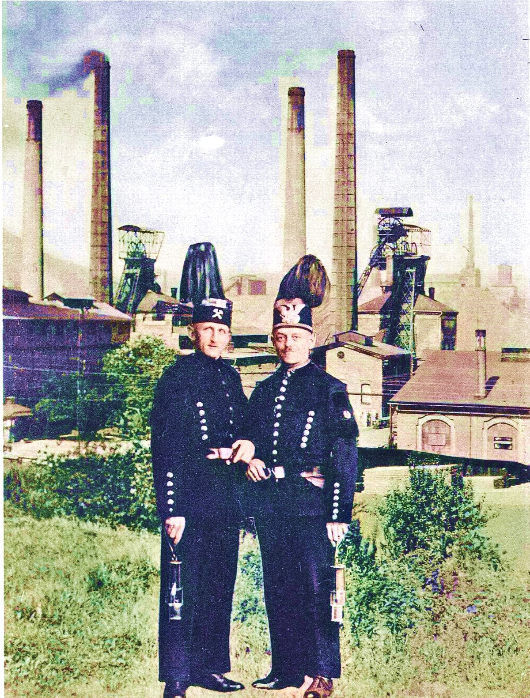
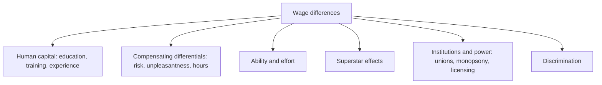

# Wage determination

**Prerequisites:** [Labour demand](02-labour-demand.md), [Labour supply](03-labour-supply.md).

*Two coal miners in Germany, about 1900; dangerous jobs such as mining tend to pay a compensating wage premium. Credit: http://www.zeno.org - Contumax GmbH &amp; Co. KG. License: [CC0](http://creativecommons.org/publicdomain/zero/1.0/deed.en). Source: [File:2 Bergleute in Knappenuniform. Two coal miners, Germany, ca. 1900.jpg](https://commons.wikimedia.org/wiki/File:2_Bergleute_in_Knappenuniform._Two_coal_miners,_Germany,_ca._1900.jpg).*

Put labour demand and labour supply together and you get an equilibrium wage, just as supply and demand for goods give an equilibrium price. But wages differ enormously across jobs and people: surgeons earn many times what cashiers earn. This lesson explains how competitive labour markets set wages and why wages differ.

## Equilibrium in a competitive labour market

In a competitive market for a particular kind of labour, the wage adjusts until the quantity of labour demanded equals the quantity supplied.

**Example.** In a city's market for warehouse workers:

- Demand: L = 10,000 − 200w
- Supply: L = −2,000 + 400w

Setting them equal: 10,000 − 200w = −2,000 + 400w, so 12,000 = 600w, **w = 20** per hour, and **L = 6,000** workers.

If a new distribution centre opens and demand rises to L = 12,400 − 200w, then 14,400 = 600w, w = **24**, L = 7,600. Higher demand raises both wages and employment.

## Why wages differ

If all workers and jobs were identical, competition would equalise wages. They are not. Economists explain wage differences through several channels.

**1. Human capital.** Education, training and experience raise productivity, and so marginal revenue product. Workers who invest in skills earn more, partly as a return on that investment. See [human capital](05-human-capital.md).

**2. Compensating differentials.** Jobs differ in their non-wage characteristics. Adam Smith observed in *The Wealth of Nations* that wages vary with "the ease or hardship, the cleanliness or dirtiness, the honourableness or dishonourableness of the employment". Dangerous, unpleasant, stressful or inconveniently timed jobs must pay more to attract workers. Night-shift workers, offshore oil workers and deep-sea fishers earn wage premiums. Conversely, pleasant or prestigious jobs may pay less than their skill requirements would suggest.

**3. Ability and effort.** Natural talent, motivation and effort differ, and so does productivity.

**4. Superstar effects.** In some markets, a small difference in talent produces a huge difference in earnings. Sherwin Rosen (1981) explained this: when technology lets the best performers reach huge audiences at little extra cost (recordings, broadcasts, online platforms), consumers flock to the very best, and the top earners capture a disproportionate share.

**5. Market power and institutions.** Unions, monopsony, minimum wages and occupational licensing affect wages. See [monopsony and unions](06-monopsony-and-unions.md).

**6. Discrimination.** Paying people differently for the same productivity because of gender, race or other characteristics.

## Discrimination

Gary Becker's *The Economics of Discrimination* (1957) modelled employers with a "taste for discrimination" who are willing to sacrifice profit to avoid hiring certain groups. He argued that competition would tend to erode such discrimination, because non-discriminating firms could hire equally productive workers more cheaply and outcompete discriminators. Critics noted that discrimination has persisted in competitive markets for long periods, and that other forms do not rely on employer tastes:

- **Statistical discrimination** (Edmund Phelps, 1972; Kenneth Arrow, 1973): employers who cannot easily observe individual productivity use group averages, so individuals are judged by group stereotypes.
- **Customer and co-worker discrimination**, which competition does not remove.
- **Pre-market differences** in access to education and networks.

Measuring discrimination is hard, because wage gaps can reflect differences in occupation, hours and experience as well as discrimination. Field experiments help: Marianne Bertrand and Sendhil Mullainathan (2004) sent fictitious resumés to US employers and found that otherwise identical resumés with names associated with white applicants received about 50 percent more callbacks than those with names associated with Black applicants. Similar studies have been conducted in Canada and elsewhere.

On gender, Claudia Goldin, who received the 2023 Nobel memorial prize, showed how much of the remaining gender pay gap in rich countries arises within occupations and grows after the birth of children, linked to the high rewards some jobs give for long, inflexible hours.

## The minimum wage, revisited

In the competitive model, a minimum wage above equilibrium reduces employment (see [price floors](../02-supply-and-demand/12-price-floors.md)). Using the warehouse example, a minimum wage of 22 gives demand of 5,600 and supply of 6,800: employment falls to 5,600, and 1,200 more people want jobs than can find them. Whether real minimum wages have such effects depends on how competitive local labour markets are, as the next lessons discuss.

## Key ideas

- A competitive labour market sets the wage where labour demand equals labour supply.
- Wages differ because of human capital, compensating differentials, ability, superstar effects, institutions and discrimination.
- Becker argued competition erodes taste-based discrimination; statistical and customer discrimination can persist.
- Field experiments document discrimination in hiring.
- Much of today's gender gap arises within occupations and after children.

## Where this leads

- Next: [human capital](05-human-capital.md).
- Glossary: [compensating differential](../glossary/compensating-differential.md), [statistical discrimination](../glossary/statistical-discrimination.md), [superstar effect](../glossary/superstar-effect.md).
