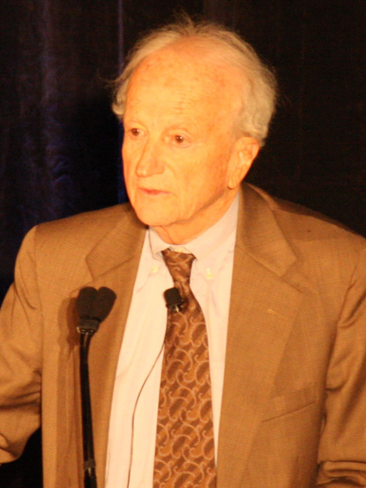
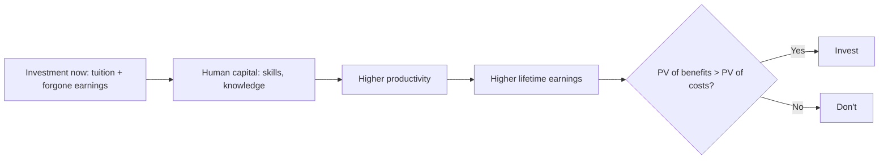

# Human capital

**Prerequisites:** [[wage-determination|Wage determination]], [[intertemporal-choice|Intertemporal choice]], [[opportunity-cost|Opportunity cost]].

*Gary Becker in 2008; his book Human Capital (1964) named the field. Credit: MAR. License: Public domain. Source: [File:GaryBecker-May24-2008.jpg](https://commons.wikimedia.org/wiki/File:GaryBecker-May24-2008.jpg).*

Why do people spend years in school, give up earnings to train, or move across the country for a better job? Economists answer with the idea of **human capital**: the knowledge, skills, health and habits that make a person more productive. Like physical capital, human capital is built by investment today that pays off later.

## The idea

Adam Smith anticipated it: in *The Wealth of Nations*, he compared an educated worker to an expensive machine, whose training costs must be repaid by higher wages over a working life. The modern theory was developed around 1960 by Theodore Schultz, Jacob Mincer and Gary Becker, whose book *Human Capital* (1964) gave the field its name. Schultz and Becker later received Nobel memorial prizes (1979 and 1992), in part for this work.

Human capital includes:

- **Formal education**: school, college, university.
- **On-the-job training**: learning by doing, apprenticeships, mentoring.
- **Health**: healthier workers are more productive and work longer.
- **Migration and job search**: moving to where skills are better rewarded.

## Education as an investment

An investment in education has costs now and benefits later:

- **Costs**: tuition and fees, plus the much larger **opportunity cost** of forgone earnings while studying.
- **Benefits**: higher earnings over a working life, plus non-monetary benefits such as more interesting work, better health and, for many people, the enjoyment of learning itself.

The decision can be analysed with present values, as in the finance course's lessons on [[path:economics/finance/01-foundations/05-present-value-and-discounting.md|present value and discounting]].

**Worked example.** Jordan can start work now at 40,000 a year, or spend two years in a technical college (tuition 5,000 a year) and then earn 52,000 a year. Assume a 40-year career either way (simplifying), and a discount rate of 5 percent.

- Cost of college: 2 years of forgone earnings (80,000) plus tuition (10,000) = 90,000, incurred in the first two years.
- Benefit: an extra 12,000 a year for 38 years, starting in year 3.
- The present value of 12,000 a year for 38 years at 5 percent, measured from the start of year 3, is about 12,000 × 16.87 ≈ 202,000. Discounting back two years (÷ 1.05² ≈ 1.1025) gives about **183,000**.
- The present value of the costs is about 45,000 + 45,000 / 1.05 ≈ **88,000**.

The net present value is roughly 95,000: college is a good investment on these numbers. The **rate of return** on this investment (the discount rate at which NPV is zero) is well above 5 percent.

## Evidence on the returns to education

Jacob Mincer developed a widely used **earnings function** relating log earnings to years of schooling and experience. Estimates across many countries typically find that each additional year of schooling is associated with roughly 5 to 15 percent higher earnings, depending on country and period.

But correlation is not causation: people who get more education may differ in ability, motivation or family background. Economists have used natural experiments to address this. Joshua Angrist and Alan Krueger (1991) used the fact that US compulsory schooling laws made students born early in the year able to leave school with slightly less education; David Card (1995) used proximity to a college. Many such studies find causal returns to schooling of similar size to, or larger than, the simple correlations. Card, Angrist and Guido Imbens shared the 2021 Nobel memorial prize partly for developing these methods.

## Signalling: an alternative view

Michael Spence's **job-market signalling** model (1973) offers a different interpretation. Suppose education does not raise productivity at all, but it is easier (less costly) for more able people to complete. Then employers can use education as a **signal** of ability, and able people get educated to distinguish themselves. Education would still raise individual earnings, but it would add less to society's output. See [[signalling-and-screening|signalling and screening]].

Most economists think both effects exist. Evidence such as the **sheepskin effect** (an extra jump in earnings for completing a degree, compared with just completing the same number of years) suggests some signalling. Bryan Caplan's *The Case Against Education* (2018) argues signalling dominates; most labour economists believe human capital accounts for a substantial share of the return.

## General and specific training

Becker distinguished:

- **General human capital**: useful to many employers (reading, programming, accounting). Firms are reluctant to pay for it, since workers can take it elsewhere. Workers usually pay, through tuition or lower wages during training.
- **Firm-specific human capital**: useful mainly to one employer (knowledge of its systems and customers). Firms and workers share its costs and returns, which encourages long-term employment relationships.

## Key ideas

- Human capital is the productive knowledge, skills and health embodied in people.
- Education and training are investments with costs now (including forgone earnings) and returns later.
- Each year of schooling is associated with roughly 5–15 percent higher earnings; natural experiments suggest much of this is causal.
- Signalling theory argues part of education's return reflects sorting rather than skill.
- General training is usually paid for by workers; specific training is shared.

## Where this leads

- Next: [[monopsony-and-unions|monopsony and unions]].
- Glossary: [[g:human-capital|human capital]], [[g:signalling|signalling]], [[g:returns-to-education|returns to education]].
