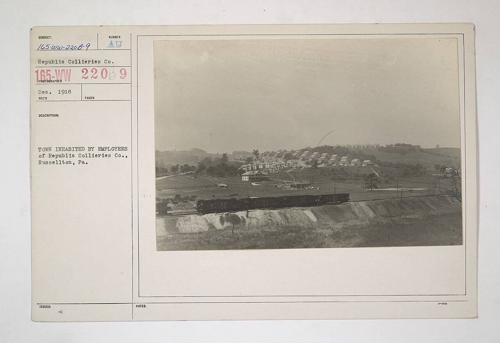
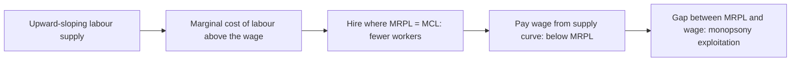

# Monopsony and unions

**Prerequisites:** [Wage determination](04-wage-determination.md), [Monopoly](../05-market-structures/04-monopoly.md).

*Russellton, Pennsylvania, a town inhabited by employees of the Republic Collieries Company: in a company town, one employer dominates the labour market. Credit: Unknown author or not provided. License: Public domain. Source: [File:Industries of War - Mining - Coal - Town inhabited by employees of Republic Collieries Company, Russellton, Pennsylvania - NARA - 45488520.jpg](https://commons.wikimedia.org/wiki/File:Industries_of_War_-_Mining_-_Coal_-_Town_inhabited_by_employees_of_Republic_Collieries_Company,_Russellton,_Pennsylvania_-_NARA_-_45488520.jpg).*

The competitive model assumes many employers compete for workers, so no single employer can set the wage. But in some labour markets, employers do have wage-setting power. And workers often bargain collectively through unions. This lesson analyses both.

## Monopsony

A **monopsony** is a market with a single buyer, the mirror image of monopoly. The term was coined by the British economist Joan Robinson in *The Economics of Imperfect Competition* (1933), who credited the classicist Bertrand Hallward with suggesting the word. In labour markets, the classic case is a **company town**, where one mine or mill is the only employer. More generally, economists speak of **monopsony power** whenever an employer faces an upward-sloping labour supply curve, so that it must raise wages to attract more workers.

## The monopsonist's problem

A monopsonist that wants to hire more workers must raise the wage, and (if it pays everyone the same) it must raise the wage for all its existing workers too. So the **marginal cost of labour** (MCL) exceeds the wage.

**Example.** Labour supply to a mill: w = 10 + 0.1L (dollars per hour; L is the number of workers). Each worker's marginal revenue product: MRPL = 40 − 0.1L.

- Total labour cost = w × L = 10L + 0.1L². Marginal cost of labour = 10 + 0.2L.
- The monopsonist hires where MRPL = MCL: 40 − 0.1L = 10 + 0.2L, so **L = 100**.
- It pays the lowest wage that attracts 100 workers, from the supply curve: w = 10 + 10 = **20**.
- But each worker's MRPL at L = 100 is 40 − 10 = **30**. Workers are paid less than the value of what they produce.

**Compare with competition.** A competitive market would set supply equal to MRPL: 10 + 0.1L = 40 − 0.1L, so L = 150, w = 25. The monopsonist hires fewer workers and pays a lower wage. As with monopoly, there is a deadweight loss: workers between 100 and 150 would produce more than their wage requires, but are not hired.

## Minimum wages under monopsony

Monopsony overturns the standard prediction about minimum wages. Suppose a minimum wage of 25 is imposed on the mill. Now the marginal cost of labour is flat at 25 for every worker up to the 150th (who would supply labour at 25 anyway). The mill hires until MRPL = 25: 40 − 0.1L = 25, L = **150**. **Both wages and employment rise.** Any minimum wage between 20 and 25 raises both. Too high a minimum (above 25 here) would start to reduce employment again.

This is one explanation for why some studies find that moderate minimum wage increases have small or no negative employment effects (see [price floors](../02-supply-and-demand/12-price-floors.md)).

## How common is monopsony?

Pure company towns are rare today, but modern research argues that monopsony power is widespread, for reasons including:

- **Job search frictions**: changing jobs takes time and effort, so employers can pay somewhat less without losing all their workers.
- **Differentiated jobs**: commute, schedule and workplace culture differ, so workers are not perfectly mobile.
- **Concentration**: in some local labour markets, a few employers dominate hiring for particular occupations.
- **Non-compete agreements** and no-poaching arrangements between employers. Canada's 2022 Competition Act amendments made wage-fixing and no-poaching agreements between unaffiliated employers a criminal offence, effective June 2023.

Alan Manning's *Monopsony in Motion* (2003) argued that monopsony is a pervasive feature of labour markets rather than a curiosity. Estimates of how elastic labour supply to individual firms is vary, and economists disagree about how large the resulting wage markdowns are.

## Unions

A **labour union** is an organisation of workers that bargains collectively with employers over wages, benefits and working conditions. Union membership rates vary widely across countries; in Canada, roughly 30 percent of employees have been covered by collective agreements in recent years, with coverage far higher in the public sector than in the private sector, according to Statistics Canada.

**Effects of unions in a competitive market.** If the labour market was competitive, a union acts like a seller with market power: by raising the wage above the competitive level, it benefits members who keep their jobs but reduces employment in the unionised sector. Displaced workers move to non-union jobs, pushing wages down there.

**Effects under monopsony.** If the employer has monopsony power, a union can act as a countervailing force. Bargaining between a single seller of labour (the union) and a single buyer (the employer) is called **bilateral monopoly**. The outcome lies somewhere between the monopsony wage and the union's preferred wage, depending on bargaining power. A union could raise both wages and employment, like a well-set minimum wage.

**Voice.** Richard Freeman and James Medoff, in *What Do Unions Do?* (1984), argued that unions also have a "voice" face: they give workers a collective way to raise problems, which can reduce turnover, improve training and raise productivity. Critics point to cases where unions have resisted productivity-enhancing changes or protected insiders at the expense of outsiders. Evidence on productivity effects is mixed and varies by country and industry.

## Key ideas

- Monopsony is a single buyer; monopsony power exists whenever employers face upward-sloping labour supply.
- A monopsonist hires fewer workers and pays them less than their marginal revenue product.
- A well-set minimum wage can raise both wages and employment under monopsony.
- Modern research finds monopsony power is common because of search frictions and concentration.
- Unions raise wages; their employment and productivity effects depend on market structure.

## Where this leads

- Next: [capital and interest](07-capital-and-interest.md).
- Glossary: [monopsony](../glossary/monopsony.md), [labour union](../glossary/labour-union.md), [bilateral monopoly](../glossary/bilateral-monopoly.md).
