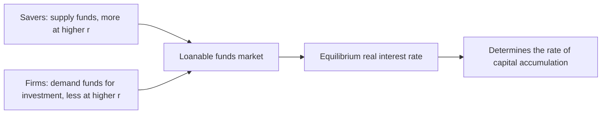

# Capital and interest

**Prerequisites:** [Derived demand and factor markets](01-derived-demand.md), [Intertemporal choice](../03-consumer-theory/12-intertemporal-choice.md).

*Eugen von Böhm-Bawerk in 1896; he explained interest by time preference and the productivity of roundabout production. Credit: Josef Löwy. License: Public domain. Source: [File:Eugen von Böhm-Bawerk 1896 Portrait cropped.png](https://commons.wikimedia.org/wiki/File:Eugen_von_Böhm-Bawerk_1896_Portrait_cropped.png).*

**Capital**, in economics, means produced means of production: machines, buildings, vehicles, tools, software, infrastructure. Firms demand capital because it raises output; households supply the funds to build it by saving. The price that brings these together is the **interest rate**. This lesson explains the market for capital and the meaning of interest.

## Physical capital and financial capital

Two senses of "capital" are often confused:

- **Physical capital** is the stock of equipment and structures used in production.
- **Financial capital** is money and financial claims (bonds, shares, loans) used to buy physical capital.

When a firm sells bonds to build a factory, savers supply financial capital, and the firm turns it into physical capital. The finance course follows the financial side in detail, from [equity and debt](../../finance/02-firms-and-capital/03-equity-and-debt.md) to the [cost of capital](../../finance/02-firms-and-capital/08-capital-structure-and-cost-of-capital.md).

## Renting capital: the rental rate

Many firms rent capital: trucks, office space, servers, construction equipment. Like labour, capital is hired until its marginal revenue product equals its price, here the **rental rate**:

**MRPK = rental rate (r)**

The demand for capital services slopes down because of diminishing marginal returns to capital.

## Buying capital: present value

When a firm buys a long-lived machine, it pays now and receives returns over many years. It should buy if the **present value** of the machine's expected future marginal revenue products exceeds its price.

**Worked example.** A printing firm can buy a press for 100,000. It will add 30,000 a year to net revenue for 5 years, then be worthless. The interest rate is 8 percent.

- Present value of benefits = 30,000 × [1 − 1.08⁻⁵] / 0.08 ≈ 30,000 × 3.993 = **119,800**.
- Net present value = 119,800 − 100,000 = **19,800** > 0. Buy the press.

If the interest rate rose to 16 percent, the annuity factor would fall to about 3.274, so PV ≈ 98,200 and NPV ≈ −1,800. Do not buy. **Higher interest rates make investment less attractive**, which is why the demand for investment funds slopes downward in the interest rate.

## The supply of saving

Households supply funds by saving, which means consuming less now to consume more later. As shown in [intertemporal choice](../03-consumer-theory/12-intertemporal-choice.md), a higher interest rate makes future consumption cheaper relative to present consumption (substitution effect toward saving) but also makes savers richer (income effect toward consuming more now). The net effect on saving is theoretically ambiguous; most textbook treatments assume the supply of saving rises modestly with the interest rate.

## The market for loanable funds

Combining investment demand and saving supply gives the market for **loanable funds**:

The equilibrium **real interest rate** balances desired saving with desired investment. In practice, interest rates are also strongly influenced by central bank policy and by risk, as explained in the finance course's [central banks and monetary policy](../../finance/05-regulation/06-central-banks-and-monetary-policy.md).

## Why is there interest at all?

Economists have long asked why lenders receive a return. Several answers, which complement each other:

- **Time preference.** People prefer consumption now to later, so they must be paid to wait. Eugen von Böhm-Bawerk, in *Capital and Interest* (1884–1889), stressed this, along with the next point.
- **Productivity of capital.** "Roundabout" methods of production, which take time but use capital, produce more output in the end. A fisherman who spends days building a net catches more fish later than one who fishes by hand. Borrowers can pay interest out of that extra output.
- **Risk.** Lenders may not be repaid; riskier loans carry higher rates.
- **Inflation.** Nominal interest rates include compensation for expected inflation. Irving Fisher's equation states that the nominal rate ≈ real rate + expected inflation.

Fisher's *The Theory of Interest* (1930) combined impatience and investment opportunities into a single framework that remains the basis of modern interest theory.

## Debates about capital

Capital theory has been contentious. In the 1950s and 1960s, the **Cambridge capital controversy** pitted economists at Cambridge, England (Joan Robinson, Piero Sraffa) against those at Cambridge, Massachusetts (Paul Samuelson, Robert Solow). The English side argued that aggregating diverse capital goods into a single quantity "K" is logically problematic, because the value of capital depends on the interest rate it is supposed to explain. Samuelson conceded in 1966 that some of the critics' technical points were correct. Most economists continued to use aggregate capital as a practical approximation, but the debate is a reminder that simple models rest on simplifications.

From a different direction, Marxian economics interprets profit and interest as surplus value extracted from labour, a view discussed in [Karl Marx](../10-history-of-thought/thinkers/04-karl-marx.md) and [schools of thought](../10-history-of-thought/05-schools-of-thought.md).

## Key ideas

- Physical capital is produced means of production; financial capital funds it.
- Firms rent capital up to where MRPK equals the rental rate; they buy capital when the present value of returns exceeds the price.
- Higher interest rates reduce investment demand.
- The loanable funds market balances saving and investment at the real interest rate.
- Interest reflects time preference, capital productivity, risk and inflation.

## Where this leads

- Next: [land and rent](08-land-and-rent.md).
- Glossary: [capital](../glossary/capital.md), [interest rate](../glossary/interest-rate.md), [loanable funds](../glossary/loanable-funds.md), [present value](../glossary/present-value.md), [time preference](../glossary/time-preference.md).
