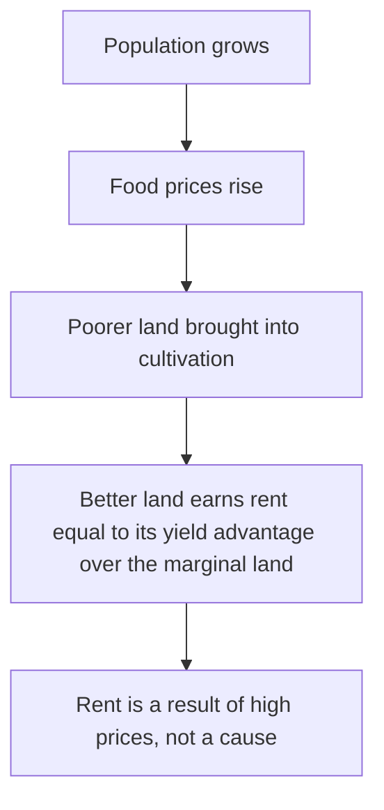

# Land and rent

**Prerequisites:** [[derived-demand|Derived demand and factor markets]], [[other-elasticities|Supply elasticity]], [[deadweight-loss|Deadweight loss]].

*Henry George in about 1885; his Progress and Poverty (1879) argued for a single tax on land values. Credit: Unknown authorUnknown author. License: Public domain. Source: [File:Henry George c1885 retouched.jpg](https://commons.wikimedia.org/wiki/File:Henry_George_c1885_retouched.jpg).*

Land is the factor of production whose total supply is, to a first approximation, fixed. Nobody produces more of downtown Vancouver or more acres of the Prairies. That simple fact gives land prices and land taxes special properties, and it gave rise to one of the most important ideas in economics: **economic rent**.

## Land in economics

In economics, "land" means all natural resources: the surface of the earth, its location, soil fertility, minerals, water, forests, fish stocks and the radio spectrum. What distinguishes land from capital is that it is not produced by human effort (though it can be improved, drained or depleted).

## Rent on land

The **rental price of land** is determined like any factor price: demand is derived from what the land can produce (its marginal revenue product), and supply is the amount of land available. Because the supply of land of a given quality in a given location is fixed, the supply curve is **vertical**.

With vertical supply, the rent is determined entirely by demand. If demand for land rises (because crop prices rise, or a city grows), the rent rises, but the quantity of land does not change. If demand falls, rent falls.

## Ricardo's theory of rent

David Ricardo, in *On the Principles of Political Economy and Taxation* (1817), developed a theory of rent based on differences in land quality. Suppose farms differ in fertility:

| Land grade | Wheat per hectare (tonnes) with the same labour and capital |
|---|---|
| A | 5 |
| B | 4 |
| C | 3 |

When population is small, only grade A is farmed, and no rent is paid because good land is plentiful. As population grows, food prices rise and grade B comes into cultivation. Now farmers will pay up to 1 tonne per hectare more to farm A than B, because A yields that much more for the same work. That difference becomes A's rent. When C is cultivated, A's rent rises to 2 tonnes and B's to 1. The worst land in use (the **margin of cultivation**) earns no rent.

Ricardo's key insight was that **high rents are caused by high grain prices, not the other way round**: "Corn is not high because a rent is paid, but a rent is paid because corn is high." This was central to his argument against the Corn Laws, which restricted grain imports and, he argued, raised grain prices and landlords' rents at the expense of workers and manufacturers. The Corn Laws were repealed in 1846.

## Economic rent generalised

Economists now use **economic rent** for any payment to a factor above the minimum needed to keep it in its current use (its opportunity cost, or **transfer earnings**). Land earns economic rent because its supply does not depend on its price. So do other factors with inelastic supply:

- A football star paid 10 million a year who would play for 200,000 earns about 9.8 million in economic rent.
- A pop star, a famous surgeon, or the owner of a taxi licence or other scarce permit can earn rents.
- Firms protected from competition earn monopoly rents.

Economic rent is not the same as everyday "rent" for an apartment. An apartment rent includes payment for the building (a produced capital good) as well as for the land underneath.

## Taxing land

Because the supply of land is perfectly inelastic, a tax on land rent cannot reduce the quantity of land supplied. The burden falls entirely on landowners (see [[taxes-and-tax-incidence|tax incidence]]), and there is **no deadweight loss**. The land is used exactly as before.

This was the basis of Henry George's *Progress and Poverty* (1879), one of the best-selling economics books of the 19th century. George argued for a "single tax" on land values to replace other taxes, which would capture for the public the rising land values created by community growth rather than by owners' effort. Many economists across the political spectrum, including Milton Friedman, who called the land value tax "the least bad tax", have praised the efficiency of taxing land. Practical difficulties include separating the value of land from the value of buildings on it, and the political resistance of landowners. Some cities tax land at higher rates than buildings, and property taxes in Canada and elsewhere include a land component.

## Land prices and housing

The price of buying land is the present value of the expected future rents. When interest rates fall, the present value of a given stream of rents rises, so land prices rise. When cities restrict building through zoning, the supply of housing becomes less elastic and more of the value of homes shows up as land value. Economists such as Edward Glaeser and Joseph Gyourko have argued that land-use restrictions are a major reason for high house prices in some North American cities.

## Key ideas

- Land includes all natural resources; its total supply is roughly fixed.
- With vertical supply, land rent is determined by demand.
- Ricardo: rent arises from differences in land quality; high rents result from high crop prices.
- Economic rent is any payment above a factor's opportunity cost; inelastically supplied factors earn it.
- A tax on land rent causes no deadweight loss (Henry George).

## Where this leads

- Next: [[income-inequality|income inequality]].
- Related: [[david-ricardo|David Ricardo]].
- Glossary: [[g:economic-rent|economic rent]], [[g:land-value-tax|land value tax]], [[g:transfer-earnings|transfer earnings]].
