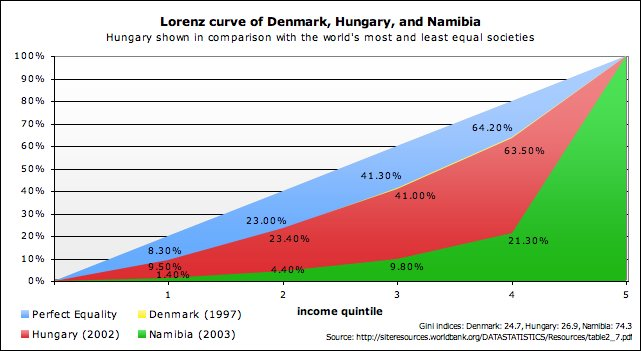

# Income inequality

**Prerequisites:** [[wage-determination|Wage determination]], [[human-capital|Human capital]], [[capital-and-interest|Capital and interest]].

*Lorenz curves for Denmark, Hungary and Namibia (data from 1997, 2002 and 2003): the further the curve sags below the diagonal, the more unequal the income distribution. Credit: Mrgann. License: [CC BY-SA 3.0](https://creativecommons.org/licenses/by-sa/3.0). Source: [File:Lorenz curve of Denmark, Hungary, and Namibia.png](https://commons.wikimedia.org/wiki/File:Lorenz_curve_of_Denmark,_Hungary,_and_Namibia.png).*

Factor markets determine how much people earn from their work, savings and property. Adding those incomes up across a population gives the **distribution of income**. How unequal that distribution is, why, and what, if anything, should be done about it are among the most debated questions in economics. This lesson covers how inequality is measured, what explains it, and the main positions in the debate.

## Measuring inequality

**Quintile shares.** Rank households by income and divide them into five equal groups. Compare the share of total income each group receives. In a perfectly equal society each would get 20 percent.

**The Lorenz curve.** Plot the cumulative share of households (from poorest to richest) on the horizontal axis against the cumulative share of income they receive on the vertical axis. Perfect equality is the 45-degree line. The more the curve sags below that line, the greater the inequality. The American economist Max Lorenz introduced the curve in 1905.

**The Gini coefficient.** The area between the line of equality and the Lorenz curve, divided by the total area under the line of equality. It ranges from 0 (perfect equality) to 1 (one household has everything). Developed by the Italian statistician Corrado Gini in 1912.

**Worked example.** A town of five households has incomes 10, 20, 30, 50 and 90 (thousand dollars), total 200.

| Quintile | Income | Share | Cumulative share |
|---|---|---|---|
| 1st | 10 | 5% | 5% |
| 2nd | 20 | 10% | 15% |
| 3rd | 30 | 15% | 30% |
| 4th | 50 | 25% | 55% |
| 5th | 90 | 45% | 100% |

Using the trapezoid rule, the area under this Lorenz curve is 0.2 × [(0 + 0.05) + (0.05 + 0.15) + (0.15 + 0.30) + (0.30 + 0.55) + (0.55 + 1.00)] / 2 = 0.2 × 3.1 / 2 = 0.31. The area under the line of equality is 0.5. Gini = (0.5 − 0.31) / 0.5 = **0.38**.

## Market income and disposable income

Inequality looks different depending on which income is measured:

- **Market income**: earnings, investment income and other private income before taxes and transfers.
- **Disposable income**: after income taxes and government transfers (pensions, child benefits, employment insurance).

Taxes and transfers substantially reduce measured inequality in most rich countries. According to OECD data, Gini coefficients for disposable income in recent years have been roughly in the high 0.20s in Nordic countries, around 0.3 in Canada, and around 0.39 in the United States, while market-income Ginis are much higher and more similar across countries. Exact figures vary by year and source.

## Income and wealth

**Wealth** (assets minus debts) is much more unequally distributed than income in every country for which data exist, because wealth accumulates over lifetimes and generations through saving, returns and inheritance.

## What explains inequality?

Economists point to several forces, with continuing disagreement about their relative importance:

1. **Skill-biased technological change.** New technologies raise the demand for highly educated workers faster than supply grows, widening the gap. Claudia Goldin and Lawrence Katz's *The Race between Education and Technology* (2008) argues that inequality rises when technology outpaces the growth of education.
2. **Globalisation.** Trade with lower-wage countries can reduce demand for less-skilled workers in rich countries while raising it for skilled workers.
3. **Institutions.** Declining union membership, falling real minimum wages, and changes in social norms about top pay.
4. **Superstar and winner-take-all dynamics**, which concentrate rewards at the very top.
5. **Capital income.** Thomas Piketty's *Capital in the Twenty-First Century* (2013) argued that when the return on capital exceeds the growth rate of the economy (r > g), wealth tends to concentrate. Critics such as Daron Acemoglu and James Robinson argued that institutions and politics matter more than any such general law, and others questioned Piketty's data and assumptions.
6. **Taxes and transfers**, which changed substantially in many countries from the 1980s onward.

## Inequality of opportunity and mobility

Many people care less about inequality of outcomes at a moment than about **inequality of opportunity** and **mobility**: how likely children from poor families are to rise. The **Great Gatsby curve**, a name popularised by Alan Krueger in 2012 based on work by Miles Corak, shows that across rich countries, those with higher inequality tend to have lower intergenerational mobility. Corak's research found that intergenerational earnings mobility in Canada is considerably higher than in the United States.

## Normative views

Economics measures inequality; judging it involves values:

- **Utilitarian** views (following Bentham and Mill) favour redistribution to the extent that a dollar is worth more to a poor person than a rich one (diminishing marginal utility), balanced against incentive costs.
- **Rawlsian** views (John Rawls, *A Theory of Justice*, 1971) judge a society by how well its worst-off members fare.
- **Libertarian** views (Robert Nozick, *Anarchy, State, and Utopia*, 1974) judge distributions by whether they arose through just acquisition and voluntary exchange, not by their shape.

These are developed in [[efficiency-versus-equity|efficiency versus equity]]. Arthur Okun's *Equality and Efficiency: The Big Tradeoff* (1975) famously compared redistribution to carrying water in a "leaky bucket": some is lost through reduced incentives and administrative costs. How leaky the bucket is remains an empirical question.

## Key ideas

- Inequality is measured with quintile shares, Lorenz curves and the Gini coefficient.
- Taxes and transfers reduce disposable-income inequality substantially.
- Wealth is far more unequal than income.
- Explanations include technology, globalisation, institutions, superstar effects and capital income.
- Judgements about inequality depend on values: utilitarian, Rawlsian, libertarian and others.

## Where this leads

- Next section: [[what-is-market-failure|market failure]].
- Related: [[efficiency-versus-equity|efficiency versus equity]].
- Related branch: philosophy's [[path:philosophy/concepts/political/README.md|political philosophy]].
- Glossary: [[g:lorenz-curve|Lorenz curve]], [[g:gini-coefficient|Gini coefficient]], [[g:intergenerational-mobility|intergenerational mobility]].
