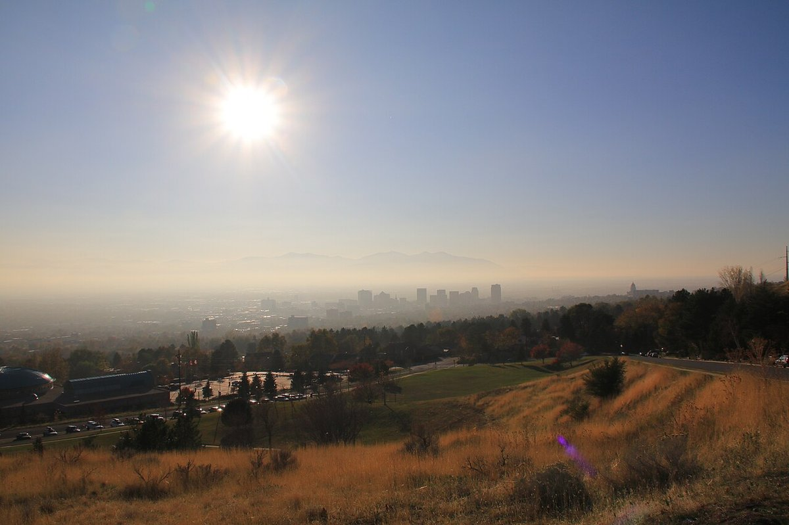
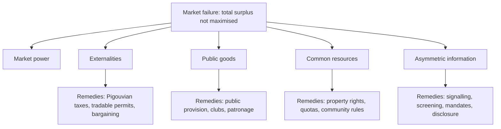

# What is market failure?

**Prerequisites:** [Deadweight loss](../02-supply-and-demand/14-deadweight-loss.md), [Long-run competitive equilibrium](../05-market-structures/03-long-run-competitive-equilibrium.md), [Monopoly pricing](../05-market-structures/05-monopoly-pricing-and-deadweight-loss.md).

*Smog and haze over the Salt Lake valley, Utah: air pollution is a classic case where market prices leave out real costs. Credit: Eltiempo10. License: [CC BY-SA 4.0](https://creativecommons.org/licenses/by-sa/4.0). Source: [File:Salt Lake City smog haze skyline 02.jpg](https://commons.wikimedia.org/wiki/File:Salt_Lake_City_smog_haze_skyline_02.jpg).*

The earlier sections showed that, under the right conditions, a competitive market produces the quantity at which marginal benefit to buyers equals marginal cost to sellers, which maximises total surplus. Adam Smith's "invisible hand" is the poetic name for this result; the [first welfare theorem](../08-welfare-economics/03-the-welfare-theorems.md) is its formal version. But the conditions matter. When they fail, markets can produce too much of some things, too little of others, or nothing at all. Economists call such situations **market failures**.

## The definition

A **market failure** is a situation in which the unregulated market outcome is **inefficient**: some reallocation could make at least one person better off without making anyone worse off, or, in surplus terms, total surplus could be increased. Market failure is about efficiency, not fairness. A market can be efficient and still produce an income distribution many people find unjust (see [efficiency versus equity](../08-welfare-economics/04-efficiency-versus-equity.md)); that is a separate concern.

## The conditions behind the invisible hand

The efficiency of competitive markets rests on assumptions:

1. **Many buyers and sellers**, none with market power.
2. **All costs and benefits are borne by the people trading** (no spillovers onto third parties).
3. **Goods are excludable and rival**, so people who do not pay can be kept out and one person's use reduces what is left for others.
4. **Both sides are well informed** about what they are trading.
5. **Property rights are clear and enforced**, and transactions are cheap.
6. **People act in their own interest in a consistent way.**

Each source of market failure is a breakdown of one of these.

## The main sources of market failure

| Source | Assumption violated | Typical result | Lessons |
|---|---|---|---|
| Market power | Many sellers | Too little output, price above marginal cost | [Monopoly](../05-market-structures/04-monopoly.md), [Oligopoly](../05-market-structures/09-oligopoly.md) |
| Externalities | All costs and benefits internal | Too much pollution, too little vaccination | [Externalities](02-externalities.md) |
| Public goods | Excludability | Under-provision; free riders | [Public goods](08-public-goods.md) |
| Common resources | Excludability with rivalry | Overuse (tragedy of the commons) | [Common resources](09-common-resources.md) |
| Asymmetric information | Both sides informed | Markets shrink or collapse | [Asymmetric information](10-asymmetric-information.md) |

Some economists add **macroeconomic instability** (unemployment and inflation) and **behavioural failures** (people making choices they themselves regret; see [the rationality assumption](../09-behavioural-economics/01-the-rationality-assumption.md)).

## A worked illustration

Return to the coffee market: Qd = 1100 − 200P and Qs = −100 + 200P, with equilibrium P = 3, Q = 500, and total surplus 1,250. Suppose roasting each bag of coffee also releases smoke that costs neighbours 1 dollar per bag. The true **social** cost curve lies 1 dollar above the supply curve: P = 1.5 + Q/200. Setting this equal to demand (P = 5.5 − Q/200) gives Q = 400 and P = 3.50. The market produces 500, which is 100 bags too many. Each of those extra bags costs society more than buyers value it. The deadweight loss is the triangle ½ × 100 × 1 = **50 dollars**. The market "fails" to account for the smoke.

## Market failure does not automatically justify intervention

A market failure shows that the outcome could be improved; it does not show that any particular government action will improve it. Governments also face information problems, interest-group pressure and incentives of their own. This is the subject of [government failure](15-government-failure.md). Ronald Coase argued that the right comparison is between real, imperfect institutions, not between an imperfect market and an ideal government. Harold Demsetz called the latter mistake the "nirvana fallacy" (1969).

Equally, private institutions often solve market failures without government: reputations and warranties tackle information problems, clubs provide shared goods, and communities manage commons, as [Elinor Ostrom](../10-history-of-thought/thinkers/15-elinor-ostrom.md) documented.

## Key ideas

- Market failure means the market outcome is inefficient; it is about efficiency, not fairness.
- The main sources are market power, externalities, public goods, common resources and asymmetric information.
- Each source corresponds to a broken assumption behind the invisible-hand result.
- A market failure creates a possible case for intervention, but intervention can also fail.

## Where this leads

- Next: [externalities](02-externalities.md).
- Later: [government failure](15-government-failure.md), [the welfare theorems](../08-welfare-economics/03-the-welfare-theorems.md).
- Glossary: [market failure](../glossary/market-failure.md), [externality](../glossary/externality.md), [nirvana fallacy](../glossary/nirvana-fallacy.md).
