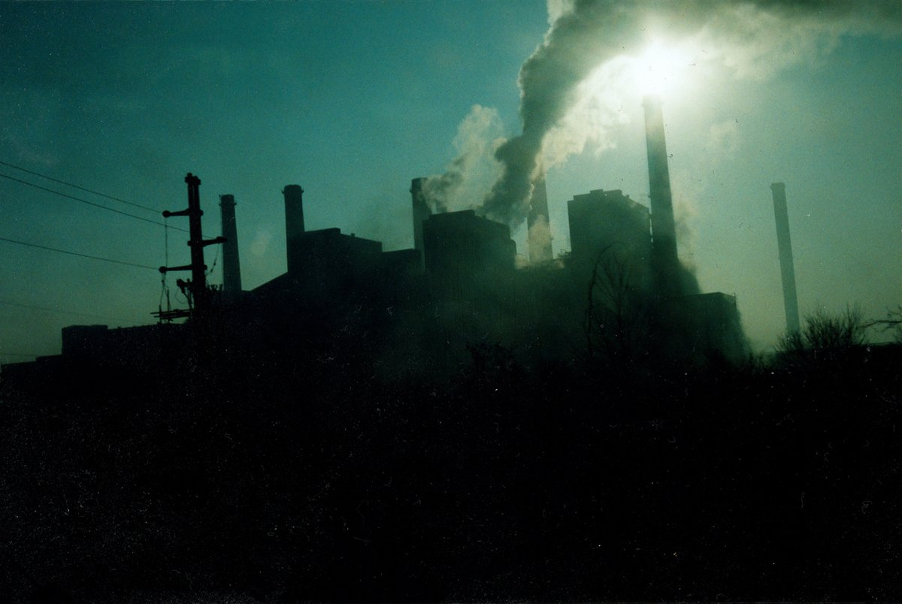
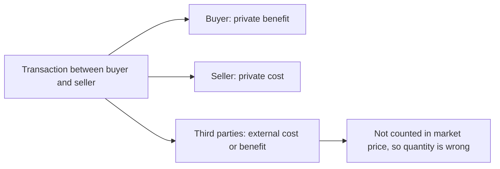

# Externalities

**Prerequisites:** [[what-is-market-failure|What is market failure?]], [[producer-surplus-and-total-surplus|Total surplus]].

*A factory stack emitting smoke; the people downwind are third parties to the factory's sales. Credit: Thomas Berg. License: [CC BY-SA 2.0](https://creativecommons.org/licenses/by-sa/2.0). Source: [File:Factory Emitting Smoke.jpg](https://commons.wikimedia.org/wiki/File:Factory_Emitting_Smoke.jpg).*

An **externality** is a cost or benefit that falls on someone who is not a party to a transaction and is not compensated or charged for it. When a factory pollutes a river, the people downstream bear a cost that neither the factory nor its customers pay. When you get a flu shot, the people around you are less likely to catch the flu, a benefit you are not paid for. Externalities are the most widely discussed source of market failure.

## Private versus social costs and benefits

The key is the gap between private and social values:

- **Marginal private cost (MPC)**: the cost borne by the producer of one more unit. This is the supply curve.
- **Marginal external cost (MEC)**: the cost imposed on third parties.
- **Marginal social cost (MSC) = MPC + MEC.**

Similarly:

- **Marginal private benefit (MPB)**: the value to the buyer. This is the demand curve.
- **Marginal external benefit (MEB)**: the value to third parties.
- **Marginal social benefit (MSB) = MPB + MEB.**

Markets equate MPB and MPC. Efficiency requires MSB = MSC. When MEC or MEB is not zero, these differ.

## Types of externality

| | On production | On consumption |
|---|---|---|
| **Negative** | Factory smoke, agricultural runoff | Second-hand smoke, traffic congestion, loud parties |
| **Positive** | Bees from a honey farm pollinating nearby orchards; research spillovers | Vaccination, education, restoring a historic house |

- **Negative externalities** lead to **overproduction**: the market quantity exceeds the efficient quantity. See [[negative-externalities-and-pollution|negative externalities and pollution]].
- **Positive externalities** lead to **underproduction**. See [[positive-externalities|positive externalities]].

## Why markets miss externalities

People respond to the costs and benefits they face. A driver deciding whether to take the car at rush hour weighs fuel, time and wear on the car, but not the extra seconds of delay she imposes on every other driver. Each individual decision is rational; the sum is too much driving. The underlying problem, as Coase emphasised, is often missing or unenforceable **property rights**: nobody owns the air or the river, so nobody can charge for its use.

## Pecuniary versus technological externalities

Not every effect on third parties is a market failure. If a new coffee chain opens and drives down the prices that rival cafés can charge, the rivals are worse off, but this works through prices: consumers gain what the rivals lose. Economists call this a **pecuniary externality**, and in competitive markets it does not cause inefficiency. The externalities that matter for efficiency are **technological** (or real) externalities, which affect someone's utility or production directly, not through prices.

## A numeric example: a positive externality

Suppose the private demand for flu shots is P = 50 − Q/10 (Q in thousands), and the supply is P = 10 + Q/10. The market equilibrium: 50 − Q/10 = 10 + Q/10, so Q = 200 thousand shots at P = 30 dollars.

If each shot gives others an external benefit of 8 dollars (reduced infection risk), MSB = 58 − Q/10. Efficiency: 58 − Q/10 = 10 + Q/10, so Q = 240 thousand. The market under-provides by 40,000 shots. The deadweight loss is ½ × 40 × 8 = 160, that is, **160,000 dollars**.

## Remedies at a glance

| Approach | Idea | Lesson |
|---|---|---|
| Pigouvian tax or subsidy | Make private cost equal social cost | [[pigouvian-taxes-and-subsidies|Pigouvian taxes and subsidies]] |
| Bargaining | Assign property rights and let parties trade | [[coase-theorem|The Coase theorem]] |
| Tradable permits | Cap total quantity, let firms trade the right to emit | [[cap-and-trade-and-regulation|Cap and trade]] |
| Command and control | Set standards or bans | [[cap-and-trade-and-regulation|Regulation]] |
| Social norms and private action | Etiquette, reputation, mergers that internalise spillovers | — |

## Key ideas

- An externality is an uncompensated effect on a third party.
- Efficiency requires marginal social benefit = marginal social cost; markets equate private values.
- Negative externalities cause overproduction; positive externalities cause underproduction.
- Pecuniary externalities, which work through prices, are not market failures in competitive markets.

## Where this leads

- Next: [[negative-externalities-and-pollution|negative externalities and pollution]].
- Related: [[path:economics/finance/05-regulation/01-why-markets-are-regulated.md|why financial markets are regulated]] (systemic risk is an externality).
- Glossary: [[g:externality|externality]], [[g:marginal-social-cost|marginal social cost]], [[g:pecuniary-externality|pecuniary externality]].
