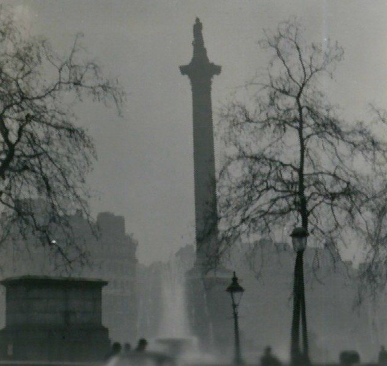
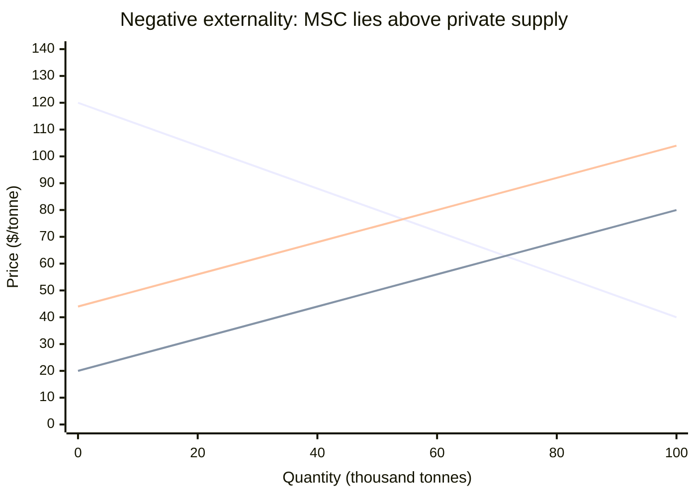

# Negative externalities and pollution

**Prerequisites:** [[externalities|Externalities]], [[deadweight-loss|Deadweight loss]].

*Nelson's Column, London, during the Great Smog of December 1952, which killed thousands and led to the UK Clean Air Act 1956. Credit: N T Stobbs. License: [CC BY-SA 2.0](https://creativecommons.org/licenses/by-sa/2.0). Source: [File:Nelson's Column during the Great Smog of 1952.jpg](https://commons.wikimedia.org/wiki/File:Nelson's_Column_during_the_Great_Smog_of_1952.jpg).*

Pollution is the textbook negative externality. A steel mill that emits sulphur dioxide pays for its ore, coal and labour, but not for the damage its emissions do to lungs, forests and buildings downwind. Because that damage does not show up in the mill's costs, the market produces more steel, and more pollution, than is efficient.

## The diagram

The supply curve reflects marginal private cost. Add the marginal external cost (MEC) to get marginal social cost (MSC), which lies above supply. The market settles where demand meets supply, at quantity Q_m. The efficient quantity Q* is where demand meets MSC, which is lower.

## Worked example

Suppose (in thousands of tonnes and dollars per tonne):

- Demand: P = 120 − 0.8Q
- Supply (MPC): P = 20 + 0.6Q
- Marginal external cost: 24 dollars per tonne (constant).

**Market outcome.** 120 − 0.8Q = 20 + 0.6Q, so 1.4Q = 100 and Q_m ≈ 71.4 thousand tonnes, P ≈ 62.9.

**Efficient outcome.** MSC = 44 + 0.6Q. Setting 120 − 0.8Q = 44 + 0.6Q gives 1.4Q = 76 and Q* ≈ 54.3, with price to buyers ≈ 76.6.

**Deadweight loss.** The over-production is about 17.1 thousand tonnes. On each of those tonnes, the social cost exceeds the value to buyers; the gap grows from 0 at Q* to 24 at Q_m. DWL = ½ × 17.1 × 24 ≈ **205 thousand dollars**.

Note that the efficient amount of pollution is **not zero**. At Q*, the steel is still worth more to buyers than its full social cost. Eliminating pollution entirely would mean giving up steel worth more than the harm it causes. The goal is the right amount, where the marginal benefit of the last tonne equals its full marginal cost.

## The abatement view

Economists often reframe the problem in terms of **abatement** (pollution reduction). Reducing emissions is costly, and the **marginal abatement cost** usually rises: the first tonnes are cheap to cut (fix leaks, switch fuels), later ones expensive. The **marginal damage** of emissions is the benefit of abating. The efficient level of emissions is where marginal abatement cost equals marginal damage.

| Tonnes abated | Marginal abatement cost ($) | Marginal damage avoided ($) |
|---|---|---|
| 1st | 5 | 30 |
| 2nd | 10 | 30 |
| 3rd | 18 | 30 |
| 4th | 28 | 30 |
| 5th | 42 | 30 |

Here it is worth abating 4 tonnes but not the 5th: the 5th costs 42 to remove but prevents only 30 of damage.

## Real examples

- **Acid rain.** Sulphur dioxide from coal power plants caused acid rain in eastern North America and Europe in the late 20th century. The US 1990 Clean Air Act Amendments created a tradable permit system for sulphur dioxide (see [[cap-and-trade-and-regulation|cap and trade]]).
- **Climate change.** Greenhouse gas emissions are a global negative externality. The *Stern Review* (2006), commissioned by the UK government, called climate change "the greatest market failure the world has ever seen". Estimates of the **social cost of carbon** (the damage from one extra tonne of CO₂) vary widely depending on assumptions about damages and the discount rate.
- **Traffic congestion.** Each driver slows others down. Cities including Singapore (1975), London (2003), Stockholm (2006) and New York (2025) have introduced congestion charges.
- **Antibiotic resistance.** Each course of antibiotics slightly increases the chance that resistant bacteria develop, a cost borne by everyone.

## Why the discount rate matters

Many pollution costs fall far in the future. Whether 1,000 dollars of damage in 100 years is worth 370 dollars today (at a 1 percent discount rate) or about 3 dollars (at 6 percent) makes an enormous difference to policy. This is the core of the debate between the Stern Review, which used a low discount rate, and economists such as William Nordhaus, who argued for rates closer to market returns. See [[path:economics/finance/01-foundations/05-present-value-and-discounting.md|present value and discounting]] and [[cost-benefit-analysis|cost-benefit analysis]].

## Key ideas

- Negative externalities make marginal social cost exceed marginal private cost, so markets overproduce.
- The deadweight loss is the triangle between MSC and demand over the excess output.
- The efficient amount of pollution is usually positive: marginal abatement cost = marginal damage.
- Climate change, acid rain and congestion are major examples; discount rates shape climate policy.

## Where this leads

- Next: [[positive-externalities|positive externalities]].
- Remedies: [[pigouvian-taxes-and-subsidies|Pigouvian taxes]], [[cap-and-trade-and-regulation|cap and trade]].
- Glossary: [[g:marginal-abatement-cost|marginal abatement cost]], [[g:social-cost-of-carbon|social cost of carbon]].
