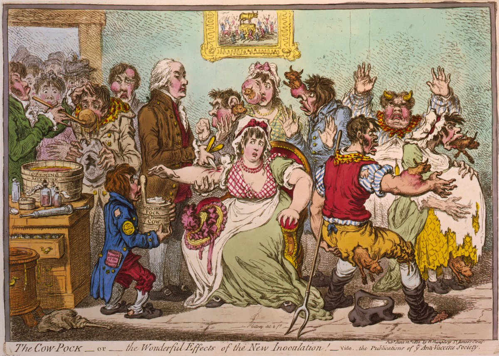
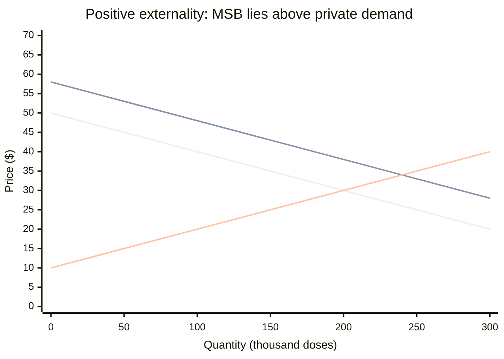

# Positive externalities

**Prerequisites:** [[externalities|Externalities]], [[consumer-surplus|Consumer surplus]].

*James Gillray's 1802 cartoon The Cow-Pock, satirising fears of Edward Jenner's smallpox vaccine; vaccination protects others as well as the person vaccinated. Credit: James Gillray. License: Public domain. Source: [File:The cow pock.jpg](https://commons.wikimedia.org/wiki/File:The_cow_pock.jpg).*

A positive externality is a benefit that spills over to people who do not pay for it. Because the person deciding whether to buy or produce something ignores the benefits to others, markets provide **too little** of goods with positive externalities. Vaccination, education, research, and well-kept gardens are the standard examples.

## The logic

With a positive consumption externality, marginal social benefit (MSB) lies above the private demand curve (MPB) by the marginal external benefit (MEB). The market equates MPB with marginal cost; efficiency requires MSB = MC. Since MSB is higher, the efficient quantity is larger than the market quantity.

Using the flu-shot numbers from [[externalities|the previous lesson]]: the market provides 200,000 shots; the efficient level is 240,000; the deadweight loss of under-provision is 160,000 dollars.

## Examples

**Vaccination and herd immunity.** When enough people are immune to a contagious disease, it cannot spread easily, protecting those who cannot be vaccinated. Each additional vaccinated person reduces infection risk for others. For highly contagious diseases such as measles, epidemiologists estimate that roughly 95 percent coverage is needed to prevent outbreaks. Individuals weighing only their own costs and benefits will tend to under-vaccinate, especially once a disease has become rare. This is why many countries subsidise vaccines, provide them free, or require them for school attendance.

**Education.** Education benefits the person educated, through higher earnings (see [[human-capital|human capital]]). Many economists also argue that it has external benefits: better-informed voters, lower crime, faster spread of ideas and innovation. The size of these external benefits is debated; empirical estimates vary, and some economists, such as Bryan Caplan in *The Case against Education* (2018), argue that much of the private return reflects signalling rather than productivity (see [[signalling-and-screening|signalling]]).

**Research and development.** New ideas can be copied. A firm that invents a better process captures only part of the benefit; competitors, customers and later inventors gain too. Studies by economists including Zvi Griliches and Charles Jones and John Williams have estimated social returns to R&D well above private returns, implying under-investment. Patents, research subsidies, tax credits and public funding of basic science are responses. Canada's Scientific Research and Experimental Development (SR&ED) program is an example of an R&D tax credit.

**Bees and orchards.** A beekeeper's bees pollinate nearby orchards; orchards provide nectar. This was James Meade's 1952 example of an unpaid positive externality. Steven Cheung's 1973 study "The Fable of the Bees" found that in Washington State, beekeepers and orchard owners actually wrote contracts with pollination fees and nectar payments. The externality was largely internalised by private bargaining, an illustration of the [[coase-theorem|Coase theorem]].

**Network effects.** When more people use a telephone network, social platform or programming language, each user benefits. If these benefits are not captured by the network owner, adoption may be too slow; if they are captured, they can lead to dominant platforms (see [[g:network-effect|network effect]]).

## Production externalities and spillovers

Positive externalities can arise in production too. Firms that cluster in one place, such as technology in Silicon Valley or film in Hollywood, can benefit from shared pools of skilled workers, specialised suppliers and the informal exchange of ideas. Alfred Marshall described these **agglomeration economies** in 1890, writing that in industrial districts "the mysteries of the trade become no mysteries; but are as it were in the air". These spillovers are part of why cities are productive.

## Remedies

- **Subsidies** equal to the marginal external benefit (a Pigouvian subsidy) shift the effective demand curve up to MSB. In the flu example, an 8-dollar subsidy per shot achieves the efficient quantity of 240,000.
- **Public provision** (free vaccines, public schools).
- **Mandates** (compulsory schooling, vaccination requirements).
- **Intellectual property rights** let inventors capture more of their benefits, at the cost of temporary monopoly pricing.
- **Private internalisation** through contracts, mergers or clubs.

## Key ideas

- With positive externalities, marginal social benefit exceeds private benefit and markets underproduce.
- Major examples: vaccination, education, R&D, pollination and agglomeration.
- Subsidies, public provision, mandates and intellectual property can raise output toward the efficient level.
- Private bargaining sometimes internalises the externality, as with bees and orchards.

## Where this leads

- Next: [[pigouvian-taxes-and-subsidies|Pigouvian taxes and subsidies]].
- Related: [[public-goods|public goods]], an extreme case of positive spillovers.
- Glossary: [[g:positive-externality|positive externality]], [[g:herd-immunity|herd immunity]], [[g:agglomeration-economies|agglomeration economies]].
