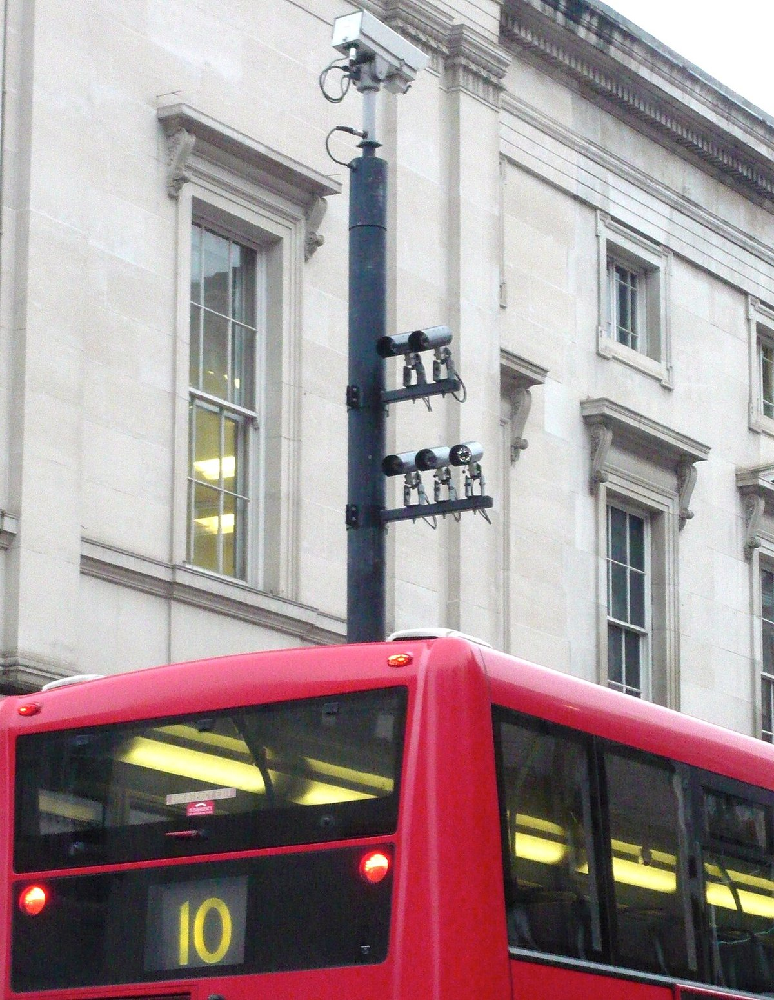
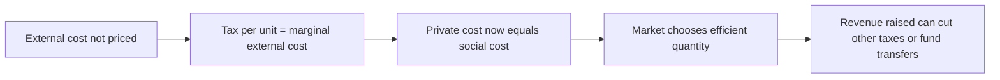

# Pigouvian taxes and subsidies

**Prerequisites:** [[negative-externalities-and-pollution|Negative externalities]], [[taxes-and-tax-incidence|Taxes and tax incidence]].

*Cameras enforcing London's congestion charge (introduced 2003), a Pigouvian-style price on road use. Credit: Guppiefish. License: [CC BY-SA 3.0](https://creativecommons.org/licenses/by-sa/3.0). Source: [File:Congestion charge cameras on Gower Street, London WC1.jpg](https://commons.wikimedia.org/wiki/File:Congestion_charge_cameras_on_Gower_Street,_London_WC1.jpg).*

If the problem with pollution is that polluters do not pay for the damage they cause, one solution is obvious: make them pay. A tax on each unit of a harmful activity, set equal to the marginal external cost, makes the private cost equal the social cost. The idea is named after the Cambridge economist [[arthur-cecil-pigou|Arthur Cecil Pigou]], who developed it in *The Economics of Welfare* (1920).

## How a Pigouvian tax works

A tax of t per unit shifts the supply curve up by t. If t equals the marginal external cost at the efficient quantity, the new supply curve passes through the point where demand meets marginal social cost. Producers and consumers, each responding only to prices, now choose the efficient quantity.

## Worked example

From [[negative-externalities-and-pollution|the steel example]]: demand P = 120 − 0.8Q, supply P = 20 + 0.6Q, and marginal external cost of 24 per tonne.

A tax of 24 per tonne makes supply P = 44 + 0.6Q. The new equilibrium is Q ≈ 54.3 thousand tonnes, the efficient quantity.

- Buyers pay ≈ 76.6 per tonne (up from 62.9).
- Sellers keep ≈ 52.6 per tonne (down from 62.9).
- Tax revenue ≈ 24 × 54.3 ≈ **1,303 thousand dollars**.
- The deadweight loss of about 205 thousand dollars is eliminated.

Unlike most taxes, which create deadweight loss by discouraging valuable trades (see [[deadweight-loss|deadweight loss]]), a correctly set Pigouvian tax **removes** a deadweight loss. It improves efficiency and raises revenue at the same time.

## The double dividend

Because Pigouvian taxes raise revenue, governments can use it to reduce taxes that do discourage valuable activity, such as income or payroll taxes. Some economists argued this gives a **double dividend**: a cleaner environment plus a more efficient tax system. Later research by economists including Lans Bovenberg and Ruud de Mooij (1994) and Lawrence Goulder showed that the second dividend is not guaranteed, because environmental taxes raise prices and interact with existing taxes on labour. The first dividend, correcting the externality, remains.

## Pigouvian subsidies

For positive externalities, the mirror image applies: a subsidy per unit equal to the marginal external benefit raises output to the efficient level. Subsidies for vaccination, research and home insulation are examples. Subsidies must be financed by other taxes, which carry their own deadweight losses.

## Real-world carbon pricing

- **British Columbia** introduced a revenue-neutral carbon tax in 2008, starting at 10 dollars per tonne of CO₂ and returning revenue through tax cuts and credits.
- **Canada's federal carbon pricing** (2019) set a national minimum price; the consumer fuel charge was set to zero in April 2025, while pricing on large industrial emitters continued.
- **Sweden** has had a carbon tax since 1991, among the highest in the world.
- Many economists have endorsed carbon taxes. In 2019 a statement published in the *Wall Street Journal* and signed by thousands of US economists, including many Nobel laureates, supported a carbon tax with revenue returned to citizens as dividends.

## Practical difficulties

1. **Measuring the external cost.** The tax should equal marginal damage at the efficient quantity, but damage is hard to measure. The social cost of carbon depends on climate models, damage estimates and the discount rate.
2. **Location matters.** Some pollutants do more damage in some places than others (a factory near a city versus a desert). A uniform tax can be too high in some places and too low in others.
3. **Distribution.** Taxes on fuel and heating can fall heavily on lower-income households. Rebates can offset this.
4. **Political acceptability.** Taxes are visible and unpopular; regulations hide their costs.
5. **Leakage.** If one country taxes carbon and others do not, production may move abroad. Border carbon adjustments, such as the EU's Carbon Border Adjustment Mechanism, aim to address this.

## Other "Pigouvian" taxes

Taxes on tobacco, alcohol, sugary drinks and gambling are sometimes justified as Pigouvian, either because of externalities (health costs borne by public systems, second-hand smoke) or because people may harm themselves through self-control problems ("internalities"; see [[time-inconsistency-and-self-control|time inconsistency]]).

## Key ideas

- A Pigouvian tax equal to marginal external cost makes private cost equal social cost.
- It eliminates deadweight loss and raises revenue; a Pigouvian subsidy corrects positive externalities.
- Measuring damage, distribution and politics are the main difficulties.
- Carbon taxes are the leading modern application.

## Where this leads

- Next: [[coase-theorem|the Coase theorem]], which questions whether taxation is always needed.
- Related: [[cap-and-trade-and-regulation|cap and trade]], a quantity-based alternative.
- Glossary: [[g:pigouvian-tax|Pigouvian tax]], [[g:double-dividend|double dividend]], [[g:carbon-tax|carbon tax]].
