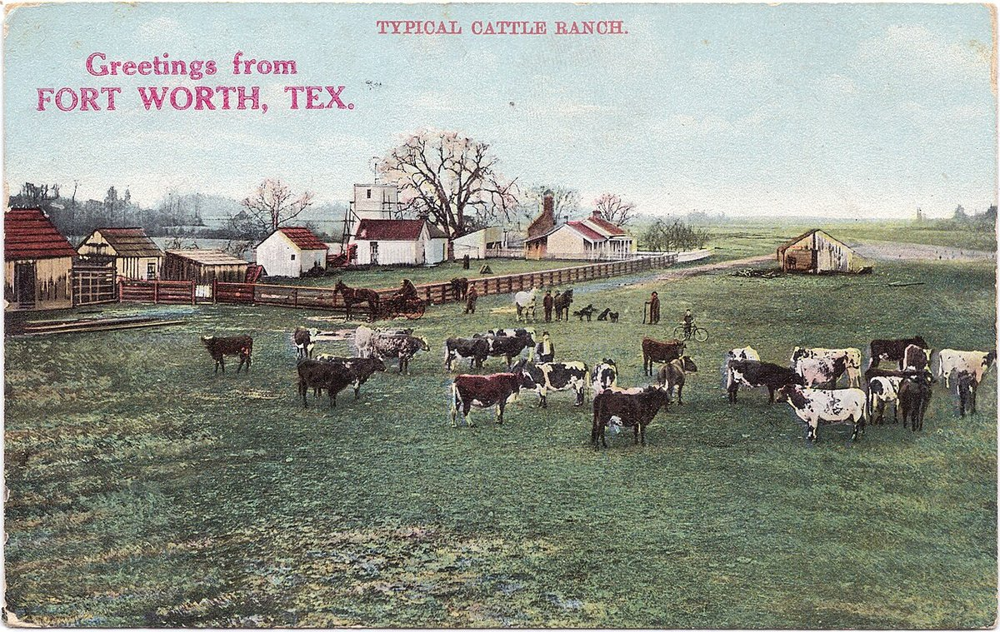
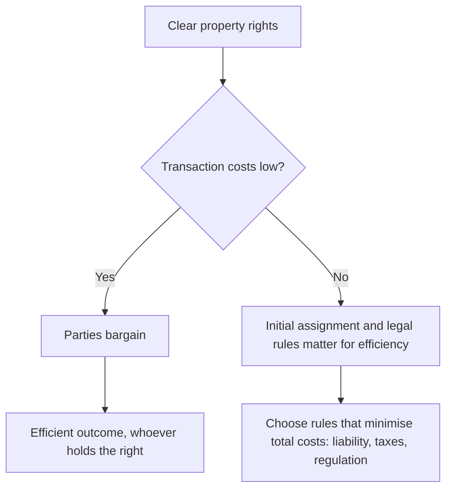

# The Coase theorem

**Prerequisites:** [[pigouvian-taxes-and-subsidies|Pigouvian taxes and subsidies]], [[markets-prices-and-property-rights|Markets, prices and property rights]], [[the-firm|The firm]] (transaction costs).

*Postcard of a typical cattle ranch near Fort Worth, Texas; straying cattle and neighbouring crops are the standard Coase example. Credit: Adolph Selige Pub. Co. (St. Louis–Leipzig). License: Public domain. Source: [File:Typical Cattle Ranch (20106810).jpg](https://commons.wikimedia.org/wiki/File:Typical_Cattle_Ranch_(20106810).jpg).*

In 1960, [[ronald-coase|Ronald Coase]] published "The Problem of Social Cost" in the *Journal of Law and Economics*. It became one of the most cited articles in economics and helped launch the field of law and economics. Coase challenged the Pigouvian view that externalities require government taxes. He argued that externalities are **reciprocal**, and that if property rights are well defined and bargaining is cheap, the parties will reach an efficient outcome on their own, whoever holds the rights.

## Externalities are reciprocal

Pigou framed pollution as the polluter harming the victim. Coase pointed out that the problem has two sides. If a confectioner's machinery disturbs a doctor next door (a real English case, *Sturges v Bridgman*, 1879, which Coase discussed), stopping the noise harms the confectioner just as surely as the noise harms the doctor. The question is not "how do we stop A harming B?" but "should A be allowed to harm B, or B to harm A?" The answer should depend on which arrangement produces the greater total value.

## The theorem

George Stigler, who named the result, stated it roughly as: **when transaction costs are zero and property rights are well defined, private bargaining leads to an efficient outcome regardless of how the rights are initially assigned.** The initial assignment affects who pays whom (the distribution of wealth), but not whether the efficient outcome is reached.

## Worked example: the rancher and the farmer

A rancher's cattle stray onto a neighbouring farmer's land and trample crops. A fence would cost 300 dollars a year. The crop damage without a fence is 500 dollars a year.

**Case 1: the farmer has the right to undamaged crops.** The rancher is liable for 500 of damage. Building the fence costs only 300, so the rancher builds it. Outcome: fence built.

**Case 2: the rancher has the right to let cattle roam.** The farmer bears the 500 of damage. The farmer offers to pay the rancher to build the fence (or builds it herself) for 300. Since 300 < 500, the farmer is better off paying. Outcome: fence built.

Either way, the fence goes up, the efficient result. Only who pays differs.

Now change the numbers: suppose the fence costs 700. Then in Case 1, the rancher would rather pay 500 in damages than build a 700 fence. In Case 2, the farmer will not pay 700 to avoid 500 of damage. Either way, no fence: again the same, efficient outcome, since the fence would cost more than the damage it prevents.

## The real lesson: transaction costs

Coase himself emphasised that the zero-transaction-cost world is unrealistic. In his Nobel lecture (1991) he said his aim had been to show that the world of zero transaction costs was the world of standard economic theory, and to push economists to study the real world where transaction costs are positive. Bargaining breaks down when:

- **Many parties are involved.** Millions of people affected by air pollution cannot practically negotiate with thousands of emitters.
- **Free riding** makes each victim reluctant to contribute to a payment.
- **Information is private.** Each party may exaggerate its costs or benefits to win a better deal ([[asymmetric-information|asymmetric information]]).
- **Enforcement is costly.**
- **Rights are unclear**, as with the atmosphere or the high seas.

When transaction costs are high, the legal assignment of rights matters a great deal, and the law should try to assign them to whichever party would have ended up with them through bargaining, or choose rules that minimise total costs.

## Evidence and examples

- **Bees and orchards.** Steven Cheung found that Washington beekeepers and orchard owners did contract over pollination, internalising the externality.
- **Ranchers in Shasta County.** Robert Ellickson's *Order without Law* (1991) found that California ranchers and neighbours resolved cattle-trespass disputes through informal norms, largely ignoring the formal law. Bargaining happened, but not in the form Coase described.
- **The lighthouse.** In "The Lighthouse in Economics" (1974), Coase showed that many British lighthouses had been privately built and financed through fees collected at ports, challenging the textbook claim that lighthouses must be publicly provided (see [[public-goods|public goods]]). Later researchers have debated how much government involvement there actually was.
- **Experiments.** Elizabeth Hoffman and Matthew Spitzer (1982) found that small groups in the lab usually reached efficient agreements, consistent with the theorem. Behavioural research also shows an **endowment effect**: people value what they own more than identical things they do not own, which can make the initial assignment affect outcomes even with low transaction costs.

## Key ideas

- Externalities are reciprocal: limiting one party's activity harms that party.
- With zero transaction costs and clear rights, bargaining yields efficiency regardless of who holds the rights; only distribution changes.
- In reality, transaction costs are often high, so legal rules and institutions matter.
- Coase's work founded law and economics and emphasised comparing real institutions.

## Where this leads

- Next: [[cap-and-trade-and-regulation|cap and trade and regulation]], which creates property rights in pollution.
- Related: [[ronald-coase|Ronald Coase]], [[the-firm|the firm]], [[heuristics-and-biases|the endowment effect]].
- Glossary: [[g:coase-theorem|Coase theorem]], [[g:transaction-costs|transaction costs]], [[g:endowment-effect|endowment effect]].
