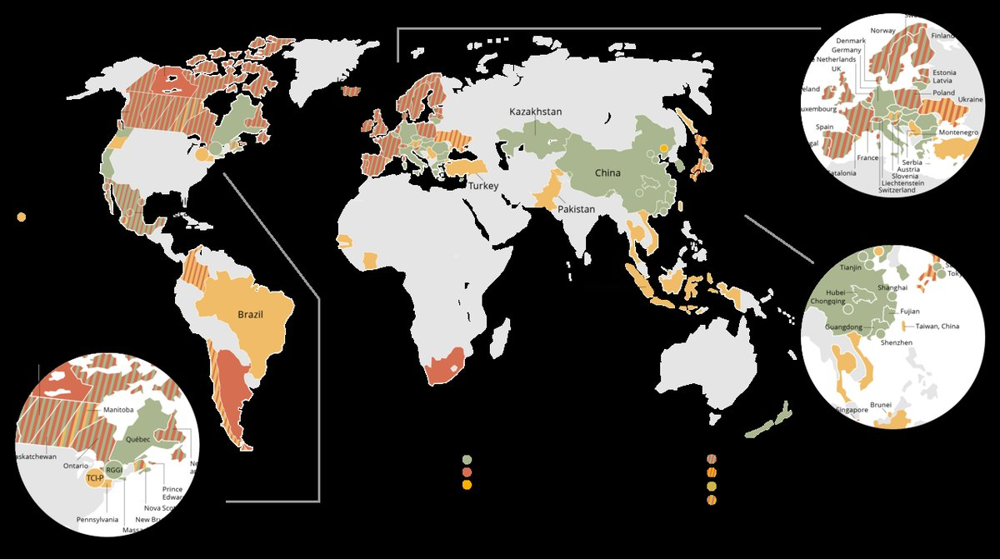
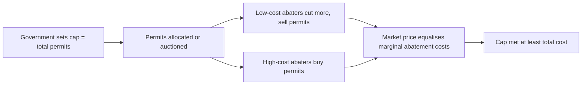

# Cap and trade and regulation

**Prerequisites:** [Pigouvian taxes and subsidies](05-pigouvian-taxes-and-subsidies.md), [The Coase theorem](06-coase-theorem.md).

*Carbon taxes and emissions trading systems around the world as of 2021. Credit: World Bank. License: [CC BY 3.0](https://creativecommons.org/licenses/by/3.0). Source: [File:Map of carbon taxes and emissions trading systems worldwide (2021).png](https://commons.wikimedia.org/wiki/File:Map_of_carbon_taxes_and_emissions_trading_systems_worldwide_(2021).png).*

A Pigouvian tax sets a price on pollution and lets the quantity adjust. An alternative is to set the quantity and let the price adjust. Under **cap and trade**, the government caps total emissions, issues permits adding up to the cap, and lets firms buy and sell them. The idea, developed by Ronald Coase's insight that pollution rights could be traded, was set out by John Dales (*Pollution, Property and Prices*, 1968, written at the University of Toronto) and formalised by Thomas Crocker and W. David Montgomery.

## Why trading saves money

Firms differ in how cheaply they can cut emissions. Suppose two plants each emit 100 tonnes, and the government wants total emissions cut by 100 tonnes.

- Plant A's marginal abatement cost is constant at 10 dollars per tonne.
- Plant B's is constant at 40 dollars per tonne.

**Uniform regulation**: each plant cuts 50 tonnes. Cost = 50 × 10 + 50 × 40 = **2,500 dollars**.

**Cap and trade**: each plant receives 50 permits (allowing 50 tonnes). Plant B would rather buy permits than abate at 40; Plant A would rather abate at 10 and sell permits. They trade at any price between 10 and 40. In the end, Plant A cuts all 100 tonnes and sells its 50 permits to Plant B. Total cost = 100 × 10 = **1,000 dollars**. The same environmental result costs 60 percent less.

The general principle: emissions are cut at least cost when every source's **marginal abatement cost is equal**. With a single permit price, every firm abates until its marginal abatement cost equals that price, which equalises marginal costs automatically. A uniform Pigouvian tax does the same.

## Prices versus quantities

If regulators knew everything, a tax and a cap would be equivalent: set the tax at the price the cap would produce, or the cap at the quantity the tax would produce. Under uncertainty they differ:

| | Carbon tax | Cap and trade |
|---|---|---|
| What is certain | Price per tonne | Total emissions |
| What is uncertain | Quantity of emissions | Permit price |
| Revenue | Automatic | Only if permits are auctioned |
| Good when | Marginal damage is fairly flat; cost certainty valued | Damage rises steeply past a threshold |

Martin Weitzman's 1974 paper "Prices vs. Quantities" showed that which instrument is better depends on the relative slopes of the marginal damage and marginal abatement cost curves. Because climate damage depends on the accumulated stock of greenhouse gases, the damage from one year's emissions is fairly flat, which many economists argue favours a price. Hybrid schemes with price floors and ceilings combine features of both.

## Real cap-and-trade systems

- **US Acid Rain Program** (1995 onward) capped sulphur dioxide from power plants. Emissions fell substantially, at costs well below early predictions. Studies, such as those summarised by Richard Schmalensee and Robert Stavins (2013), credit trading with major savings, though falling prices of low-sulphur coal also helped.
- **EU Emissions Trading System** (2005) covers power, industry and aviation in the EU. Early phases over-allocated permits and prices collapsed; reforms, including the Market Stability Reserve, later raised prices.
- **Western Climate Initiative**: California's program is linked with Quebec's (since 2014).

## Command-and-control regulation

The traditional alternative is **command and control**: technology standards (install scrubbers), performance standards (emit no more than X per unit of output), or outright bans (lead in petrol, CFCs under the 1987 Montreal Protocol).

Advantages:

- Simple to understand and enforce in some cases.
- Appropriate for highly toxic pollutants where the safe level is near zero.
- Certain outcome for each source, which matters for local "hot spots".

Disadvantages:

- Ignores differences in abatement cost, so it achieves goals at higher cost.
- Gives no incentive to cut beyond the standard or to innovate.
- Technology mandates can lock in particular solutions.

## Key ideas

- Cap and trade fixes total emissions and lets permit trading find the cheapest way to meet the cap.
- Least-cost abatement requires equal marginal abatement costs across sources, which a single price delivers.
- Taxes fix price; caps fix quantity. Under uncertainty, the better choice depends on cost and damage curves (Weitzman).
- Command and control is simpler and certain but usually more expensive.

## Where this leads

- Next: [public goods](08-public-goods.md).
- Related: [what an exchange does](../../finance/04-markets/01-what-an-exchange-does.md) (permit markets are exchanges).
- Glossary: [cap and trade](../glossary/cap-and-trade.md), [command and control](../glossary/command-and-control.md), [emissions permit](../glossary/emissions-permit.md).
