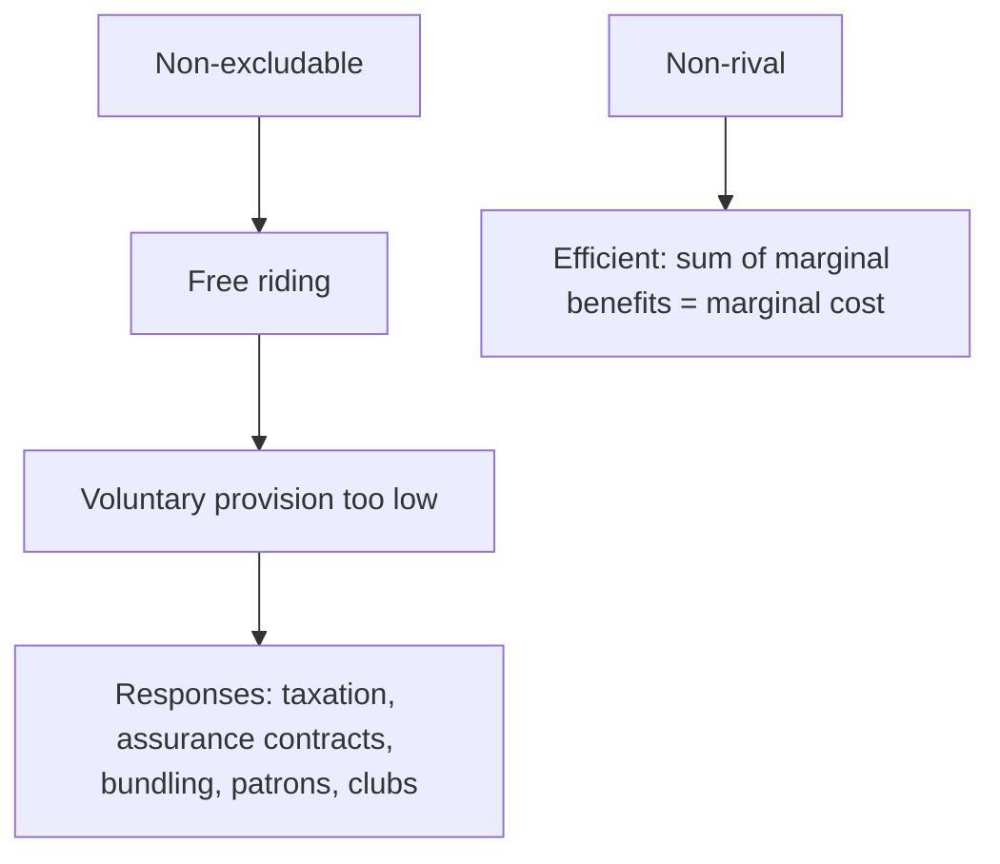

# Public goods

**Prerequisites:** [Positive externalities](04-positive-externalities.md), [What is market failure?](01-what-is-market-failure.md).

*Aerial photograph of Westerhever lighthouse, Germany; lighthouses are the textbook (and disputed) example of a public good. Credit: Marco Leiter. License: [CC BY-SA 4.0](https://creativecommons.org/licenses/by-sa/4.0). Source: [File:Leuchtturm in Westerheversand crop.jpg](https://commons.wikimedia.org/wiki/File:Leuchtturm_in_Westerheversand_crop.jpg).*

Some goods are hard to sell because you cannot stop people who do not pay from enjoying them, and one person's enjoyment does not reduce anyone else's. National defence, a fireworks display, clean air and basic scientific knowledge are examples. Paul Samuelson formalised the theory of these **public goods** in a three-page 1954 paper, "The Pure Theory of Public Expenditure".

## Two properties

Goods can be classified by two questions:

- **Excludability:** can people who do not pay be prevented from using it?
- **Rivalry in consumption:** does one person's use reduce the amount available to others?

| | **Rival** | **Non-rival** |
|---|---|---|
| **Excludable** | **Private goods**: sandwiches, clothes, cars | **Club goods**: streaming services, cinemas, toll roads when uncongested, software |
| **Non-excludable** | **Common resources**: ocean fish, groundwater, public pasture | **Public goods**: national defence, lighthouses (arguably), flood barriers, basic knowledge |

A **pure public good** is both non-rival and non-excludable. "Public good" in economics means something with these properties, not simply something the government provides. Governments provide many private goods (postal delivery, electricity) and markets provide some public goods.

## The free-rider problem

If a good is non-excludable, each person has an incentive to let others pay and enjoy it anyway: to **free ride**. If everyone reasons this way, the good is under-provided or not provided at all, even though everyone would be better off if all contributed. This is a [prisoners' dilemma](../05-market-structures/12-prisoners-dilemma-and-cartels.md) with many players.

## The Samuelson condition

For a private good, the efficient quantity is where each consumer's marginal benefit equals marginal cost; we add demand curves **horizontally** (adding quantities at each price). For a public good, every person consumes the same quantity, so the total benefit of one more unit is the **sum of everyone's marginal benefits**. We add demand curves **vertically**. The efficient quantity satisfies:

**Sum of marginal benefits = marginal cost.**

### Worked example

A street of three households is deciding how many streetlights to install. Each light costs 120 dollars. Marginal benefits (dollars) are:

| Lights | Ana | Ben | Cleo | Sum |
|---|---|---|---|---|
| 1st | 80 | 60 | 50 | 190 |
| 2nd | 60 | 45 | 35 | 140 |
| 3rd | 40 | 30 | 25 | 95 |
| 4th | 20 | 15 | 10 | 45 |

The efficient number is **2**: the 2nd light's summed benefit (140) exceeds its cost (120), but the 3rd's (95) does not.

Left to the market, though, no single household values even the first light at 120. Ana, the keenest, values it at 80. If each household buys lights alone, **none get bought**. Even if Ana's 80 were combined with others, each household would prefer to understate its value and let the others pay.

## How public goods get provided

- **Government provision financed by taxation.** Compulsory taxes solve free riding, but government must estimate how much citizens value the good, and voting may not reveal it well.
- **Making the good excludable.** Encryption turned broadcast TV into subscription TV; toll technology makes roads excludable.
- **Bundling with private goods.** Free-to-air radio is paid for by advertising; open-source software is often funded by firms that sell complementary services.
- **Philanthropy and patronage.** Public parks, libraries and basic research are often funded by donors.
- **Assurance contracts.** Crowdfunding platforms commit contributors only if a funding target is met, reducing the risk of contributing alone.
- **Social norms and small groups.** In small communities, reputation and reciprocity sustain contributions.

## The lighthouse debate

Textbooks long used lighthouses as the classic public good: a ship cannot be stopped from seeing the light, and one ship's use does not dim it. Coase's 1974 study found that many English lighthouses had been built by private individuals and financed by tolls collected in ports, enforced by government. The example shows that "public good" problems can sometimes be solved by creative institutions, though the lighthouses still relied on government-granted rights to collect fees.

## Knowledge as a public good

Ideas are non-rival: one person using the Pythagorean theorem does not stop anyone else using it. Once published, they are often hard to exclude. This is why basic research is largely funded by governments and universities, and why patents and copyrights create temporary excludability. Paul Romer's work on endogenous growth (for which he shared the 2018 Nobel prize) built on the non-rivalry of ideas.

## Key ideas

- Public goods are non-rival and non-excludable; club goods are excludable but non-rival; common resources are rival but non-excludable.
- Non-excludability leads to free riding and under-provision.
- The efficient quantity sets the sum of marginal benefits equal to marginal cost (Samuelson condition).
- Responses include taxation, excludability, bundling, philanthropy and assurance contracts.

## Where this leads

- Next: [common resources](09-common-resources.md).
- Related: [social choice](../08-welfare-economics/05-social-choice-and-arrows-theorem.md) (how groups decide on public goods).
- Glossary: [public good](../glossary/public-good.md), [free-rider problem](../glossary/free-rider-problem.md), [club good](../glossary/club-good.md), [non-rival](../glossary/non-rival.md), [non-excludable](../glossary/non-excludable.md).
