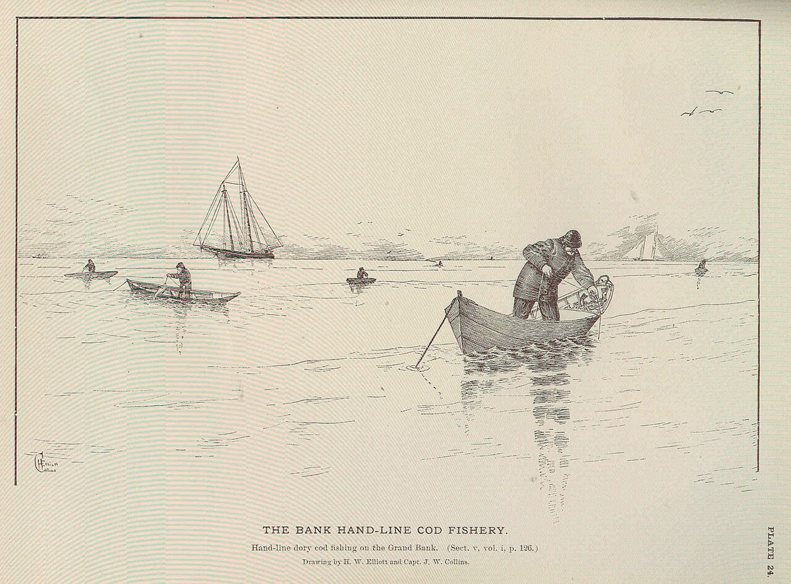
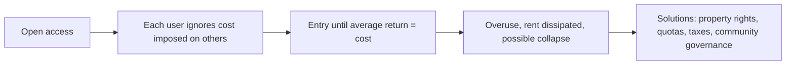

# Common resources

**Prerequisites:** [Public goods](08-public-goods.md), [Negative externalities](03-negative-externalities-and-pollution.md).

*Hand-line dory cod fishing on the Grand Bank of Newfoundland, a common resource that collapsed by the early 1990s. Credit: Henry Wood Elliott / Joseph William Collins. License: Public domain. Source: [File:FMIB 45872 Bank Hand-Line Cod Fishery.jpeg](https://commons.wikimedia.org/wiki/File:FMIB_45872_Bank_Hand-Line_Cod_Fishery.jpeg).*

A **common resource** (or common-pool resource) is rival but non-excludable: anyone can use it, but each use leaves less for others. Ocean fisheries, groundwater, unregulated grazing land, and the atmosphere's capacity to absorb carbon are examples. Such resources tend to be **overused**, a problem made famous by the ecologist Garrett Hardin's 1968 essay "The Tragedy of the Commons" in *Science*.

## The tragedy of the commons

Hardin imagined a pasture open to all herders. Each herder gains the full benefit of adding another animal but bears only a fraction of the cost of the extra grazing, since that cost is shared by everyone. Each herder therefore keeps adding animals until the pasture is ruined. The idea had been anticipated much earlier: Aristotle observed in the *Politics* that "that which is common to the greatest number has the least care bestowed upon it", and the English writer William Forster Lloyd made a similar argument about common pastures in 1833.

The tragedy is a negative externality each user imposes on the others: by taking more, you reduce the yield for everyone else.

## Worked example: a fishing ground

A lake's total daily catch depends on the number of boats (B): total catch = 20B − B² (in fish; beyond 10 boats, crowding actually reduces the total catch). Fish sell for 10 dollars; each boat costs 60 dollars a day to run.

| Boats | Total catch | Catch per boat | Marginal catch |
|---|---|---|---|
| 4 | 64 | 16 | — |
| 5 | 75 | 15 | 11 |
| 6 | 84 | 14 | 9 |
| 7 | 91 | 13 | 7 |
| 8 | 96 | 12 | 5 |
| 14 | 84 | 6 | — |

**Open access.** A new boat enters as long as its own catch per boat, times 10, exceeds 60: so as long as average catch exceeds 6. Average catch is 20 − B, so boats keep entering until B = 14. At 14 boats, total profit is zero: the rent from the fishery is entirely dissipated. (The formula gives total catch 84 at B = 14, the same as at B = 6, but with more than twice the boats.)

**Efficient management.** The lake's owner, or a well-run authority, would add boats only while the **marginal** catch (20 − 2B in the continuous version) is worth more than 60, that is, while 20 − 2B > 6, so B = 7. Total profit = 10 × 91 − 60 × 7 = **490 dollars a day**.

Open access wastes the whole 490 dollars of resource rent, and in a renewable fishery it can also deplete the fish stock below sustainable levels.

## Real cases

- **Atlantic cod.** The cod fishery off Newfoundland, among the richest in the world, collapsed in the early 1990s. Canada imposed a moratorium in 1992, putting about 30,000 people out of work. Stocks have recovered only partially.
- **Groundwater depletion** in regions such as the Ogallala Aquifer in the US Great Plains.
- **Traffic congestion** on unpriced roads is a commons problem: road space is rival when crowded but free to use.
- **Climate change**: the atmosphere's absorptive capacity is a global commons.

## Solutions

1. **Private property rights.** Divide the commons and let owners manage their parts. This works for land but not for mobile resources such as fish or air.
2. **Quotas and individual transferable quotas (ITQs).** Total catch is capped and shares are assigned to fishers, who can trade them. Iceland and New Zealand adopted ITQs in the 1980s; studies such as Costello, Gaines and Lynham (2008) found that ITQ fisheries were much less likely to collapse.
3. **Taxes or fees** per unit of use, like congestion charges.
4. **Government regulation** of seasons, gear and licences.
5. **Community governance.** [Elinor Ostrom](../10-history-of-thought/thinkers/15-elinor-ostrom.md) showed that many communities manage commons successfully for centuries without either privatisation or central control.

## Ostrom's design principles

In *Governing the Commons* (1990), Ostrom studied Swiss alpine meadows, Japanese forests, Spanish irrigation systems (the *huertas* of Valencia) and Philippine *zanjeras*, among others. She found eight design principles that successful long-lived commons tend to share:

1. Clearly defined boundaries (who may use the resource).
2. Rules suited to local conditions.
3. Collective-choice arrangements: users can help change the rules.
4. Monitoring by people accountable to the users.
5. Graduated sanctions for rule-breakers.
6. Cheap, local conflict-resolution mechanisms.
7. Recognition by outside authorities of the community's right to organise.
8. For larger systems, nested layers of governance.

Ostrom became the first woman to win the Nobel prize in economics, in 2009, shared with Oliver Williamson.

## Key ideas

- Common resources are rival and non-excludable, so each user ignores the cost imposed on others.
- Open access leads to overuse until rents are dissipated, and can collapse renewable resources.
- Solutions include property rights, transferable quotas, fees, regulation and community governance.
- Ostrom showed the tragedy is not inevitable: communities often design effective rules.

## Where this leads

- Next: [asymmetric information](10-asymmetric-information.md).
- Related: [Aristotle](../../../philosophy/history/ancient/greek/thinkers/aristotle.md), who anticipated the problem.
- Glossary: [tragedy of the commons](../glossary/tragedy-of-the-commons.md), [common resource](../glossary/common-resource.md), [individual transferable quota](../glossary/individual-transferable-quota.md).
