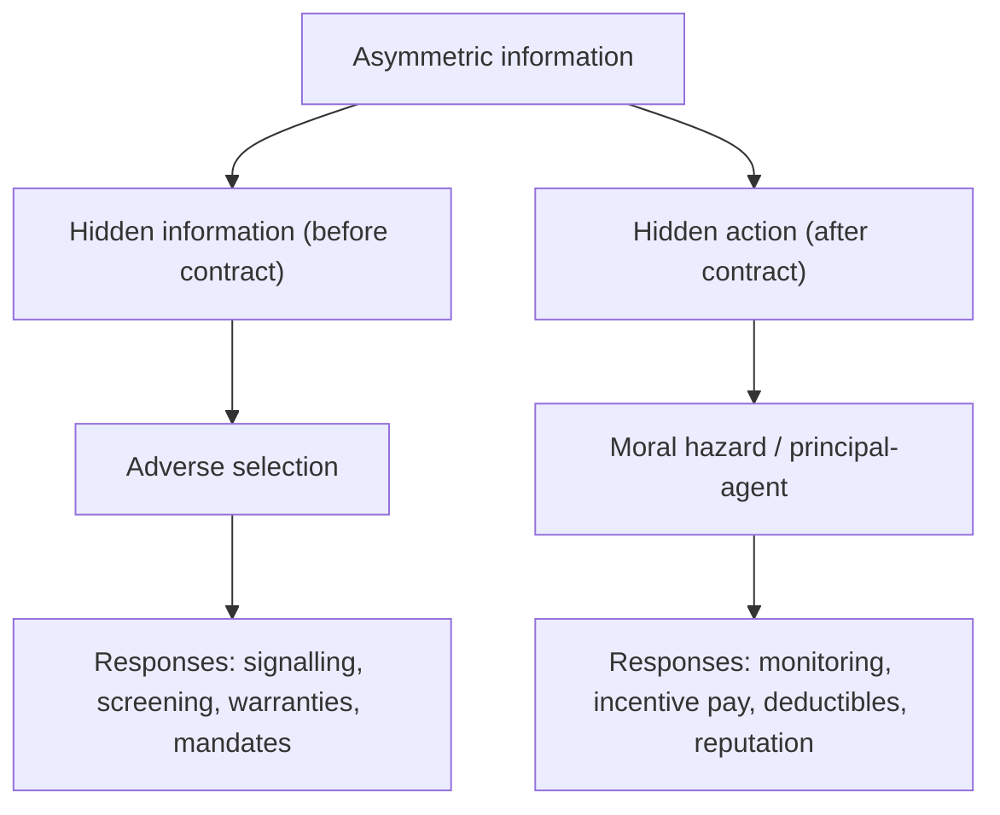

# Asymmetric information

**Prerequisites:** [[what-is-market-failure|What is market failure?]], [[choice-under-uncertainty|Choice under uncertainty]].

*George Akerlof at Berkeley; his 1970 lemons paper launched the economics of asymmetric information. Credit: Yan Chi Vinci Chow. License: [CC BY 3.0](https://creativecommons.org/licenses/by/3.0). Source: [File:George Akerlof.jpg](https://commons.wikimedia.org/wiki/File:George_Akerlof.jpg).*

The competitive model assumes buyers and sellers know what they are trading. Often they do not. The seller of a used car knows its history; the buyer does not. A job applicant knows how hard she works; the employer does not. A person buying health insurance knows more about his own health habits than the insurer. When one side of a transaction knows something relevant that the other does not, there is **asymmetric information**, and markets can work badly or not at all.

The economics of information became a major field in the 1970s. The 2001 Nobel prize went to George Akerlof, Michael Spence and Joseph Stiglitz "for their analyses of markets with asymmetric information".

## Two kinds of problem

| | **Hidden information** (before the deal) | **Hidden action** (after the deal) |
|---|---|---|
| What is hidden | A characteristic: quality, risk type, ability | Behaviour: effort, care, honesty |
| Resulting problem | **Adverse selection** | **Moral hazard** |
| Example | Sick people are more eager to buy health insurance | Insured drivers take less care |
| Lesson | [[adverse-selection|Adverse selection]] | [[moral-hazard|Moral hazard]] |

Closely related is the [[principal-agent-problem|principal–agent problem]], where one party (the agent) acts on behalf of another (the principal) whose interests differ and who cannot fully observe the agent's actions.

## Why it causes market failure

Information asymmetries can destroy mutually beneficial trades. If buyers cannot tell good products from bad, they will pay only for average quality, which drives good products out, as Akerlof showed (see [[adverse-selection|adverse selection]]). If insurers cannot observe care, insurance encourages carelessness, so insurers ration cover. In both cases, trades that would benefit both sides under full information do not happen, a deadweight loss.

## Examples across the economy

- **Used cars, second-hand goods, art.** Sellers know quality better than buyers.
- **Insurance.** Buyers know their risk; insurers know averages.
- **Credit.** Borrowers know more about their projects and intentions than lenders. Stiglitz and Andrew Weiss (1981) showed that banks may ration credit rather than raise interest rates, because higher rates attract riskier borrowers.
- **Labour markets.** Workers know their ability and effort; employers see only credentials and output.
- **Medical care.** Doctors know more than patients about what treatment is needed, which creates possible "supplier-induced demand".
- **Financial markets.** Corporate insiders know more than outside investors, which is one reason for disclosure rules and insider trading laws (see [[path:economics/finance/05-regulation/01-why-markets-are-regulated.md|why markets are regulated]]).

## How markets and governments respond

Markets develop many institutions to bridge information gaps:

- **Reputation and brands.** A firm that sells shoddy goods loses repeat customers. Online ratings extend reputation to strangers.
- **Warranties and guarantees.** A seller confident in quality can promise to fix defects.
- **Signalling.** The informed side takes a costly action that low-quality types would find too costly, such as earning a degree (see [[signalling-and-screening|signalling and screening]]).
- **Screening.** The uninformed side offers a menu of contracts that sorts people by type, such as insurance with different deductibles.
- **Third-party certification.** Inspections, credit ratings, professional licences, organic labels.
- **Intermediaries.** Dealers, who stake their reputation on quality.

Governments also act:

- **Disclosure requirements** (financial statements, nutrition labels).
- **Licensing** of professions.
- **Mandatory insurance** to counter adverse selection.
- **Consumer protection law**, such as "lemon laws" for defective cars.

Each response has costs: licensing can restrict entry and raise prices; disclosure can overwhelm consumers.

## Information and the price system

A different tradition, associated with [[friedrich-hayek|Friedrich Hayek]], emphasises that knowledge is dispersed and that markets are a way of using information no single person has. In "The Use of Knowledge in Society" (1945), Hayek argued that prices summarise local knowledge about scarcity and coordinate behaviour without anyone needing to know the whole picture. Asymmetric information theory and Hayek's view are complementary: one studies when markets fail to transmit information, the other why they transmit it so well in many cases.

## Key ideas

- Asymmetric information exists when one party knows something relevant the other does not.
- Hidden information before a deal causes adverse selection; hidden action after a deal causes moral hazard.
- Information problems can make markets shrink or collapse.
- Reputation, warranties, signalling, screening, certification and regulation all address them.

## Where this leads

- Next: [[adverse-selection|adverse selection]].
- Related: [[path:philosophy/concepts/epistemology/knowledge-and-opinion.md|knowledge and opinion]].
- Glossary: [[g:asymmetric-information|asymmetric information]], [[g:adverse-selection|adverse selection]], [[g:moral-hazard|moral hazard]].
