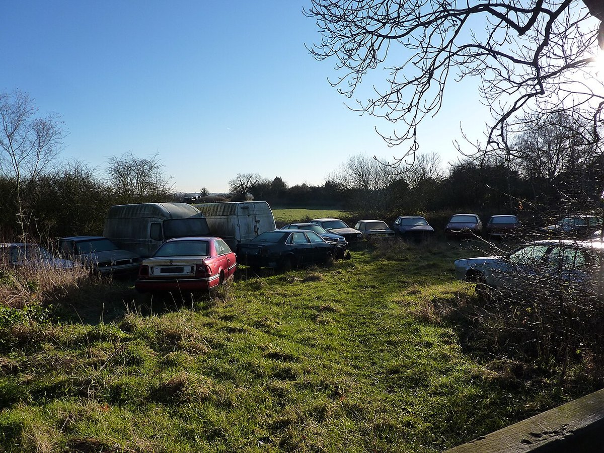
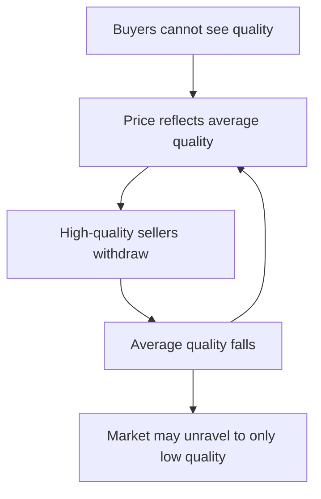

# Adverse selection

**Prerequisites:** [Asymmetric information](10-asymmetric-information.md), [Market equilibrium](../02-supply-and-demand/05-market-equilibrium.md).

*A used-car lot in the UK: the setting of Akerlof's market for lemons. Credit: Peter Barr. License: [CC BY-SA 2.0](https://creativecommons.org/licenses/by-sa/2.0). Source: [File:Used car lot - geograph.org.uk - 3249979.jpg](https://commons.wikimedia.org/wiki/File:Used_car_lot_-_geograph.org.uk_-_3249979.jpg).*

**Adverse selection** happens when hidden information before a transaction means that the people most eager to trade are disproportionately the ones the other side would least like to trade with. The classic analysis is George Akerlof's 1970 paper "The Market for 'Lemons': Quality Uncertainty and the Market Mechanism", which was rejected by several journals before being published in the *Quarterly Journal of Economics*.

## The market for lemons

In American slang, a defective used car is a "lemon"; a good one is sometimes called a "peach" (or "plum"). Akerlof's insight was that if buyers cannot tell them apart, bad cars can drive good ones out of the market.

### Worked example

There are 100 used cars of the same model: 50 peaches and 50 lemons. Sellers know which they have; buyers do not.

| | Value to seller | Value to buyer |
|---|---|---|
| Peach | 8,000 | 10,000 |
| Lemon | 3,000 | 4,000 |

With full information, every car would sell: peaches for between 8,000 and 10,000, lemons for between 3,000 and 4,000. All 100 trades create value.

With asymmetric information, a buyer who thinks any car is equally likely to be either type is willing to pay at most the expected value: 0.5 × 10,000 + 0.5 × 4,000 = **7,000**. But at 7,000, peach owners (who value their cars at 8,000) refuse to sell. Only lemons are offered. Buyers who understand this will pay only 4,000 at most. The market ends up trading **only lemons**. The 50 potential peach trades, each worth at least 2,000 in surplus, are lost.

If peaches were a larger share, say 80 percent, the buyer's expected value would be 0.8 × 10,000 + 0.2 × 4,000 = 8,800, above 8,000, and both types could trade at a single price. Adverse selection does not always destroy a market, but it always threatens it.

## Insurance and the death spiral

Insurance is the most important real-world case. Suppose a health insurer charges everyone the same premium based on average expected claims. People who know they are healthy may find the premium too high and drop out; those who expect large medical bills stay. Average claims rise, so the insurer raises the premium, driving out the next-healthiest group, and so on. This is an **adverse selection death spiral**.

### A numeric illustration

Three equal-sized groups expect annual medical costs of 2,000, 5,000 and 11,000. Suppose each is willing to pay up to 1,000 more than its expected cost for insurance (because people are risk-averse).

1. Premium set at the average for all: (2,000 + 5,000 + 11,000) / 3 = 6,000. The low-cost group values cover at 3,000, so it drops out.
2. New average for the remaining two groups: 8,000. The middle group values cover at 6,000, so it drops out.
3. Only the high-cost group remains, at a premium of 11,000.

Two of the three groups end up uninsured even though each valued insurance above its own expected cost.

## Responses to adverse selection

- **Mandates.** Requiring everyone to buy insurance keeps low-risk people in the pool. Public health insurance (as in Canada's provincial systems) or employer-based group plans, which pool people for reasons unrelated to health, avoid selection. The US Affordable Care Act (2010) combined rules preventing insurers from refusing people with pre-existing conditions with an individual mandate (whose penalty was reduced to zero from 2019) and subsidies.
- **Risk classification.** Insurers charge different premiums based on observable characteristics such as age or driving record. This reduces selection but raises fairness concerns, and is restricted for some characteristics.
- **Signalling and screening.** Sellers of good cars offer warranties; insurers offer menus of deductibles (see [signalling and screening](14-signalling-and-screening.md)).
- **Reputation and intermediaries.** Certified pre-owned programs, dealer reputation, independent inspections, and vehicle history reports reduce the used-car problem.
- **Waiting periods and exclusions.** Some insurance excludes conditions in the first months of cover.

## Other examples

- **Credit markets.** At high interest rates, safe borrowers drop out and risky ones remain, so lenders may ration credit instead of raising rates (Stiglitz and Weiss, 1981).
- **Annuities.** People who expect to live long are more likely to buy annuities, which raises annuity prices.
- **Labour markets.** If a firm cuts wages, its best workers, who have better outside options, may leave first. This is one reason for efficiency wages.
- **Lemons in finance.** Firms that issue new shares may be those whose managers think the shares are overvalued; investors know this and react (Myers and Majluf, 1984). See [capital structure](../../finance/02-firms-and-capital/08-capital-structure-and-cost-of-capital.md).

## Evidence

Empirical work finds adverse selection in some markets and not others. Amy Finkelstein and James Poterba (2004) found evidence of it in UK annuity markets. Pierre-André Chiappori and Bernard Salanié (2000) found little evidence in French car insurance for young drivers. In some markets the opposite, **advantageous selection**, appears: cautious people may buy more insurance and also take fewer risks.

## Key ideas

- Adverse selection arises from hidden characteristics before a trade.
- In the lemons model, buyers pay only for average quality, which can drive good products out.
- Insurance markets can unravel in a death spiral as low-risk customers leave.
- Mandates, risk classification, warranties, screening and reputation are common responses.

## Where this leads

- Next: [moral hazard](12-moral-hazard.md).
- Related: [signalling and screening](14-signalling-and-screening.md).
- Glossary: [adverse selection](../glossary/adverse-selection.md), [market for lemons](../glossary/market-for-lemons.md), [death spiral](../glossary/death-spiral.md).
