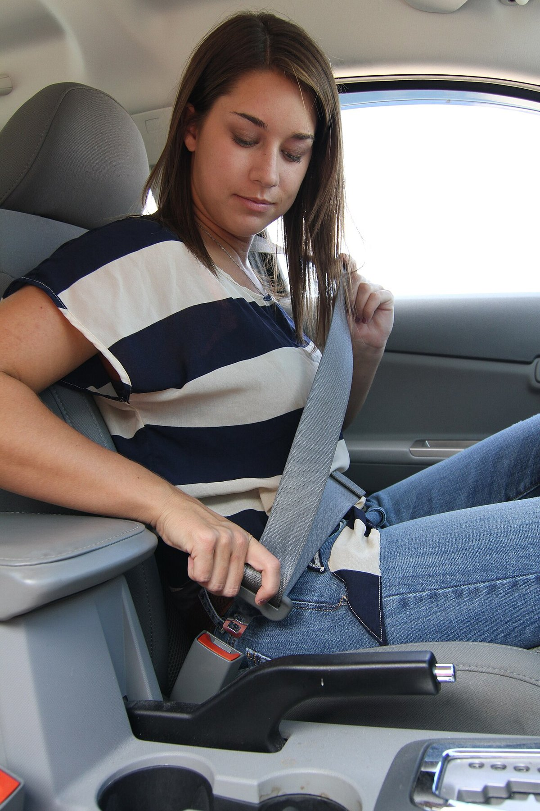
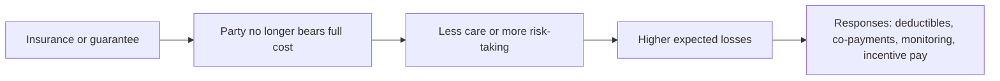

# Moral hazard

**Prerequisites:** [[asymmetric-information|Asymmetric information]], [[incentives|Incentives]].

*Buckling a seat belt; whether safety protection makes people take more risks (risk compensation) is a close cousin of moral hazard. Credit: State Farm. License: [CC BY 2.0](https://creativecommons.org/licenses/by/2.0). Source: [File:Female driver buckling seatbelt.jpg](https://commons.wikimedia.org/wiki/File:Female_driver_buckling_seatbelt.jpg).*

**Moral hazard** arises when one party changes its behaviour after a deal because it no longer bears the full consequences, and the other party cannot fully observe or control that behaviour. The term comes from the insurance industry, where it described the risk that insurance would make policyholders careless. Economists use it without any moral judgement: it is simply a response to incentives under hidden action.

## The basic logic

Insurance protects people from the cost of bad outcomes. But if the costs of an accident are covered, the incentive to avoid it weakens. A driver with comprehensive insurance may park in riskier spots; a homeowner may skip the smoke detector batteries. Because the insurer cannot watch every action, it cannot write a contract that specifies careful behaviour.

### Worked example

A cyclist owns a 1,000-dollar bike. If she locks it carefully (costing her effort worth 30 dollars a year), the chance of theft in a year is 5 percent; if not, 15 percent.

**Without insurance.** Expected loss if careful: 0.05 × 1,000 = 50, plus 30 effort = 80. If careless: 0.15 × 1,000 = 150. She takes care.

**With full insurance.** Theft costs her nothing, so careful costs 30 and careless costs 0. She stops taking care. The theft probability rises to 15 percent, and a fair premium rises from 50 to 150.

If the insurer could observe care, it would offer cover at 50 for careful cyclists, and she would be better off (50 + 30 = 80 < 150). Because care is hidden, the efficient deal is unavailable. Moral hazard has a real cost.

**Partial insurance.** Suppose the policy has a **deductible** of 400 (she pays the first 400 of any loss). Careful: 0.05 × 400 + 30 = 50. Careless: 0.15 × 400 = 60. Taking care is now worth it again. A deductible restores some incentive at the cost of leaving her with some risk.

## Examples beyond insurance

- **Health care.** With insurance, patients may use more care than they would if paying full cost. The RAND Health Insurance Experiment (1974 to 1982) randomly assigned families to plans with different cost-sharing. Families with free care used about 30 percent more services than those with substantial cost-sharing, with little measurable difference in health for the average participant, though some low-income people with particular conditions did benefit.
- **Banking and bailouts.** If banks expect governments to rescue them in a crisis ("too big to fail"), they may take on more risk. Deposit insurance protects savers but can reduce depositors' incentive to monitor banks. Regulators respond with capital requirements and supervision (see [[path:economics/finance/05-regulation/01-why-markets-are-regulated.md|why financial markets are regulated]]).
- **Employment.** Once hired at a fixed wage, workers may shirk. This is a [[principal-agent-problem|principal–agent problem]].
- **Unemployment insurance** may lengthen job searches. Studies find modest effects, and longer search can also produce better job matches.
- **Rental cars.** People are said to treat rental cars less carefully than their own.
- **Limited liability.** Shareholders cannot lose more than they invested, which can encourage firms near bankruptcy to "gamble for resurrection" with creditors' money.

## Responses

| Tool | How it helps | Example |
|---|---|---|
| Deductibles and co-payments | Leave the insured bearing part of the loss | Health and car insurance |
| Monitoring | Make actions observable | Telematics devices in cars; audits |
| Incentive contracts | Tie pay to outcomes | Commissions, bonuses, stock options |
| Experience rating | Raise future premiums after claims | No-claims discounts |
| Collateral | Borrower loses an asset on default | Mortgages |
| Regulation | Limit risky behaviour directly | Bank capital requirements |
| Reputation | Future business depends on behaviour now | Repeated relationships |

Each response trades off **insurance against incentives**: the more risk the insured person bears, the more careful they are, but the less protection they get. Optimal contracts balance the two.

## Moral hazard versus adverse selection

Both stem from asymmetric information, but the timing differs. Adverse selection is about who signs up (hidden type, before the contract); moral hazard is about what people do after signing up (hidden action). In practice, both often occur together, and distinguishing them empirically is difficult.

## Key ideas

- Moral hazard is a change in behaviour after a contract because the actor no longer bears the full cost and cannot be observed.
- It raises expected losses and can make efficient insurance unavailable.
- Deductibles, co-payments, monitoring and incentive pay restore incentives at the cost of less insurance.
- It appears in insurance, health care, banking, employment and corporate finance.

## Where this leads

- Next: [[principal-agent-problem|the principal–agent problem]].
- Related: [[repeated-games-and-strategic-moves|repeated games]] (reputation).
- Glossary: [[g:moral-hazard|moral hazard]], [[g:deductible|deductible]], [[g:too-big-to-fail|too big to fail]].
