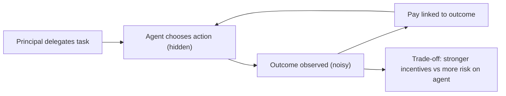

# The principal–agent problem

**Prerequisites:** [[moral-hazard|Moral hazard]], [[the-firm|The firm]].

*A board of directors meeting; boards monitor managers on behalf of shareholders. Credit: Hashoo Foundation USA. License: [CC BY-SA 2.0](https://creativecommons.org/licenses/by-sa/2.0). Source: [File:HF USA first Board of Directors meeting in Houston, December 2007 (15).jpg](https://commons.wikimedia.org/wiki/File:HF_USA_first_Board_of_Directors_meeting_in_Houston,_December_2007_(15).jpg).*

Much economic activity involves one party acting on behalf of another. Shareholders hire managers to run companies; patients rely on doctors; voters elect politicians; homeowners hire real-estate agents. The person who delegates is the **principal**; the person who acts is the **agent**. When their interests differ and the principal cannot perfectly observe what the agent does, the agent may act in its own interest rather than the principal's. This is the **principal–agent problem** (or agency problem).

## Ingredients

An agency problem needs three things:

1. **Delegation**: the agent takes actions that affect the principal.
2. **Conflicting interests**: the agent cares about things the principal does not (effort, perks, career, leisure).
3. **Hidden action or information**: the principal cannot fully observe or verify the agent's actions or knowledge.

If any is missing, the problem disappears. If interests are perfectly aligned, the agent does what the principal wants. If actions are observable, the principal can contract on them directly.

## Separation of ownership and control

Adolf Berle and Gardiner Means, in *The Modern Corporation and Private Property* (1932), observed that large US corporations were owned by thousands of dispersed shareholders but controlled by salaried managers. They worried that managers would pursue growth, prestige and comfort rather than shareholder value. Michael Jensen and William Meckling's 1976 paper "Theory of the Firm: Managerial Behavior, Agency Costs and Ownership Structure" defined **agency costs** as the sum of:

- monitoring costs paid by the principal (audits, boards of directors),
- bonding costs paid by the agent to assure the principal (contracts, reputational commitments), and
- the residual loss from decisions that still diverge from the principal's interest.

See [[path:economics/finance/02-firms-and-capital/02-limited-liability-and-the-corporation.md|limited liability and the corporation]].

## Designing incentives: a worked example

A firm owner hires a salesperson. If the salesperson works hard (personal cost: 400 dollars' worth of effort per month), sales are 20,000 with probability 0.8 and 5,000 with probability 0.2. If she slacks, the probabilities reverse. The firm earns a 25 percent margin on sales. The owner cannot observe effort, only sales. Assume (for simplicity) the salesperson is risk-neutral.

**Expected sales:** hard work 0.8 × 20,000 + 0.2 × 5,000 = 17,000; slacking 0.2 × 20,000 + 0.8 × 5,000 = 8,000.

**Flat salary.** Pay is the same whatever she does, so she slacks. Expected margin = 0.25 × 8,000 = 2,000.

**Commission.** Pay 10 percent of sales. Hard work earns her 0.10 × 17,000 − 400 = 1,300; slacking earns 0.10 × 8,000 = 800. She works hard. The firm's expected margin net of commission = 0.25 × 17,000 − 1,700 = 2,550. Under the flat salary the firm's margin is only 2,000 before it even pays the salary, so commission leaves both sides better off.

Commission aligns incentives. But if the salesperson were risk-averse, a pure commission would expose her to income risk she dislikes, and she would demand higher average pay to accept it. Real contracts balance **incentives against risk sharing**, which is why many sales jobs combine a base salary with a commission. Bengt Holmström and Oliver Hart received the 2016 Nobel prize for work on contract theory, including how to design such contracts.

## Pitfalls of incentive pay

- **Multitasking.** Holmström and Paul Milgrom (1991) showed that if a job has several tasks and only some are measurable, strong incentives on measurable tasks crowd out effort on others. Teachers paid on test scores may "teach to the test".
- **Gaming.** Agents manipulate the measure rather than improve the outcome. Goodhart's law (after economist Charles Goodhart) is often paraphrased: "When a measure becomes a target, it ceases to be a good measure."
- **Short-termism.** Executives paid with stock options may favour short-term share price over long-term value.
- **Crowding out intrinsic motivation.** Some studies suggest monetary incentives can reduce people's internal motivation for tasks they care about (see [[social-preferences-and-fairness|social preferences]]).

## Other examples

| Principal | Agent | Typical conflict |
|---|---|---|
| Shareholders | CEO | Empire-building, perks, risk aversion over firm-specific risk |
| Patient | Doctor | Over- or under-treatment depending on payment system |
| Homeowner | Real-estate agent | Agents may sell quickly rather than hold out for the best price |
| Voters | Politicians | Re-election and interest-group pressure |
| Investors | Fund managers | Fees, herding, risk-taking near year-end |
| Taxpayers | Bureaucrats | Budget maximisation (William Niskanen) |

The real-estate example has empirical support: Steven Levitt and Chad Syverson (2008) found that agents selling their own homes kept them on the market longer and sold them for slightly more than comparable homes they sold for clients.

## Key ideas

- A principal–agent problem arises when an agent with different interests acts for a principal who cannot fully observe the agent.
- Agency costs include monitoring, bonding and residual losses.
- Incentive pay aligns interests but shifts risk to the agent; optimal contracts trade these off.
- Multitasking, gaming and short-termism limit what incentive pay can achieve.

## Where this leads

- Next: [[signalling-and-screening|signalling and screening]].
- Related: [[government-failure|government failure]], where voters and officials are principals and agents.
- Glossary: [[g:principal-agent-problem|principal–agent problem]], [[g:agency-costs|agency costs]], [[g:goodharts-law|Goodhart's law]].
