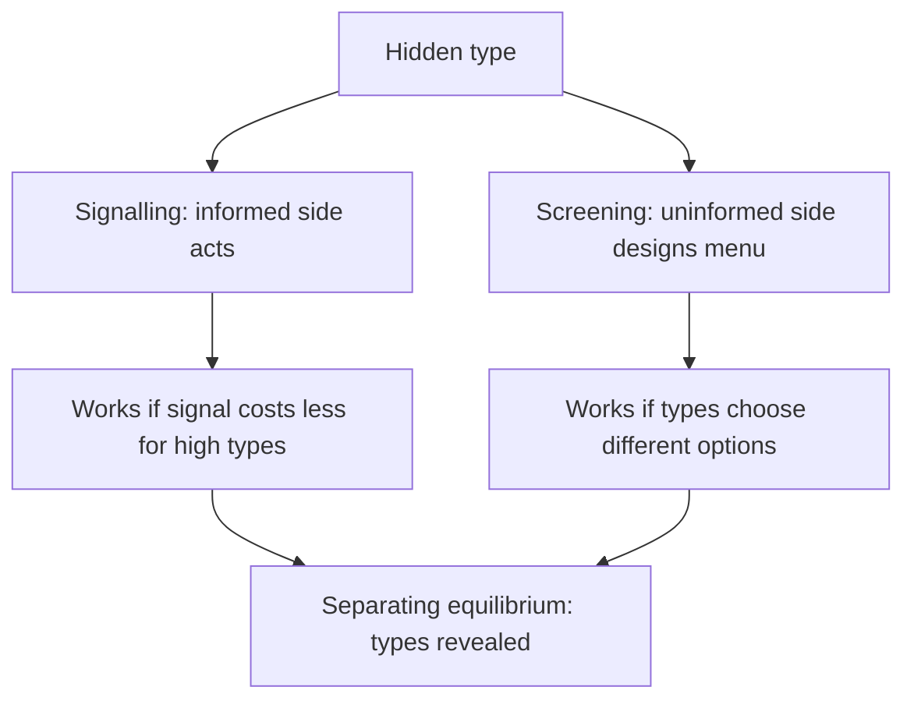

# Signalling and screening

**Prerequisites:** [Adverse selection](11-adverse-selection.md), [Human capital](../06-factor-markets/05-human-capital.md).

*Michael Spence, who developed the theory of job-market signalling and shared the 2001 Nobel prize. Credit: Robert Scoble from Half Moon Bay, USA. License: [CC BY 2.0](https://creativecommons.org/licenses/by/2.0). Source: [File:A Michael Spence.jpg](https://commons.wikimedia.org/wiki/File:A_Michael_Spence.jpg).*

When one side of a market knows something the other does not, both sides have reasons to close the gap. The informed side may **signal**: take a costly, observable action that reveals its hidden type. The uninformed side may **screen**: design choices that lead people to sort themselves by type. Michael Spence developed signalling theory in "Job Market Signaling" (1973); Michael Rothschild and Joseph Stiglitz analysed screening in insurance (1976).

## Signalling

A signal works only if it is **cheaper for high-quality types to send than for low-quality types**. Otherwise everyone would send it and it would reveal nothing. Talk is cheap: anyone can claim to be a hard worker. A signal must be costly in a way that differs by type.

### Spence's education model: worked example

Two types of workers exist in equal numbers. High-ability workers produce 100 (thousand dollars over a career); low-ability workers produce 60. Employers cannot tell them apart directly. Suppose (in Spence's stark version) education adds nothing to productivity, but it is less costly for high-ability people, who find study easier:

| | Cost of a degree |
|---|---|
| High ability | 20 |
| Low ability | 50 |

Suppose employers pay 100 to degree holders and 60 to others.

- A high-ability worker gains 100 − 20 = 80 with a degree versus 60 without. **Gets the degree.**
- A low-ability worker gains 100 − 50 = 50 with a degree versus 60 without. **Does not.**

The degree perfectly separates the types: a **separating equilibrium**. Employers' beliefs (degree means high ability) are confirmed. Notice two things:

1. The signal works even if education teaches nothing useful.
2. Society spends 20 per high-ability worker on a signal that only redistributes wages; it creates no output. Signalling can be **socially wasteful**, although it does improve the matching of workers to jobs.

If the cost for low-ability workers fell to 30, they would get degrees too (100 − 30 = 70 > 60), the signal would fail, and a **pooling equilibrium** could result.

### How much of education is signalling?

This is debated. Human capital theory ([human capital](../06-factor-markets/05-human-capital.md)) says education raises productivity. Signalling theory says it partly certifies traits people already had. Evidence for some signalling includes the "sheepskin effect", where earnings jump at degree completion more than for each additional year of study. Evidence for human capital includes natural experiments, such as changes in compulsory schooling laws, that raise earnings. Most economists believe both matter; Bryan Caplan's *The Case against Education* (2018) argues that signalling dominates, a minority view that has been widely discussed and contested.

## Other signals

- **Warranties.** A seller of reliable products can offer a long warranty cheaply; a seller of unreliable products cannot.
- **Advertising.** Heavy advertising by a new product may signal confidence that customers will return (Phillip Nelson, 1974; Paul Milgrom and John Roberts, 1986).
- **Dividends.** Paying steady dividends can signal that a firm's cash flows are solid.
- **Costly displays in nature.** The biologist Amotz Zahavi's "handicap principle" proposes that the peacock's tail is a reliable signal of fitness precisely because it is costly to maintain.
- **Conspicuous consumption** (Thorstein Veblen, *The Theory of the Leisure Class*, 1899).

## Screening

In screening, the uninformed party moves first. The classic case is insurance. An insurer cannot tell high-risk from low-risk customers, so it offers a menu:

| Plan | Premium | Deductible |
|---|---|---|
| A: full cover | High | 0 |
| B: partial cover | Low | High |

High-risk customers, who expect to claim often, prefer full cover even at a high price. Low-risk customers prefer to save on the premium and accept a high deductible, since they rarely claim. Customers reveal their type through their choice. Rothschild and Stiglitz showed that, in equilibrium, low-risk people end up **under-insured**, the cost of making the contracts unattractive to high-risk types.

Other screening devices:

- **Airline fares**: cheap tickets that require a Saturday-night stay screen out business travellers, a form of [price discrimination](../05-market-structures/06-price-discrimination.md).
- **Job probation periods and deferred pay**: only workers who expect to stay and perform well accept them.
- **Credit applications** asking for collateral.

## Key ideas

- Signalling: the informed side takes an action that is costly in a way that differs by type.
- A signal works only if it is cheaper for high types; it can be socially wasteful.
- Screening: the uninformed side offers a menu so that people sort themselves.
- Education, warranties, advertising and insurance deductibles are central examples.

## Where this leads

- Next: [government failure](15-government-failure.md).
- Related: [price discrimination](../05-market-structures/06-price-discrimination.md), [human capital](../06-factor-markets/05-human-capital.md).
- Glossary: [signalling](../glossary/signalling.md), [screening](../glossary/screening.md), [separating equilibrium](../glossary/separating-equilibrium.md), [pooling equilibrium](../glossary/pooling-equilibrium.md).
