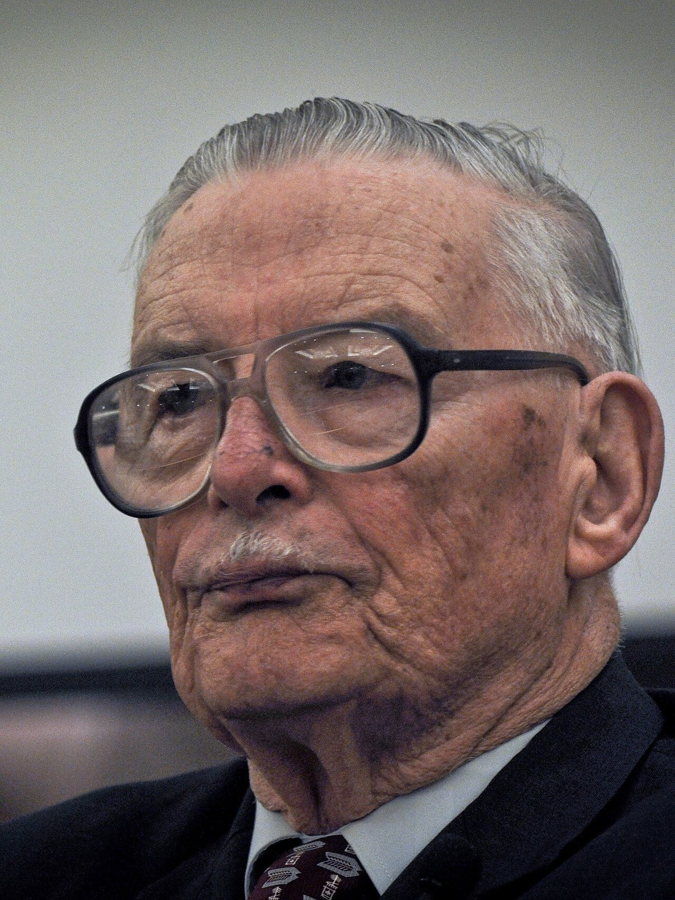
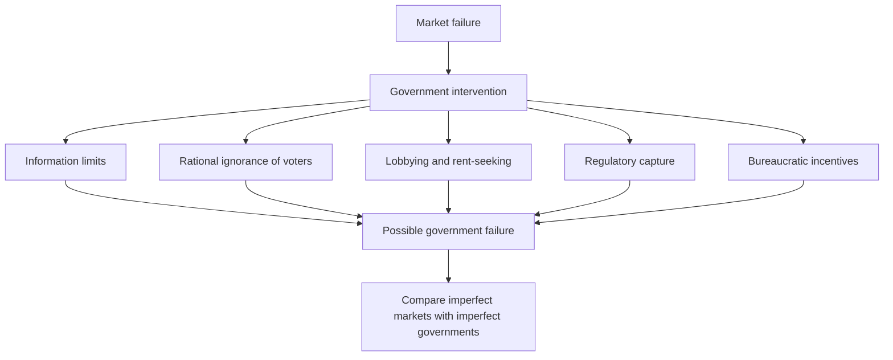

# Government failure

**Prerequisites:** [[what-is-market-failure|What is market failure?]], [[principal-agent-problem|The principal–agent problem]].

*James M. Buchanan, a founder of public choice theory and winner of the 1986 Nobel prize in economics. Credit: Atlas Network Official website. License: [CC BY-SA 3.0](https://creativecommons.org/licenses/by-sa/3.0). Source: [File:James Buchanan by Atlas network.jpg](https://commons.wikimedia.org/wiki/File:James_Buchanan_by_Atlas_network.jpg).*

Market failures create a potential case for government action. But governments are made of people with their own information limits and incentives. **Government failure** occurs when government intervention produces a less efficient outcome than the market would have, or fails to correct a market failure at reasonable cost. The study of how political decisions are made using economic tools is called **public choice theory**, associated with James Buchanan (Nobel prize 1986) and Gordon Tullock, whose *The Calculus of Consent* (1962) is a founding text.

## Sources of government failure

### 1. Information problems

To set an ideal Pigouvian tax, regulators must know marginal damage; to regulate a natural monopoly, they must know its costs. Often they do not. [[friedrich-hayek|Hayek]] argued that central planners could never gather the dispersed, local and often tacit knowledge that prices summarise ("The Use of Knowledge in Society", 1945). This was a key argument in the socialist calculation debate with economists such as Oskar Lange in the 1930s and 1940s.

### 2. Rational ignorance and voting

For an individual voter, the chance of deciding an election is tiny, so the benefit of becoming well informed about policy is small compared with the cost. Anthony Downs (*An Economic Theory of Democracy*, 1957) called this **rational ignorance**. Voters may therefore not notice policies with diffuse costs.

### 3. Concentrated benefits, diffuse costs

Mancur Olson's *The Logic of Collective Action* (1965) showed that small groups with a lot at stake organise more easily than large groups with a little at stake each. A tariff on sugar may cost each consumer a few dollars a year, too little to bother fighting, while raising each sugar producer's income substantially. Producers lobby; consumers do not. Policy tilts toward organised interests.

### 4. Rent-seeking

**Rent-seeking** is spending resources to obtain a transfer of existing wealth rather than to create new wealth: lobbying for tariffs, licences, subsidies or protection from competition. Tullock (1967) and Anne Krueger (1974, who coined the term) argued that resources spent competing for these rents are a social cost on top of the usual deadweight loss. If firms compete for a monopoly worth 10 million, they may spend up to that amount lobbying, dissipating much of the monopoly profit (see [[g:rent-seeking|rent-seeking]]).

### 5. Regulatory capture

George Stigler's "The Theory of Economic Regulation" (1971) argued that regulatory agencies tend to be "captured" by the industries they regulate, because those industries care most about regulation and have the most expertise. Regulators may also hope for future industry jobs (the "revolving door"). See [[natural-monopoly-and-regulation|natural monopoly and regulation]].

### 6. Bureaucratic incentives

William Niskanen (1971) modelled bureaucrats as maximising their budgets, since budget size brings staff, status and influence, leading to oversupply of government output. Bureaucracies also lack the profit signal that tells firms when to expand or shut down.

### 7. Short time horizons

Elected politicians face elections every few years, which can favour policies with visible short-term benefits and hidden long-term costs, such as underfunded pensions or deferred infrastructure maintenance.

### 8. Unintended consequences

Policies change incentives in ways designers did not foresee. [[price-ceilings|Rent control]] can reduce housing supply; fuel-economy standards may encourage more driving (the rebound effect).

## A worked illustration: lobbying for a quota

An industry of 10 firms gains 50 million dollars a year in extra profit from an import quota. The quota costs 30 million consumers an average of 2.50 dollars each, a total of 75 million. The deadweight loss is the 25 million difference. Each firm gains 5 million and would happily spend hundreds of thousands lobbying. Each consumer loses 2.50 and would not spend an hour opposing it. If firms collectively spend 20 million on lobbying, the total social cost rises from 25 million (deadweight loss) to 45 million.

## Balancing the two kinds of failure

The point of government-failure analysis is not that government action is always worse, but that the choice is between **imperfect alternatives**. As Coase and Demsetz argued, one should compare actual markets with actual governments, not with an ideal. Many interventions have clearly improved welfare: the elimination of leaded petrol, the Montreal Protocol on ozone-depleting substances, and public health measures such as sanitation and vaccination. Others have failed or been captured. Careful empirical evaluation, [[cost-benefit-analysis|cost-benefit analysis]], sunset clauses, transparency and independent agencies are among the tools used to reduce government failure.

Economists across the spectrum accept both market and government failures; they disagree about which is more common in particular areas, and therefore about the right scope for government.

## Key ideas

- Government failure occurs when intervention makes outcomes worse or corrects failures at excessive cost.
- Sources include information limits, rational ignorance, concentrated interests, rent-seeking, regulatory capture and bureaucratic incentives.
- Public choice theory applies economic reasoning to political behaviour.
- The right comparison is between imperfect markets and imperfect governments.

## Where this leads

- Next section: [[efficiency-and-pareto-optimality|efficiency and Pareto optimality]].
- Related: [[social-choice-and-arrows-theorem|social choice and Arrow's theorem]].
- Related branch: philosophy's [[path:philosophy/concepts/political/the-polis-and-political-animal.md|the polis and the political animal]].
- Glossary: [[g:government-failure|government failure]], [[g:public-choice-theory|public choice theory]], [[g:rational-ignorance|rational ignorance]], [[g:regulatory-capture|regulatory capture]].
