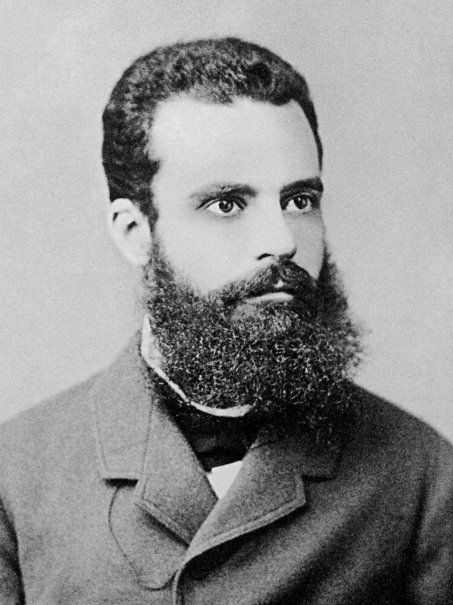

# Efficiency and Pareto optimality

**Prerequisites:** [Total surplus](../02-supply-and-demand/10-producer-surplus-and-total-surplus.md), [Gains from trade](../01-foundations/08-gains-from-trade.md), [Preferences and utility](../03-consumer-theory/01-preferences-and-utility.md).

*Vilfredo Pareto in the 1870s; his name is attached to the central efficiency standard in welfare economics. Credit: Unknown author. License: Public domain. Source: [File:Vilfredo Pareto 1870s2.jpg](https://commons.wikimedia.org/wiki/File:Vilfredo_Pareto_1870s2.jpg).*

**Welfare economics** is the branch of economics that evaluates outcomes: is one allocation of resources better than another? To answer, economists need a standard. The most widely used is **Pareto efficiency**, named after the Italian economist [Vilfredo Pareto](../10-history-of-thought/thinkers/09-vilfredo-pareto.md), who developed it in his *Manual of Political Economy* (1906).

## Definitions

- A change is a **Pareto improvement** if it makes at least one person better off and nobody worse off.
- An allocation is **Pareto efficient** (or Pareto optimal) if no Pareto improvement is possible: the only way to make someone better off is to make someone else worse off.

The appeal of the Pareto criterion is that it relies on minimal value judgements. Almost everyone accepts that if a change helps some people and harms nobody, it is good. It does not require comparing one person's happiness with another's.

## A simple example

Two people, Ali and Bea, share 10 apples and 10 oranges. Ali likes apples more; Bea likes oranges more.

| Allocation | Ali | Bea | Pareto efficient? |
|---|---|---|---|
| A | 5 apples, 5 oranges | 5 apples, 5 oranges | No: Ali would trade oranges for Bea's apples; both gain |
| B | 8 apples, 2 oranges | 2 apples, 8 oranges | Plausibly yes, depending on preferences |
| C | 10 apples, 10 oranges | nothing | **Yes**: any change makes Ali worse off |

Allocation C shows the key limitation. Giving everything to one person is Pareto efficient, because taking anything from Ali makes him worse off. **Pareto efficiency says nothing about fairness.** There are typically infinitely many efficient allocations, ranging from very equal to very unequal.

## The three efficiency conditions

In an economy with many goods, people and firms, Pareto efficiency requires three conditions:

1. **Efficiency in exchange (consumption).** Goods are distributed so that no further trade benefits both parties. Every consumer's [marginal rate of substitution](../03-consumer-theory/04-marginal-rate-of-substitution.md) between any two goods is equal.
2. **Efficiency in production.** Inputs are allocated so that more of one good cannot be produced without less of another. Every producer's marginal rate of technical substitution between inputs is equal. The economy is on its [production possibilities frontier](../01-foundations/09-production-possibilities-frontier.md).
3. **Product-mix efficiency (allocative efficiency).** The economy produces the right combination of goods: the rate at which consumers are willing to trade goods (MRS) equals the rate at which the economy can transform one into the other (the marginal rate of transformation, the slope of the PPF).

In a competitive market, all three hold because every consumer and producer faces the same prices (see [the welfare theorems](03-the-welfare-theorems.md)).

## The Edgeworth box

The **Edgeworth box**, named after Francis Ysidro Edgeworth (*Mathematical Psychics*, 1881) and refined by Pareto, shows exchange efficiency for two people and two goods. The box's width is the total of one good and its height the total of the other; Ali's origin is the bottom-left corner and Bea's the top-right. Every point in the box is an allocation. Points where their indifference curves are tangent (equal MRS) are Pareto efficient; joining them gives the **contract curve**. From any starting point off the curve, trade can move both people onto the part of the curve they both prefer.

### Numeric illustration

At allocation A above, suppose Ali would give up 2 oranges for 1 more apple (his MRS is 2 oranges per apple), and Bea would give up an apple for just 0.5 oranges (her MRS is 0.5). If Ali gives Bea 1 orange for 1 apple, Ali gains (he would have paid up to 2) and Bea gains (she would have accepted as little as 0.5). Trades continue until their MRS are equal.

## Beyond Pareto: the Kaldor–Hicks criterion

Most real policies help some people and harm others: a new highway benefits commuters and harms people whose homes are demolished. The Pareto criterion cannot rank these. Nicholas Kaldor and John Hicks (1939) proposed a weaker test: a change is an improvement if **the winners gain enough that they could compensate the losers** and still be better off, whether or not compensation is actually paid. This is the logic behind maximising total surplus and behind [cost-benefit analysis](06-cost-benefit-analysis.md).

The Kaldor–Hicks test is controversial because compensation is hypothetical: the losers really do lose. It also implicitly weights a dollar equally for everyone, rich or poor.

## Efficiency is not the only value

Economists often focus on efficiency because it is relatively uncontroversial and measurable, but welfare economics also studies equity, freedom and other values (see [efficiency versus equity](04-efficiency-versus-equity.md)). Amartya Sen argued in *Collective Choice and Social Welfare* (1970) that a society can be Pareto optimal while some people are starving and others live in luxury.

## Key ideas

- A Pareto improvement makes someone better off without making anyone worse off; an efficient allocation allows no such improvement.
- Efficiency requires efficient exchange, production and product mix.
- The Edgeworth box and contract curve show efficient exchange.
- Pareto efficiency is silent about distribution; Kaldor–Hicks extends it through hypothetical compensation.

## Where this leads

- Next: [general equilibrium](02-general-equilibrium.md).
- Related: [Vilfredo Pareto](../10-history-of-thought/thinkers/09-vilfredo-pareto.md).
- Glossary: [Pareto efficiency](../glossary/pareto-efficiency.md), [Pareto improvement](../glossary/pareto-improvement.md), [Edgeworth box](../glossary/edgeworth-box.md), [Kaldor–Hicks efficiency](../glossary/kaldor-hicks-efficiency.md), [contract curve](../glossary/contract-curve.md).
