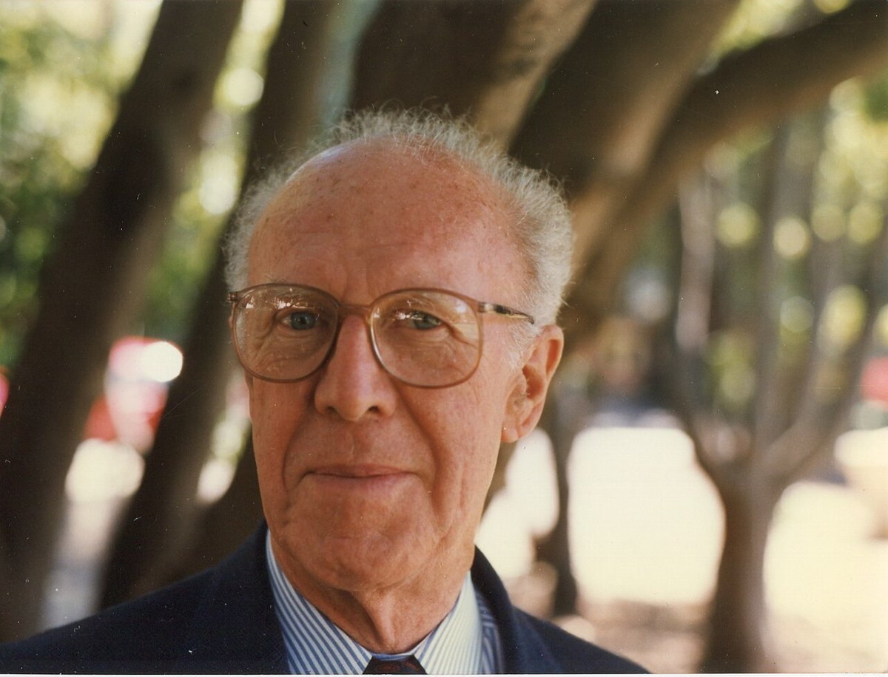
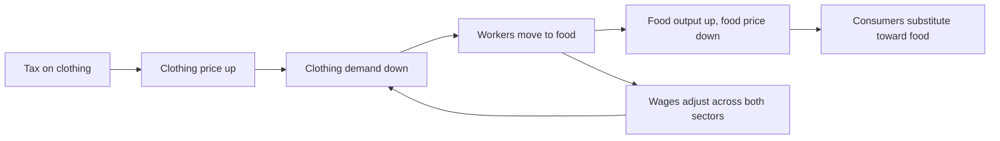

# General equilibrium

**Prerequisites:** [Market equilibrium](../02-supply-and-demand/05-market-equilibrium.md), [Efficiency and Pareto optimality](01-efficiency-and-pareto-optimality.md).

*Gérard Debreu at Berkeley; with Kenneth Arrow he proved in 1954 that a competitive general equilibrium exists. Credit: George Bergman. License: [CC BY-SA 4.0](https://creativecommons.org/licenses/by-sa/4.0). Source: [File:Gerard Debreu 1997.jpg](https://commons.wikimedia.org/wiki/File:Gerard_Debreu_1997.jpg).*

Most of this course has used **partial equilibrium** analysis: we studied one market at a time, holding prices in other markets constant. This is a powerful simplification, but markets are connected. A rise in the price of oil affects the demand for cars, the wages of auto workers, the price of bicycles, and the incomes of oil-producing regions, which in turn affect demand for everything else. **General equilibrium** analysis studies all markets simultaneously.

## Walras and the idea of a whole economy

[Léon Walras](../10-history-of-thought/thinkers/07-leon-walras.md), in *Elements of Pure Economics* (1874), was the first to describe an economy as a system of simultaneous equations: supply equals demand in every market at once, with all prices determined together. A **general equilibrium** is a set of prices at which every market clears.

**Walras's law** states that the total value of excess demand across all markets is zero. If people spend all their income, and every market but one is in equilibrium, the last market must be in equilibrium too. A consequence is that only **relative prices** are determined; one good can be chosen as the **numéraire**, with price set to 1.

## A two-sector example

Consider an economy with two goods, food and clothing, produced by labour. Suppose the government taxes clothing.

**Partial equilibrium view.** Clothing prices rise, clothing sales fall, and there is a deadweight loss in the clothing market.

**General equilibrium view.** As clothing demand falls, clothing firms lay off workers, who move to food production. Food output rises and food prices fall. Wages may change. Consumers spend more on food. The total effects of the tax, and who ultimately bears it, depend on all these adjustments. Arnold Harberger's 1962 model of the corporate income tax showed, for example, that a tax on capital in one sector can end up borne partly by capital in all sectors.

## Exchange equilibrium: a worked example

Two people, Ali and Bea, trade apples (A) and oranges (O). Each has Cobb–Douglas preferences and spends half of their wealth on each good (utility U = A^0.5 × O^0.5). Ali starts with 10 apples and 0 oranges; Bea with 0 apples and 10 oranges. Set the price of apples to 1 (numéraire) and let p be the price of oranges.

- Ali's wealth = 10. He spends half on each good: demands 5 apples and 5/p oranges.
- Bea's wealth = 10p. She demands 5p apples and 5 oranges.

Apple market clears when total demand equals supply: 5 + 5p = 10, so **p = 1**. At this price, Ali ends with 5 apples and 5 oranges; Bea with 5 apples and 5 oranges. The orange market also clears (5 + 5 = 10), as Walras's law guarantees. Both are better off than at the start: initially each had zero of one good, giving utility 0; now each has utility 5.

If Ali had started with 15 apples and Bea had 10 oranges, apple demand 7.5 + 5p would have to equal 15, giving p = 1.5: oranges are scarcer relative to apples, so they cost more.

## Does an equilibrium exist?

Walras counted equations and unknowns but could not prove that a solution with non-negative prices exists. The proof came in 1954, when [Kenneth Arrow](../10-history-of-thought/thinkers/13-kenneth-arrow.md) and Gérard Debreu published "Existence of an Equilibrium for a Competitive Economy" using fixed-point theorems from mathematics. Lionel McKenzie proved a similar result independently. The **Arrow–Debreu model** requires assumptions including convex preferences and technologies, no increasing returns, and markets for every good in every possible future state of the world.

Other questions turned out to be harder:

- **Uniqueness.** There may be more than one equilibrium.
- **Stability.** Will prices actually move toward equilibrium? Walras imagined an auctioneer adjusting prices (*tâtonnement*, "groping"). Herbert Scarf (1960) found examples where this process cycles without converging.
- **The Sonnenschein–Mantel–Debreu results** (1972 to 1974) showed that aggregate excess demand functions can have almost any shape, so individual rationality places few restrictions on market-level behaviour.

## Uses of general equilibrium

- **The welfare theorems**, which connect competitive equilibrium to Pareto efficiency (see [the welfare theorems](03-the-welfare-theorems.md)).
- **Computable general equilibrium (CGE) models**, numerical models of whole economies used to analyse trade agreements, tax reforms and carbon taxes.
- **Macroeconomics.** Modern macroeconomic models (dynamic stochastic general equilibrium, DSGE) are built on general equilibrium foundations.
- **Finance.** Arrow–Debreu securities, which pay off in one state of the world, are the theoretical building blocks of asset pricing (see [risk and return](../../finance/01-foundations/10-risk-and-return.md)).

## Key ideas

- Partial equilibrium studies one market; general equilibrium studies all markets at once.
- A general equilibrium is a set of relative prices that clears every market; Walras's law links the markets.
- Arrow and Debreu proved existence in 1954 under strong assumptions; uniqueness and stability are not guaranteed.
- General equilibrium underlies welfare theorems, CGE models and modern macroeconomics.

## Where this leads

- Next: [the welfare theorems](03-the-welfare-theorems.md).
- Related: [Léon Walras](../10-history-of-thought/thinkers/07-leon-walras.md), [Kenneth Arrow](../10-history-of-thought/thinkers/13-kenneth-arrow.md).
- Glossary: [general equilibrium](../glossary/general-equilibrium.md), [partial equilibrium](../glossary/partial-equilibrium.md), [Walras's law](../glossary/walras-law.md), [numéraire](../glossary/numeraire.md).
