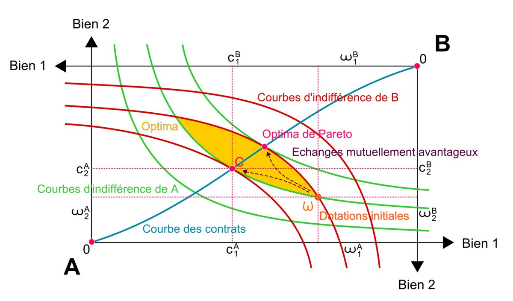
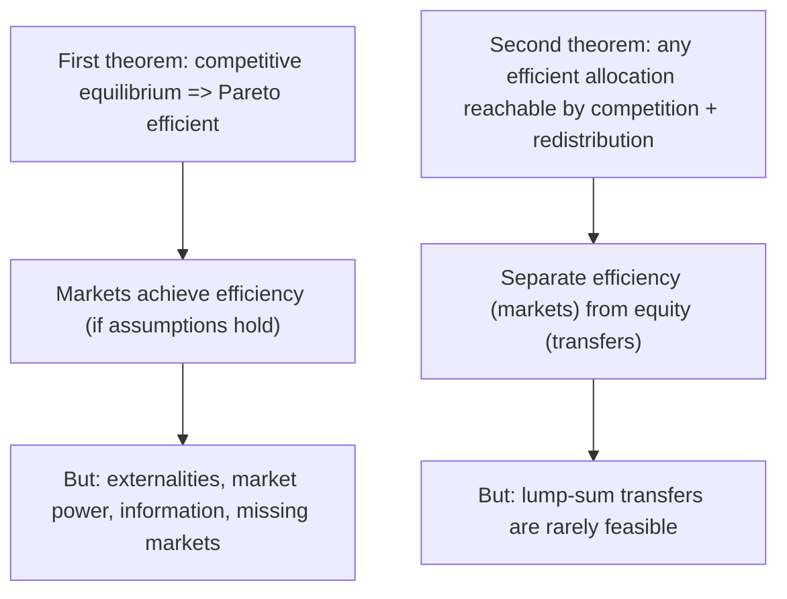

# The welfare theorems

**Prerequisites:** [[general-equilibrium|General equilibrium]], [[efficiency-and-pareto-optimality|Efficiency and Pareto optimality]].

*An Edgeworth box illustrating the first welfare theorem: trade from the starting endowment leads to a Pareto-optimal point on the contract curve. Credit: Cyrflo2000. License: [CC BY-SA 3.0](https://creativecommons.org/licenses/by-sa/3.0). Source: [File:Edgeworth box.png](https://commons.wikimedia.org/wiki/File:Edgeworth_box.png).*

Adam Smith wrote in 1776 that an individual pursuing his own gain is "led by an invisible hand to promote an end which was no part of his intention". For nearly two centuries this was an insight, not a theorem. The **fundamental theorems of welfare economics**, proved rigorously in the 1950s by [[kenneth-arrow|Kenneth Arrow]], Gérard Debreu and others, state precisely when competitive markets produce efficient outcomes, and what this does and does not imply.

## The first welfare theorem

**Every competitive equilibrium is Pareto efficient**, provided that:

- markets exist for all goods (including future and contingent goods),
- all agents are price-takers,
- there are no externalities or public goods,
- information is complete (no asymmetric information), and
- preferences are locally non-satiated (people always want a little more of something).

### Why it works

In a competitive equilibrium, every consumer chooses a bundle where their marginal rate of substitution between two goods equals the price ratio. Every firm produces where its marginal rate of transformation equals the same price ratio. Since everyone faces the **same prices**, everyone's MRS is equal (efficient exchange), every firm's marginal rate of technical substitution is equal (efficient production), and MRS equals the marginal rate of transformation (efficient product mix). All three conditions from [[efficiency-and-pareto-optimality|the previous lesson]] hold.

A more intuitive argument: suppose a different allocation made someone better off and no one worse off. The person made better off must be consuming a bundle she could not afford at equilibrium prices (otherwise she would already have chosen it), and everyone else needs bundles costing at least as much as before. So the alternative would cost more in total than the economy's total value, which is impossible for an allocation the economy can actually produce.

### A worked check

Return to the coffee market (Qd = 1100 − 200P, Qs = −100 + 200P). At the competitive equilibrium (P = 3, Q = 500), the last buyer values coffee at 3 and the last seller's marginal cost is 3. Producing a 501st unit would cost about 3.005 and be valued at about 2.995, a loss. Producing only 499 would forgo a unit worth about 3.005 to a buyer that costs about 2.995: a missed gain. Total surplus (1,250) is maximised at 500. This partial-equilibrium result is the one-market version of the first theorem.

## The second welfare theorem

**Any Pareto-efficient allocation can be achieved as a competitive equilibrium**, given a suitable redistribution of initial endowments (wealth), under additional assumptions, notably **convex** preferences and production sets.

The significance: if society wants a more equal efficient outcome, it does not need to abandon markets or control prices. It can redistribute **lump-sum** (transfers that do not depend on behaviour) and then let markets operate. In principle, **efficiency and equity can be separated**: markets for efficiency, transfers for equity.

## What the theorems do not say

The welfare theorems are often misread. Important caveats:

1. **Efficiency is not fairness.** A competitive equilibrium is efficient given the initial distribution of wealth, however unequal.
2. **The assumptions often fail.** Externalities, public goods, market power and asymmetric information are common, which is why the theorems are also a map of [[what-is-market-failure|market failure]]. Each assumption corresponds to a reason markets can fail.
3. **Lump-sum transfers are impractical.** Real taxes depend on income or spending, which people can change, so they distort behaviour and create [[deadweight-loss|deadweight loss]]. The clean separation of efficiency and equity is an idealisation. This is why redistribution usually involves trade-offs (see [[efficiency-versus-equity|efficiency versus equity]]).
4. **Missing markets.** The theorems require markets for every good in every future contingency, which do not exist. Bruce Greenwald and Joseph Stiglitz (1986) showed that with imperfect information or incomplete markets, competitive equilibria are generally not even "constrained" efficient: government interventions could, in principle, improve on them.
5. **The theory of the second best.** Richard Lipsey and Kelvin Lancaster (1956) showed that if one efficiency condition cannot be satisfied, satisfying the others is not necessarily desirable. Removing one distortion when others remain may make things worse.

## Interpretations

Different economists draw different lessons. Some see the first theorem as a strong argument for markets: under idealised conditions, decentralised self-interested behaviour produces efficiency without central planning. Others, such as Stiglitz, emphasise that the conditions are so demanding that the theorems mainly show how much can go wrong. Hayek and the Austrian school argued that the equilibrium framework itself misses what markets actually do: discover and coordinate dispersed knowledge in a world that is never in equilibrium.

## Key ideas

- First theorem: competitive equilibria are Pareto efficient under conditions including no externalities, complete markets and full information.
- Second theorem: with convexity, any efficient allocation can be reached by redistributing endowments and letting markets work.
- Each assumption marks a potential source of market failure.
- Lump-sum transfers are rarely possible, so efficiency and equity usually conflict in practice; second-best problems complicate policy.

## Where this leads

- Next: [[efficiency-versus-equity|efficiency versus equity]].
- Related: [[adam-smith|Adam Smith]], [[kenneth-arrow|Kenneth Arrow]].
- Glossary: [[g:first-welfare-theorem|first welfare theorem]], [[g:second-welfare-theorem|second welfare theorem]], [[g:lump-sum-tax|lump-sum tax]], [[g:theory-of-the-second-best|theory of the second best]].
