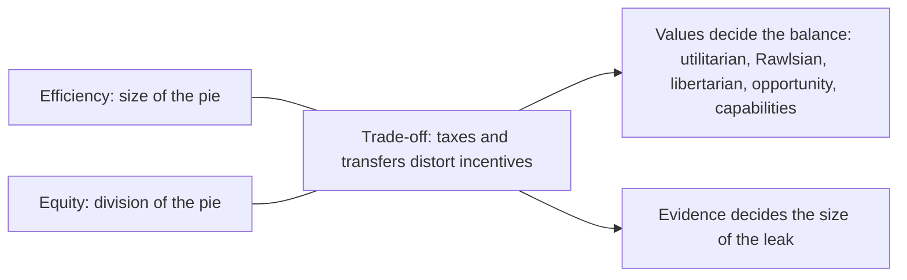

# Efficiency versus equity

**Prerequisites:** [[the-welfare-theorems|The welfare theorems]], [[income-inequality|Income inequality]].

*John Rawls in 1971, the year A Theory of Justice was published. Credit: Published by the Belknap Press of Harvard University Press. Photograph taken by Alec Rawls, John's son. The portrait was uncredited on the o. License: Public domain. Source: [File:John Rawls (1971 photo portrait).jpg](https://commons.wikimedia.org/wiki/File:John_Rawls_(1971_photo_portrait).jpg).*

Efficiency asks whether the economic pie is as large as it can be. **Equity** asks whether it is divided fairly. Markets can deliver efficiency under the right conditions, but they distribute income according to what people own and what their skills fetch, which may not match anyone's idea of fairness. Most policy debates involve both concerns, and often a trade-off between them.

## Why there is often a trade-off

The [[the-welfare-theorems|second welfare theorem]] suggests that society could redistribute with lump-sum transfers without any loss of efficiency. In practice, governments must tax things people can change: income, spending, wealth. Taxes on these reduce the reward for working, saving or investing, which creates [[deadweight-loss|deadweight loss]]. Means-tested benefits that shrink as income rises create similar disincentives.

Arthur Okun described redistribution as carrying money from rich to poor in a **leaky bucket**: some leaks out through administrative costs and reduced work, saving and investment. How large the leak is, and how much leakage is acceptable, are the key questions.

### Worked example: the leaky bucket

Suppose taking 100 dollars from a high-income household reduces its work effort so that the economy loses 15 dollars of output, and administering the transfer costs 5 dollars. The low-income household receives 80 dollars. Is this worthwhile?

- A pure efficiency (Kaldor–Hicks) view says no: 100 lost, 80 gained.
- If the poorer household's marginal utility of income is, say, three times the richer household's (plausible with [[diminishing-marginal-utility|diminishing marginal utility]]), a utilitarian counts the 80 as worth 240 units of welfare against 100 lost. Yes.
- A Rawlsian, focused on the worst-off, says yes as long as it improves their position.
- A libertarian may say no regardless of the numbers, because compulsory taking violates property rights.

The answer depends on the leak and on values.

## Concepts of fairness

| View | Key thinkers | What is fair? | Implication for redistribution |
|---|---|---|---|
| **Utilitarian** | Jeremy Bentham, John Stuart Mill | Maximise the sum of utilities | Redistribute until the marginal utility gain to the poor equals the efficiency loss |
| **Rawlsian (maximin)** | John Rawls | Arrange inequalities to benefit the least advantaged | Redistribute as long as the worst-off gain |
| **Libertarian** | Robert Nozick | Outcomes are just if they result from just acquisition and voluntary transfer | Little or no redistribution beyond rectifying injustice |
| **Equality of opportunity** | Various (John Roemer) | Equalise starting chances, not outcomes | Invest in education, early childhood, anti-discrimination |
| **Capabilities** | Amartya Sen, Martha Nussbaum | Ensure people can achieve basic functionings (health, education, participation) | Focus on what people can do and be, not only income |

Rawls (*A Theory of Justice*, 1971) asked what principles people would choose behind a **veil of ignorance**, not knowing their place in society. He argued they would choose equal basic liberties and the "difference principle": inequalities are justified only if they benefit the least advantaged. Nozick (*Anarchy, State, and Utopia*, 1974) replied with his "Wilt Chamberlain" example: if millions of fans freely pay to watch a basketball star, the resulting inequality arises from free choices, and redistributing it requires interfering with liberty.

The capabilities view connects to Aristotle's idea of human flourishing; see philosophy's [[path:philosophy/concepts/ethics/eudaimonia.md|eudaimonia]].

## Social welfare functions

Economists formalise these views with a **social welfare function** W(U₁, U₂, ..., Uₙ) that ranks allocations by the utilities of all individuals:

- **Utilitarian**: W = U₁ + U₂ + ... + Uₙ.
- **Rawlsian**: W = min(U₁, U₂, ..., Uₙ).
- **Weighted** (between these): give extra weight to people with lower utility.

Abram Bergson (1938) and Paul Samuelson developed this approach. Whether a social welfare function that satisfies reasonable democratic conditions can be constructed from individual preferences is the subject of [[social-choice-and-arrows-theorem|Arrow's theorem]].

## How big is the trade-off?

This is an empirical question, and evidence is mixed:

- Studies of labour supply generally find that hours worked respond modestly to tax rates for primary earners and more for second earners and people near retirement (see [[labour-supply|labour supply]]).
- Taxable income (as opposed to hours) is more responsive among top earners, partly through tax avoidance.
- Some redistributive policies may increase efficiency: early-childhood programs, health care for poor children, and education can raise future productivity. Research by economists including Raj Chetty and James Heckman has found long-run benefits from such investments.
- Countries with high taxes and large welfare states, such as the Nordic countries, have high incomes, suggesting the trade-off can be managed, though there is debate about what explains their success.

## Key ideas

- Efficiency concerns the size of the pie; equity its division.
- Real redistribution uses distorting taxes and transfers, so there is usually a trade-off (Okun's leaky bucket).
- Judging the trade-off requires values: utilitarian, Rawlsian, libertarian, equality of opportunity, capabilities.
- The size of the trade-off is empirical and varies by policy; some policies improve both.

## Where this leads

- Next: [[social-choice-and-arrows-theorem|social choice and Arrow's theorem]].
- Related: [[cost-benefit-analysis|cost-benefit analysis]], [[path:economics/finance/09-personal-investing-canada/06-taxes-on-investments.md|taxes on investments in Canada]].
- Glossary: [[g:equity|equity]], [[g:social-welfare-function|social welfare function]], [[g:veil-of-ignorance|veil of ignorance]], [[g:okuns-leaky-bucket|Okun's leaky bucket]].
