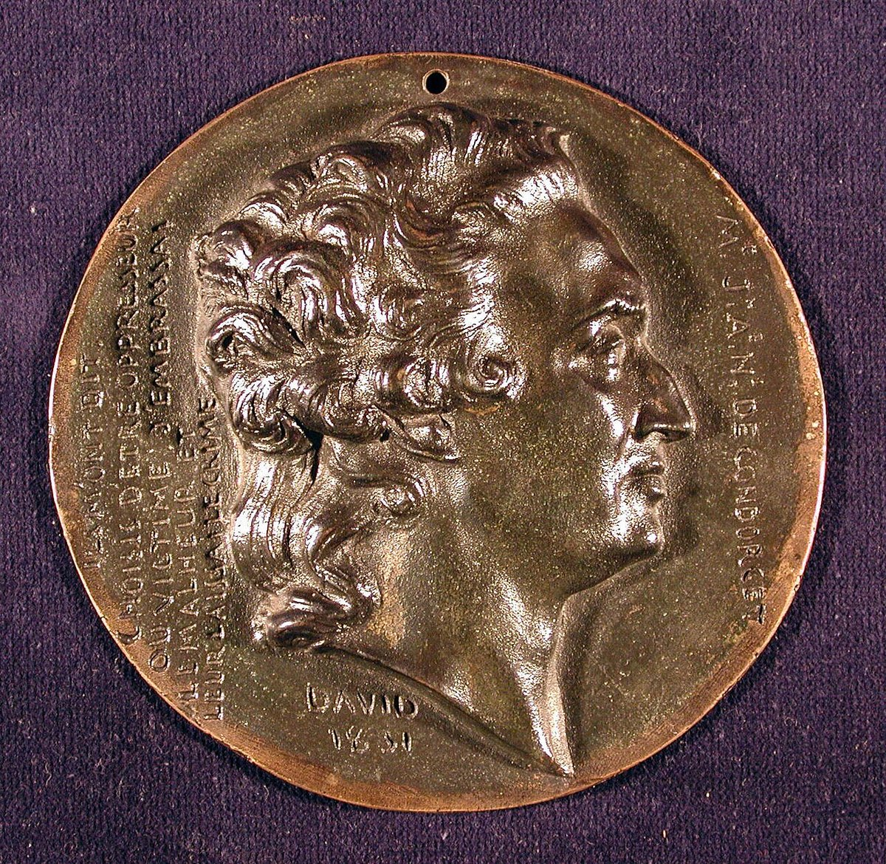
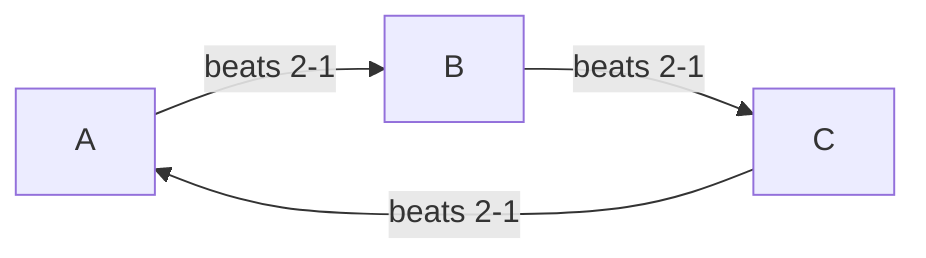

# Social choice and Arrow's theorem

**Prerequisites:** [[efficiency-versus-equity|Efficiency versus equity]], [[preferences-and-utility|Preferences and utility]].

*Medallion of the Marquis de Condorcet by David d'Angers; Condorcet discovered the voting paradox that bears his name (1785). Credit: David d'Angers. License: [CC0](http://creativecommons.org/publicdomain/zero/1.0/deed.en). Source: [File:Marie-Jean-Antoine-Nicolas de Caritat, marquis de Condorcet MET SF2003 492 1.jpg](https://commons.wikimedia.org/wiki/File:Marie-Jean-Antoine-Nicolas_de_Caritat,_marquis_de_Condorcet_MET_SF2003_492_1.jpg).*

Individuals have preferences, but how should a group decide? Should it vote, and if so how? Can individual preferences be combined into a coherent "social preference"? **Social choice theory** studies these questions. Its central result, [[kenneth-arrow|Kenneth Arrow]]'s impossibility theorem (*Social Choice and Individual Values*, 1951), shows that no method of aggregating ranked preferences can satisfy a short list of reasonable conditions at once.

## The Condorcet paradox

The problem was noticed in 1785 by the French mathematician and philosopher the Marquis de Condorcet. Suppose three voters rank three options, A, B and C:

| Voter | 1st | 2nd | 3rd |
|---|---|---|---|
| 1 | A | B | C |
| 2 | B | C | A |
| 3 | C | A | B |

Now hold pairwise majority votes:

- A versus B: voters 1 and 3 prefer A. **A wins 2–1.**
- B versus C: voters 1 and 2 prefer B. **B wins 2–1.**
- C versus A: voters 2 and 3 prefer C. **C wins 2–1.**

The group prefers A to B, B to C, and C to A: a cycle. Each individual's preferences are perfectly consistent (transitive), but majority rule produces an intransitive social preference. There is no option that beats all others (no **Condorcet winner**).

One consequence: whoever controls the **agenda** (the order of votes) can control the outcome. If the vote is first A versus B, then the winner versus C, C wins. If B versus C first, then the winner versus A, A wins.

## Arrow's conditions

Arrow asked whether **any** rule, not just majority voting, could turn individual rankings into a social ranking while satisfying:

1. **Unrestricted domain.** The rule works for any possible set of individual rankings.
2. **Pareto principle (unanimity).** If everyone prefers X to Y, society ranks X above Y.
3. **Independence of irrelevant alternatives (IIA).** The social ranking of X versus Y depends only on how individuals rank X versus Y, not on how they rank some third option Z.
4. **Non-dictatorship.** No single person's preferences always determine the social ranking.
5. **Transitivity (rationality) of the social ranking.**

**Arrow's impossibility theorem**: with at least three options and at least two people, no rule satisfies all five. Any rule satisfying the first three and transitivity must be a dictatorship.

## Examples of rules and which condition they break

| Rule | How it works | Condition violated |
|---|---|---|
| Pairwise majority | Compare each pair by vote | Transitivity (cycles possible) |
| Plurality (first past the post) | Most first-place votes wins | IIA (spoilers) |
| Borda count | Points by rank: 2 for 1st, 1 for 2nd, 0 for 3rd | IIA |
| Dictatorship | One person decides | Non-dictatorship |

### A spoiler example

In a plurality election, 40 percent rank A > B > C, 35 percent rank B > A > C, and 25 percent rank C > B > A. Plurality: A wins with 40 percent. If C drops out, C's voters move to B, and B wins 60–40. Whether C runs changes the ranking of A and B, even though nobody's view of A versus B changed. That breaks IIA. Canada's federal elections, which use plurality voting, regularly see debates about "vote splitting" of this kind.

## Escaping the impossibility

Arrow's theorem does not say democracy is impossible; it says every rule has flaws. Responses include:

- **Restricting the domain.** Duncan Black (1948) showed that if preferences are **single-peaked**, as when options lie on a left–right spectrum and each voter prefers options closer to their ideal, majority rule has no cycles and the **median voter**'s preferred option wins. This is the basis of the **median voter theorem**, used in political economy since Anthony Downs (1957).
- **Using more information.** Arrow's framework uses only rankings. If we can measure how strongly people feel, and compare across people, social welfare functions such as utilitarian sums become possible. Amartya Sen showed that interpersonal comparisons can escape the impossibility.
- **Relaxing IIA.** Methods such as the Borda count or ranked-choice voting break IIA but may be acceptable in practice.
- **Gibbard–Satterthwaite theorem** (1973, 1975): a related result showing that any non-dictatorial voting rule with three or more options can be manipulated by strategic voting in some situations.

## Why this matters for economics

Welfare economics often speaks of "society's" preferences or a social welfare function. Arrow's theorem warns that such a function cannot simply be derived from individual rankings in a neutral way: value judgements about how to weigh people, or restrictions on what counts, are unavoidable. It also underpins public choice analysis of voting and agenda control (see [[government-failure|government failure]]).

## Key ideas

- The Condorcet paradox: majority voting can produce cycles even when individuals are consistent.
- Arrow's theorem: no rule for aggregating rankings satisfies unrestricted domain, Pareto, IIA, non-dictatorship and transitivity together.
- Single-peaked preferences, interpersonal comparisons or relaxed conditions allow escapes.
- Every voting rule has trade-offs; agenda-setting and strategic voting matter.

## Where this leads

- Next: [[cost-benefit-analysis|cost-benefit analysis]].
- Related: [[kenneth-arrow|Kenneth Arrow]]; philosophy's [[path:philosophy/concepts/political/the-polis-and-political-animal.md|the polis and the political animal]].
- Glossary: [[g:arrows-impossibility-theorem|Arrow's impossibility theorem]], [[g:condorcet-paradox|Condorcet paradox]], [[g:median-voter-theorem|median voter theorem]], [[g:independence-of-irrelevant-alternatives|independence of irrelevant alternatives]].
