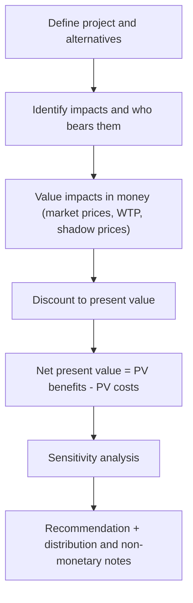

# Cost-benefit analysis

**Prerequisites:** [[efficiency-and-pareto-optimality|Efficiency and Pareto optimality]] (Kaldor–Hicks), [[consumer-surplus|Consumer surplus]], [[intertemporal-choice|Intertemporal choice]].

*The Manhattan Bridge under construction, 1909; Jules Dupuit's 1844 analysis of bridges founded cost-benefit analysis. Credit: Irving Underhill. License: Public domain. Source: [File:Manhattan Bridge Construction 1909.jpg](https://commons.wikimedia.org/wiki/File:Manhattan_Bridge_Construction_1909.jpg).*

Should a city build a new subway line? Should a regulator ban a chemical? Should a province build a dam? **Cost-benefit analysis (CBA)** is the practical method economists use to answer such questions. It tries to list all the costs and benefits of a project, express them in money, adjust for timing, and recommend projects whose benefits exceed their costs. It is the applied form of the [[efficiency-and-pareto-optimality|Kaldor–Hicks criterion]].

The French engineer Jules Dupuit pioneered the approach in 1844, analysing the benefits of bridges and roads using what we now call consumer surplus. The US Flood Control Act of 1936 required that federal water projects have benefits "in excess of the estimated costs". Today, governments, including Canada's through the Treasury Board's cost-benefit analysis guide for regulatory proposals, routinely require CBA for major regulations.

## The steps

1. **Define the project and the alternatives**, including doing nothing.
2. **Identify who is affected** and all impacts, including those not traded in markets.
3. **Measure and value** costs and benefits in money.
4. **Discount** future values to present values.
5. **Compute net present value (NPV)** and other summary measures.
6. **Test sensitivity** to uncertain assumptions.
7. **Consider distribution** and impacts that cannot be monetised.

## A worked example: a bike lane

A city considers a protected bike lane costing 2 million dollars to build now and 50,000 a year to maintain. Analysts estimate annual benefits:

| Benefit | Annual value ($) |
|---|---|
| Time saved by cyclists | 120,000 |
| Health benefits from more cycling | 150,000 |
| Reduced accidents | 60,000 |
| Reduced congestion and emissions | 30,000 |
| **Total** | **360,000** |

Net annual benefit: 360,000 − 50,000 = 310,000, for 20 years.

At a 3 percent discount rate, the present value of 310,000 a year for 20 years is 310,000 × [1 − 1.03⁻²⁰] / 0.03 ≈ 310,000 × 14.88 ≈ **4.61 million**. NPV ≈ 4.61 − 2.00 = **+2.61 million**. Build it.

At a 10 percent discount rate, the annuity factor is ≈ 8.51, so PV ≈ 2.64 million and NPV ≈ +0.64 million. Still positive, but the conclusion is more sensitive to the benefit estimates. If health benefits were overstated by half, NPV at 10 percent would fall to about 2.64 − 0.64 − 2.00 ≈ 0.0: borderline.

## Valuing things without market prices

The hardest part of CBA is valuing non-market goods:

- **Revealed preference.** Infer values from behaviour. **Hedonic pricing** compares house prices near and far from parks, airports or polluted areas. The **travel cost method** values a park by how much people spend to get there. Wage premiums for risky jobs reveal how much workers require to accept risk.
- **Stated preference (contingent valuation).** Survey people about willingness to pay. This was used to estimate damages from the 1989 *Exxon Valdez* oil spill and is debated, since hypothetical answers can differ from real behaviour.
- **Value of a statistical life (VSL).** Not the value of any particular person's life, but how much people collectively are willing to pay for small reductions in risk. If 100,000 people would each pay 100 dollars to reduce their annual risk of death by 1 in 100,000, they would together pay 10 million to prevent one expected death: the VSL is 10 million. Governments use VSL figures in the millions of dollars; in Canada, the Treasury Board has published guidance in this range.

## Discounting

Because benefits and costs occur at different times, they must be discounted (see [[path:economics/finance/01-foundations/05-present-value-and-discounting.md|present value and discounting]]). The choice of discount rate can decide the outcome, especially for long-lived projects such as climate policy or nuclear waste storage. A high rate favours projects with quick returns; a low rate gives more weight to future generations. There are two main views: base the rate on market returns on capital (the opportunity cost of investment), or on ethical judgements about how to weigh future people's welfare (the "social rate of time preference").

## Criticisms and limits

- **Distribution.** Standard CBA adds dollars regardless of who gains or loses. Some analysts apply **distributional weights** that count gains to poorer people more.
- **Willingness to pay depends on income.** Rich people are willing to pay more for the same thing, so unweighted CBA can favour projects benefiting the rich.
- **Incommensurability.** Some philosophers, such as Elizabeth Anderson and Michael Sandel, argue that some values (rights, sacred places, human life) should not be priced at all.
- **Uncertainty and catastrophic risks** are difficult to handle with expected values alone.
- **Political misuse.** Assumptions can be tilted to justify a predetermined conclusion; transparency and sensitivity analysis help.

Defenders reply that decisions inevitably trade off values; CBA makes those trade-offs explicit and consistent, rather than hidden.

## Key ideas

- CBA lists, monetises and discounts all costs and benefits to compute net present value.
- It applies the Kaldor–Hicks criterion: projects pass if winners could compensate losers.
- Non-market values are estimated with revealed and stated preference methods and the value of a statistical life.
- The discount rate, distribution and incommensurable values are the main points of controversy.

## Where this leads

- Next section: [[the-rationality-assumption|the rationality assumption]].
- Related: [[negative-externalities-and-pollution|pollution and the social cost of carbon]], [[capital-and-interest|capital and interest]].
- Glossary: [[g:cost-benefit-analysis|cost-benefit analysis]], [[g:value-of-a-statistical-life|value of a statistical life]], [[g:contingent-valuation|contingent valuation]], [[g:hedonic-pricing|hedonic pricing]], [[g:social-discount-rate|social discount rate]].
