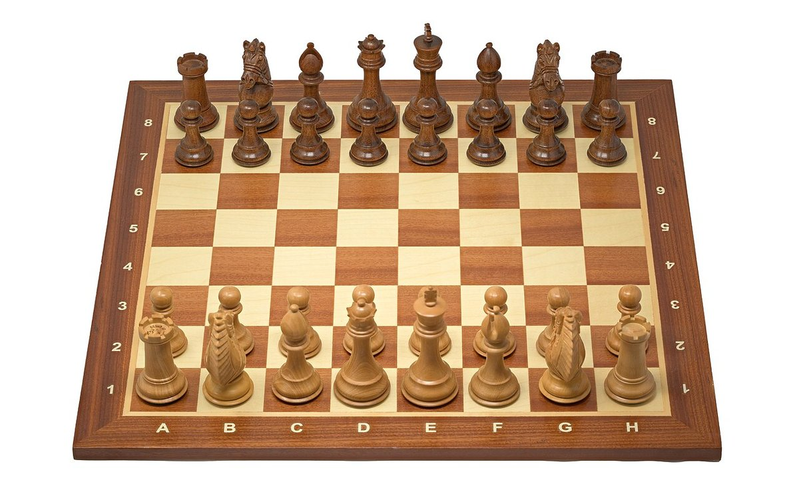
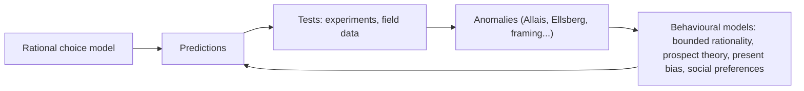

# The rationality assumption

**Prerequisites:** [[preferences-and-utility|Preferences and utility]], [[optimal-choice|Optimal choice]], [[choice-under-uncertainty|Choice under uncertainty]].

*A chess position: the rational agent of economic theory is often pictured as a flawless calculator, looking ahead to every consequence. Credit: Wilfredor. License: [CC0](http://creativecommons.org/publicdomain/zero/1.0/deed.en). Source: [File:Chess game Staunton No. 6.jpg](https://commons.wikimedia.org/wiki/File:Chess_game_Staunton_No._6.jpg).*

Almost everything in this course so far has assumed that people are **rational**: they have consistent preferences, they know what they want, and they choose the best option available given their constraints. This assumption made economics remarkably powerful, allowing predictions about how people respond to prices, taxes and incentives. **Behavioural economics** asks what happens when the assumption is relaxed, using evidence from psychology, experiments and field data. This lesson explains what the rationality assumption actually claims, why economists use it, and where the challenges begin.

## What "rational" means in economics

In everyday speech, "rational" suggests sensible or reasonable. In economics it has a narrower technical meaning:

1. **Completeness.** For any two options, a person either prefers one or is indifferent.
2. **Transitivity.** If you prefer A to B and B to C, you prefer A to C.
3. **Maximisation.** You choose the most preferred option you can afford.
4. Under uncertainty, **expected utility maximisation**: you weigh outcomes by their probabilities (see [[choice-under-uncertainty|choice under uncertainty]]).
5. Over time, **consistent discounting**: your plans for the future do not change merely because time passes (see [[intertemporal-choice|intertemporal choice]]).
6. Often, **self-interest**: people care mainly about their own consumption.

Rationality in this sense says nothing about *what* people should want. Someone who prefers opera to football, or spends all their money on charity, can be perfectly rational. It concerns the consistency of choices, not their content.

The term **homo economicus** ("economic man") is often used, sometimes mockingly, for the idealised agent with these properties.

## Why economists assume rationality

- **Tractability.** Rational choice gives precise, testable predictions. If you assume people maximise, you can derive demand curves, labour supply and responses to taxes.
- **"As if" reasoning.** Milton Friedman argued in "The Methodology of Positive Economics" (1953) that the realism of assumptions matters less than the accuracy of predictions. Billiard players do not solve physics equations, but they play "as if" they did. See [[models-and-economic-method|models and economic method]].
- **Markets discipline mistakes.** Firms that do not maximise profit may be driven out. Arbitrageurs exploit mispricing. Mistakes may cancel out in aggregate.
- **Normative benchmark.** Even if people are not fully rational, rational choice describes what they would do with full information and consistency, a useful standard for policy.
- **Many predictions work.** People buy less when prices rise; drivers respond to fuel prices; workers move toward higher wages. The [[law-of-demand|law of demand]] holds broadly.

## Early challenges

Doubts about rationality are old. Adam Smith's *The Theory of Moral Sentiments* (1759) discussed sympathy, self-deception and overconfidence. But formal challenges began in the 1950s:

- **The Allais paradox** (Maurice Allais, 1953). Faced with pairs of gambles, most people make choices that are inconsistent with expected utility theory.
- **Herbert Simon** (1955) argued that people have limited time, information and computing power, and so "satisfice" rather than optimise (see [[bounded-rationality|bounded rationality]]).
- **The Ellsberg paradox** (Daniel Ellsberg, 1961). People prefer known risks to unknown ones (ambiguity aversion) in ways expected utility cannot explain.

### The Allais paradox: a worked example

Choose between:

- **1A**: 1 million dollars for certain.
- **1B**: 89% chance of 1 million, 10% chance of 5 million, 1% chance of nothing.

Most people choose 1A. Now choose between:

- **2A**: 11% chance of 1 million, 89% chance of nothing.
- **2B**: 10% chance of 5 million, 90% chance of nothing.

Most people choose 2B. But under expected utility, the two choices should go the same way. Remove the common "89% chance of 1 million" from both 1A and 1B, and replace it with "89% chance of nothing": you get exactly 2A and 2B. Preferring 1A means 0.11 × U(1M) > 0.10 × U(5M) + 0.01 × U(0); preferring 2B means the opposite inequality. The pattern reveals a **certainty effect**: people overweight outcomes that are certain.

## From anomalies to a field

In the 1970s, the psychologists Daniel Kahneman and Amos Tversky documented systematic patterns in judgement and choice ([[heuristics-and-biases|heuristics and biases]], [[prospect-theory-in-economics|prospect theory]]). Economists such as Richard Thaler collected "anomalies" in a regular column in the *Journal of Economic Perspectives* (from 1987). Behavioural economics became mainstream: Kahneman won the Nobel prize in 2002 (Tversky died in 1996), Robert Shiller in 2013, and Thaler in 2017.

## The key distinction

Behavioural economics does not claim people are irrational in the sense of random or foolish. Its central claim is that departures from the standard model are **systematic and predictable**. If errors were random, they might cancel out; because they are systematic, they can affect markets and policy.

## Key ideas

- Economic rationality means consistent preferences and maximisation, not sensible goals.
- Economists assume it for tractability, "as if" prediction, and as a normative benchmark.
- The Allais and Ellsberg paradoxes and Simon's bounded rationality were early challenges.
- Behavioural economics documents systematic departures and builds them into models.

## Where this leads

- Next: [[bounded-rationality|bounded rationality]].
- Related: [[path:economics/finance/07-behavioural-finance/01-from-rational-to-behavioural.md|from rational to behavioural finance]].
- Glossary: [[g:homo-economicus|homo economicus]], [[g:allais-paradox|Allais paradox]], [[g:behavioural-economics|behavioural economics]], [[g:ambiguity-aversion|ambiguity aversion]].
