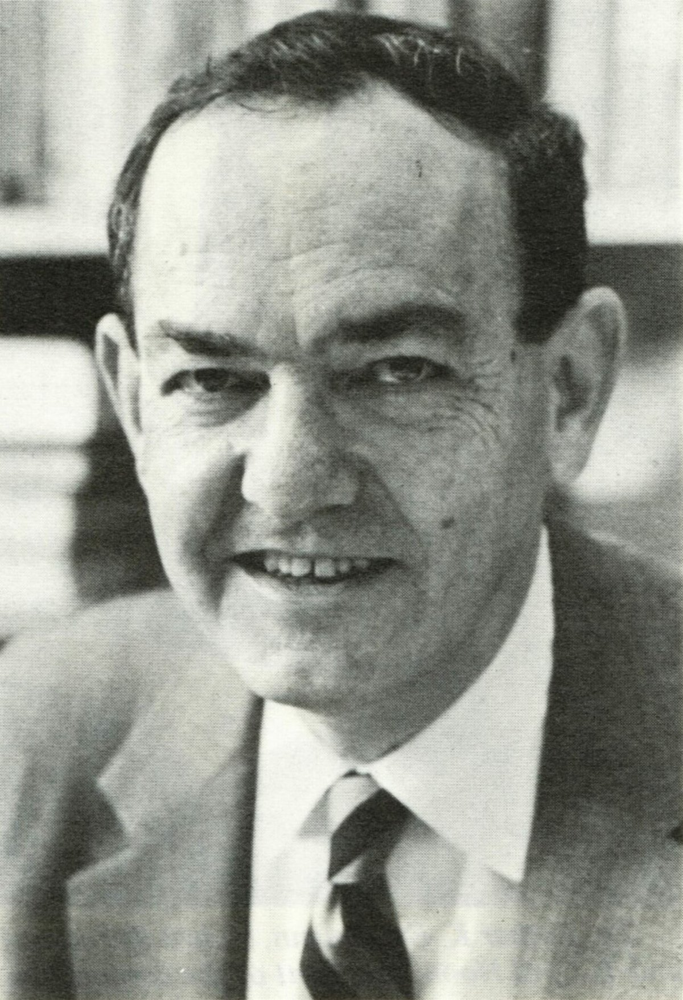
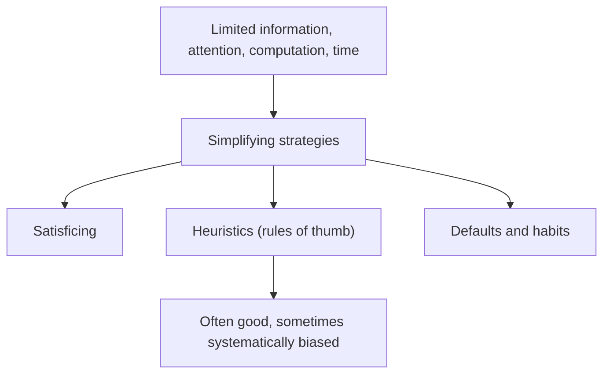

# Bounded rationality

**Prerequisites:** [[the-rationality-assumption|The rationality assumption]].

*Herbert A. Simon in 1981, as featured in a Rochester Institute of Technology newsletter; Simon coined bounded rationality and satisficing. Credit: Rochester Institute of Technology. License: Public domain. Source: [File:Herbert Simon, RIT NandE Vol13Num11 1981 Mar19 Complete.jpg](https://commons.wikimedia.org/wiki/File:Herbert_Simon,_RIT_NandE_Vol13Num11_1981_Mar19_Complete.jpg).*

Real people cannot consider every option, gather every fact or compute every consequence. Herbert Simon, a political scientist, psychologist and computer scientist who won the 1978 Nobel prize in economics, called this **bounded rationality**: people are "intendedly rational, but only limitedly so". Rather than abandoning the idea that people try to do well, Simon argued that we should model how they decide given limited cognitive resources.

## Satisficing

Simon's key alternative to maximising was **satisficing** (a blend of "satisfy" and "suffice"): searching until you find an option that is good enough, by some aspiration level, and then stopping.

### Example: choosing an apartment

Suppose you are looking for an apartment in Toronto. There are thousands of listings. A maximiser would view all of them, compare every feature, and pick the best. A satisficer sets criteria (under 2,200 dollars a month, near a subway station, allows a cat) and takes the first apartment that meets them.

Satisficing can be the smart strategy when search is costly. Suppose each viewing costs you 3 hours, which you value at 25 dollars an hour (75 dollars per viewing), and each extra viewing has a declining chance of finding something better. Once the expected improvement from another viewing falls below 75 dollars, stopping is optimal. In this sense, satisficing can itself be rational once the costs of thinking and searching are counted. George Stigler's "The Economics of Information" (1961) modelled search this way.

## Why bounds matter

Bounded rationality has several sources:

- **Limited information.** People rarely know all prices, product qualities or probabilities.
- **Limited attention.** Attention is scarce. People may ignore taxes not shown on price tags. Raj Chetty, Adam Looney and Kory Kroft (2009) found that posting tax-inclusive prices on supermarket shelves reduced demand for the affected products by about 8 percent, even though the tax was unchanged.
- **Limited computation.** Even with all the facts, some problems, such as optimal retirement saving or chess, are too complex to solve exactly.
- **Limited time.** Decisions must often be made quickly.
- **Limited self-control** (see [[time-inconsistency-and-self-control|time inconsistency]]).

## Choice overload

More options are not always better. In a well-known study, Sheena Iyengar and Mark Lepper (2000) set up a jam-tasting display in a supermarket. When 24 jams were displayed, more shoppers stopped, but only about 3 percent bought a jar; with 6 jams, about 30 percent of those who stopped bought. Later meta-analyses (such as Scheibehenne, Greifeneder and Todd, 2010) found that the **choice overload** effect varies greatly and is often small on average, depending on factors such as the complexity of the options and how clear people's preferences are.

## Ecological rationality

The psychologist Gerd Gigerenzer argues that simple heuristics are not merely error-prone shortcuts; in many real environments they perform as well as, or better than, complex calculations. His "fast and frugal" heuristics include the **recognition heuristic** (if you recognise one option but not another, infer that the recognised one is bigger or better) and **take-the-best** (decide on the single most important cue that discriminates between options). Rationality, in this view, is about the fit between a decision method and the environment (**ecological rationality**).

This contrasts with the "heuristics and biases" programme of Kahneman and Tversky, which emphasises when heuristics lead to systematic errors (see [[heuristics-and-biases|heuristics and biases]]). The two views agree that people use heuristics; they disagree on how often this leads people astray.

## Bounded rationality in organisations

Simon's earlier book *Administrative Behavior* (1947) studied how organisations make decisions. Firms use rules, routines and standard procedures because no manager can optimise everything. Richard Cyert and James March's *A Behavioral Theory of the Firm* (1963) and Richard Nelson and Sidney Winter's *An Evolutionary Theory of Economic Change* (1982) built on this, modelling firms as following routines that change slowly through search and selection rather than through maximisation (see [[the-firm|the firm]]).

## Implications for economics

- Small frictions, such as the effort of filling in a form, can have large effects on behaviour (for example, on take-up of benefits).
- Defaults matter because many people do not actively choose (see [[nudges-and-choice-architecture|nudges]]).
- Complexity can be exploited: firms may design confusing pricing (shrouded fees) to take advantage of limited attention.
- Markets may still work well when the environment rewards learning and feedback is quick.

## Key ideas

- Bounded rationality: people try to decide well but have limited information, attention, computation and time.
- Satisficing means stopping at a good-enough option; with search costs it can be optimal.
- Limited attention, choice overload and complexity affect real decisions.
- Gigerenzer's ecological rationality stresses that simple heuristics can work well in the right environment.

## Where this leads

- Next: [[heuristics-and-biases|heuristics and biases]].
- Related: [[path:philosophy/concepts/epistemology/knowledge-and-opinion.md|knowledge and opinion]].
- Glossary: [[g:bounded-rationality|bounded rationality]], [[g:satisficing|satisficing]], [[g:choice-overload|choice overload]], [[g:ecological-rationality|ecological rationality]].
