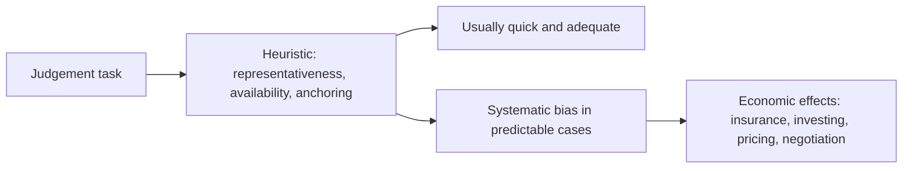

# Heuristics and biases

**Prerequisites:** [Bounded rationality](02-bounded-rationality.md), [Choice under uncertainty](../03-consumer-theory/11-choice-under-uncertainty.md).

*The Müller-Lyer illusion: the lines are equal in length but do not look it. Kahneman and Tversky compared cognitive biases to such perceptual illusions, which persist even when you know about them. Credit: Franz Müller-Lyer. License: Public domain. Source: [File:Müller-Lyer Illusion - MathWorld version.svg](https://commons.wikimedia.org/wiki/File:Müller-Lyer_Illusion_-_MathWorld_version.svg).*

In 1974, Amos Tversky and Daniel Kahneman published "Judgment under Uncertainty: Heuristics and Biases" in *Science*. They argued that people judge probabilities and values using a few mental shortcuts, or **heuristics**, which are usually useful but lead to **systematic errors** (biases) in predictable situations. This research programme became the foundation of much of behavioural economics.

## The three original heuristics

### Representativeness

People judge the probability that something belongs to a category by how much it resembles the category's stereotype, neglecting base rates and statistics.

**The Linda problem** (Tversky and Kahneman, 1983). Linda is 31, single, outspoken and very bright. She majored in philosophy and was deeply concerned with issues of discrimination and social justice. Which is more probable?

1. Linda is a bank teller.
2. Linda is a bank teller and is active in the feminist movement.

Most people choose 2, but this is impossible: the probability of two things both being true can never exceed the probability of one of them. This is the **conjunction fallacy**.

**Base-rate neglect: a worked example.** A disease affects 1 in 1,000 people. A test detects it 99 percent of the time, and gives a false positive 5 percent of the time. You test positive. What is the chance you have the disease? Many people say about 95 percent. Out of 100,000 people, 100 have the disease and 99 test positive; of the 99,900 without it, 4,995 test positive. So only 99 of 5,094 positives, about **1.9 percent**, are true. See [probability and expected value](../../finance/01-foundations/08-probability-and-expected-value.md).

Representativeness also produces the **gambler's fallacy** (believing a coin is "due" for heads after several tails) and the belief that small samples resemble the population ("the law of small numbers").

### Availability

People judge frequency by how easily examples come to mind. Dramatic, recent or memorable events seem more common. After news coverage of plane crashes, people overestimate the risk of flying relative to driving. Purchases of flood insurance rise after floods and decline over the following years as memories fade.

### Anchoring and adjustment

People start from an initial value (an anchor) and adjust insufficiently. In one Tversky–Kahneman experiment, participants watched a wheel of fortune rigged to stop at 10 or 65, then estimated the percentage of African countries in the United Nations. Those who saw 10 gave a median estimate of 25; those who saw 65 gave 45. An obviously irrelevant number shifted judgements. Anchors affect negotiations, list prices, damages awards and real-estate appraisals.

## Other important biases

| Bias | Description | Example |
|---|---|---|
| **Overconfidence** | Overestimating one's knowledge, ability or precision | Most drivers rate themselves above average |
| **Confirmation bias** | Seeking and favouring information that supports existing beliefs | Reading only news that agrees with you |
| **Hindsight bias** | Believing after the fact that an outcome was predictable | "I knew the crash was coming" |
| **Endowment effect** | Valuing things more once you own them | Mug experiments (below) |
| **Status quo bias** | Preferring the current state of affairs | Sticking with default pension plans |
| **Sunk-cost fallacy** | Letting unrecoverable costs affect decisions | Finishing a bad movie because you paid for it (see [sunk cost](../glossary/sunk-cost.md)) |
| **Framing effects** | Different descriptions of the same choice change decisions | "90% survival" vs "10% mortality" |
| **Mental accounting** | Treating money differently depending on its source or label | Spending a tax refund freely while carrying credit-card debt |

### The endowment effect

Kahneman, Jack Knetsch and Richard Thaler (1990) gave coffee mugs to half the students in a class. Owners were asked their minimum selling price; non-owners their maximum buying price. Standard theory predicts the two should be similar and about half the mugs should trade. In fact, median selling prices were roughly two to three times median buying prices, and far fewer trades occurred. This is consistent with **loss aversion**: giving up the mug feels like a loss (see [prospect theory](04-prospect-theory-in-economics.md)). Later research, such as Plott and Zeiler (2005), found the gap shrinks with careful experimental procedures, and debate continues about its size and causes.

### Framing: the Asian disease problem

Tversky and Kahneman (1981) asked people to choose between programmes to fight a disease expected to kill 600 people. When options were framed as lives **saved** ("200 people will be saved" versus "a one-third chance that 600 will be saved"), most chose the sure option. When the same options were framed as **deaths** ("400 people will die" versus "a two-thirds chance that 600 will die"), most chose the gamble. The choices are identical in outcomes; only the description changed.

## Debates

- **Replication.** Some findings in psychology have failed to replicate (the broader "replication crisis"). Core results like anchoring, framing and loss aversion have generally held up, though often with smaller effects than first reported; others, such as some "priming" effects discussed in Kahneman's *Thinking, Fast and Slow* (2011), have not.
- **Ecological rationality.** Gigerenzer argues that many "biases" disappear when problems are presented in natural frequencies (as in the disease example above) rather than percentages.
- **Markets and learning.** Experienced traders show smaller biases in some studies (John List, 2003), suggesting experience and market feedback can reduce them.

## Key ideas

- Heuristics are mental shortcuts; representativeness, availability and anchoring are the original three.
- They cause predictable biases: conjunction fallacy, base-rate neglect, overestimating vivid risks, anchoring on irrelevant numbers.
- Other biases include overconfidence, endowment effect, framing and mental accounting.
- The size and robustness of biases vary; experience and presentation matter.

## Where this leads

- Next: [prospect theory in economics](04-prospect-theory-in-economics.md).
- Related: [overconfidence and other biases in investing](../../finance/07-behavioural-finance/03-overconfidence-and-other-biases.md), [mental accounting, anchoring and framing](../../finance/07-behavioural-finance/05-mental-accounting-anchoring-and-framing.md).
- Glossary: [heuristic](../glossary/heuristic.md), [anchoring](../glossary/anchoring.md), [availability heuristic](../glossary/availability-heuristic.md), [representativeness heuristic](../glossary/representativeness-heuristic.md), [framing effect](../glossary/framing-effect.md), [endowment effect](../glossary/endowment-effect.md).
