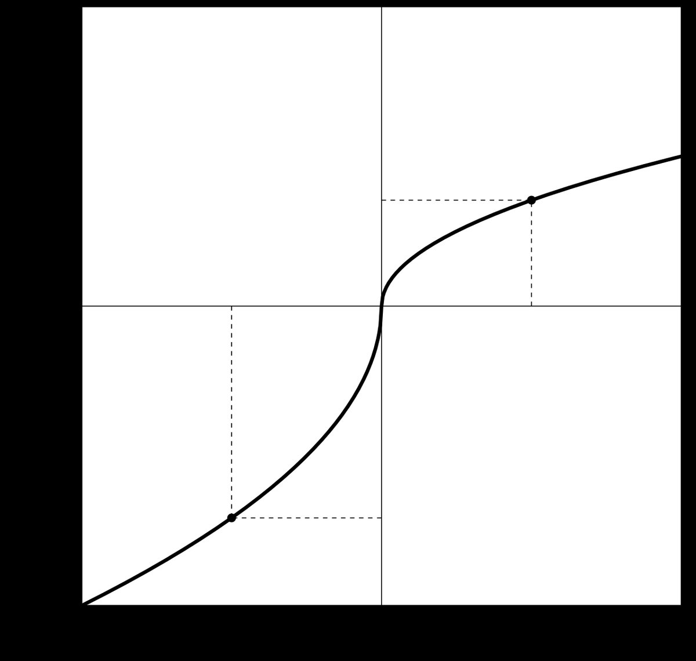
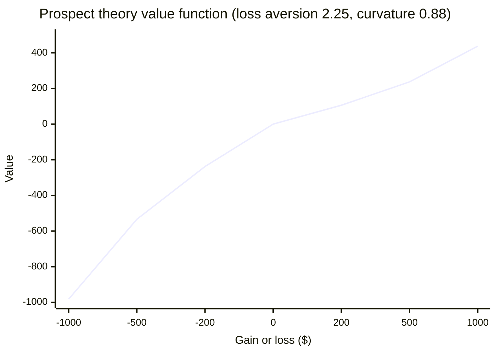

# Prospect theory in economics

**Prerequisites:** [[heuristics-and-biases|Heuristics and biases]], [[choice-under-uncertainty|Choice under uncertainty]] (expected utility).

*The prospect theory value function computed with the Tversky–Kahneman (1992) parameters: concave for gains, convex and steeper for losses. Credit: Halunkilein. License: [CC0](http://creativecommons.org/publicdomain/zero/1.0/deed.en). Source: [File:Prospect Theory Value Function.svg](https://commons.wikimedia.org/wiki/File:Prospect_Theory_Value_Function.svg).*

Expected utility theory says people evaluate risky choices by weighting the utility of final wealth by probabilities. In 1979, Daniel Kahneman and Amos Tversky published "Prospect Theory: An Analysis of Decision under Risk" in *Econometrica*, offering a descriptive alternative based on experimental evidence. It became one of the most cited papers in economics. A refined version, **cumulative prospect theory**, followed in 1992.

## Four key features

### 1. Reference dependence

People evaluate outcomes as **gains and losses relative to a reference point** (often the status quo or an expectation), not as levels of final wealth. A salary of 80,000 dollars feels like a gain to someone expecting 70,000 and a loss to someone expecting 90,000.

### 2. Loss aversion

**Losses loom larger than gains.** Losing 100 dollars hurts more than winning 100 dollars pleases. Tversky and Kahneman (1992) estimated a loss-aversion coefficient of about **2.25**: a loss is weighted roughly twice as heavily as an equal gain. Most people reject a 50–50 bet to win 150 or lose 100, even though its expected value is +25.

### 3. Diminishing sensitivity

The value function is **concave for gains** and **convex for losses**. The difference between gaining 100 and 200 feels larger than between 1,100 and 1,200. The same holds for losses. As a result, people tend to be **risk-averse over gains** and **risk-seeking over losses**.

### 4. Probability weighting

People do not weight outcomes by their actual probabilities. They **overweight small probabilities** and **underweight moderate and large ones**. This helps explain why people buy lottery tickets (overweighting a tiny chance of winning) and insurance (overweighting a small chance of disaster) at the same time.

## A worked example

Using the Tversky–Kahneman (1992) parameters, the value of a gain x is x^0.88 and the value of a loss is −2.25 × |x|^0.88.

- v(+100) = 100^0.88 ≈ 57.5
- v(−100) = −2.25 × 57.5 ≈ −129.4

Consider a 50–50 bet to win 200 or lose 100 (expected value +50). Ignoring probability weighting:

- 0.5 × v(+200) + 0.5 × v(−100) = 0.5 × 105.9 + 0.5 × (−129.4) ≈ **−11.8**

The bet is rejected despite its positive expected value. A risk-neutral person would take it; an expected-utility maximiser with modest risk aversion over such small stakes would also take it. Matthew Rabin (2000) showed that explaining rejection of small favourable bets with expected-utility risk aversion implies absurd levels of risk aversion over large stakes, a key argument for loss aversion.

## The fourfold pattern

Combining the value function and probability weighting produces a characteristic pattern:

| | Gains | Losses |
|---|---|---|
| **High probability** | Risk-averse (take a sure gain) | Risk-seeking (gamble to avoid a sure loss) |
| **Low probability** | Risk-seeking (lotteries) | Risk-averse (insurance) |

## Applications in economics

- **The disposition effect.** Investors sell winning stocks too early and hold losers too long (Hersh Shefrin and Meir Statman, 1985; Terrance Odean, 1998), consistent with risk-seeking in the loss domain and reluctance to "realise" a loss. See [[path:economics/finance/07-behavioural-finance/02-prospect-theory-and-loss-aversion.md|prospect theory and loss aversion in finance]].
- **The equity premium puzzle.** Shlomo Benartzi and Richard Thaler (1995) argued that loss-averse investors who check their portfolios frequently ("myopic loss aversion") demand a high premium to hold stocks, helping explain why historical stock returns have been so much higher than bond returns.
- **Labour supply.** Colin Camerer and co-authors (1997) found that some New York cab drivers seemed to target a daily income, quitting early on good days, consistent with reference dependence. Henry Farber's later studies found weaker evidence.
- **Housing.** David Genesove and Christopher Mayer (2001) found that Boston condo owners facing a nominal loss set higher asking prices and waited longer to sell.
- **Tax compliance.** Taxpayers who expect to owe money at filing time (a loss relative to their reference point) appear more willing to take aggressive positions than those expecting a refund.
- **Endowment effect and status quo bias**, explained by loss aversion (see [[heuristics-and-biases|heuristics and biases]]).
- **Insurance.** People choose low deductibles, paying far more than the expected savings (Justin Sydnor, 2010).
- **Marketing and pricing.** Framing price changes as "discounts" rather than "surcharges" (for example, cash discounts rather than credit-card surcharges).

## Limits and criticism

- Prospect theory is descriptive; it does not say how people *should* choose.
- The reference point is often unclear, which gives the theory flexibility that critics see as a weakness. Botond Kőszegi and Matthew Rabin (2006) proposed that reference points are rational expectations of outcomes.
- Some researchers, such as David Gal and Derek Rucker (2018), argue that evidence for loss aversion is weaker than often claimed; others reply that it is robust across many settings.

## Key ideas

- Prospect theory: people value gains and losses relative to a reference point.
- Losses weigh about twice as much as gains (loss aversion).
- Diminishing sensitivity makes people risk-averse for gains and risk-seeking for losses; small probabilities are overweighted.
- Applications include the disposition effect, the equity premium, housing and insurance choices.

## Where this leads

- Next: [[time-inconsistency-and-self-control|time inconsistency and self-control]].
- Related: [[daniel-kahneman|Daniel Kahneman]].
- Glossary: [[g:prospect-theory|prospect theory]], [[g:loss-aversion|loss aversion]], [[g:reference-point|reference point]], [[g:probability-weighting|probability weighting]], [[g:disposition-effect|disposition effect]].
