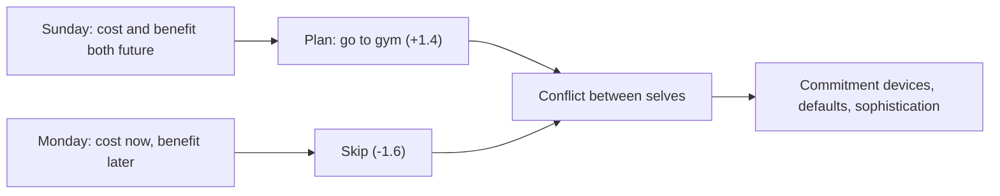

# Time inconsistency and self-control

**Prerequisites:** [Intertemporal choice](../03-consumer-theory/12-intertemporal-choice.md), [The rationality assumption](01-the-rationality-assumption.md).

*Ulysses and the Sirens by Herbert James Draper (1909): Odysseus had himself bound to the mast, the original commitment device. Credit: Herbert James Draper. License: Public domain. Source: [File:Draper Herbert James Ulysses and the Sirens.jpg](https://commons.wikimedia.org/wiki/File:Draper_Herbert_James_Ulysses_and_the_Sirens.jpg).*

On Sunday night you plan to go to the gym every morning this week. On Monday morning, you hit snooze. You resolve to save more starting next month; next month, you resolve to start the month after. Standard economics models people as discounting the future at a constant rate, which implies that plans made today will still look right tomorrow. Real behaviour often shows **time inconsistency**: preferences between two future moments change as those moments get closer.

## Exponential discounting and consistency

In the standard model (Paul Samuelson, 1937), a person values utility t periods from now at δ^t times its present value, where δ (the discount factor) is less than 1. With **exponential discounting**, the trade-off between any two dates depends only on the gap between them, not on how far away they are. So if you prefer 110 dollars in 31 days to 100 dollars in 30 days, you will still prefer it when day 30 arrives. Plans are **time-consistent**.

## Present bias and hyperbolic discounting

Experiments show something different. Many people prefer 100 dollars today over 110 dollars tomorrow, yet prefer 110 dollars in 31 days over 100 dollars in 30 days. The one-day delay feels costly when it starts now, but trivial when it is a month away. When day 30 arrives, they switch: they now want the 100 immediately. This is **present bias**.

Richard Thaler (1981) and George Ainslie documented such patterns. A common model is **quasi-hyperbolic (β–δ) discounting**, developed by David Laibson (1997) building on Edmund Phelps and Robert Pollak (1968). Utility now counts fully; every future period is discounted by an extra factor β < 1 in addition to the usual δ^t:

U = u₀ + β × [δu₁ + δ²u₂ + δ³u₃ + ...]

### A worked example

Let β = 0.7 and δ = 1 (ignore ordinary discounting for simplicity). Going to the gym costs 10 units of discomfort on the day you go and gives 12 units of health benefit the next day.

**Planning on Sunday for Monday.** Both cost and benefit are in the future, so both are multiplied by β: 0.7 × (−10 + 12) = **+1.4**. Going looks worthwhile. You plan to go.

**Deciding on Monday morning.** The cost is now immediate and not discounted; the benefit is still in the future: −10 + 0.7 × 12 = −10 + 8.4 = **−1.6**. Going no longer seems worthwhile. You skip.

Your Sunday self and Monday self disagree. Each new day, the same thing happens, so the gym is always "tomorrow".

## Naive and sophisticated agents

Ted O'Donoghue and Matthew Rabin (1999) distinguished:

- **Naive** agents believe their future selves will follow their plans. They repeatedly procrastinate, always expecting to act tomorrow.
- **Sophisticated** agents know their future selves will be present-biased. They may act now, or seek ways to bind their future selves.

## Commitment devices

A **commitment device** restricts your future choices to help you stick with plans. Odysseus had his crew tie him to the mast so he could hear the Sirens without steering toward them, the classic image of self-commitment.

Modern examples:

- **Save More Tomorrow** (Thaler and Shlomo Benartzi, 2004): employees commit in advance to raise their pension contribution rate with future pay rises. In the first implementation, average saving rates for participants rose from 3.5 percent to 13.6 percent over about 40 months.
- **Commitment savings accounts.** Nava Ashraf, Dean Karlan and Wesley Yin (2006) offered Philippine bank customers accounts that restricted withdrawals until a goal date or amount; take-up was substantial and savings rose.
- **Gym memberships.** Stefano DellaVigna and Ulrike Malmendier's "Paying Not to Go to the Gym" (2006) found that people on monthly contracts paid about 70 dollars a month but attended about 4.3 times, paying more than 17 dollars per visit when a 10-visit pass would have cost about 10 dollars per visit, consistent with overconfidence about future self-control.
- **Websites** that donate your money to a cause you dislike if you fail a goal.

## Economic consequences

- **Under-saving for retirement.** Present bias can explain why many people save less than they say they want to, and why automatic enrolment in pension plans has such large effects (see [nudges](07-nudges-and-choice-architecture.md)).
- **Credit-card borrowing.** People may borrow at high interest for immediate consumption while planning to pay it off soon.
- **Health behaviours.** Smoking, exercise, diet and medication adherence involve immediate costs and delayed benefits.
- **Procrastination** on tasks such as filing taxes or applying for benefits.
- **"Sin taxes".** Some economists, such as Jonathan Gruber and Botond Kőszegi (2001), argue that taxes on cigarettes can benefit present-biased smokers by helping their long-run selves, an "internality" correction.

## Is present bias irrational?

It depends on the standard. Time inconsistency violates consistency, but whose preferences should count, the present self's or the planning self's? Policies that favour the long-run self are sometimes criticised as paternalistic. Some economists argue that apparent present bias can reflect uncertainty, liquidity constraints or trust in whether future rewards will be paid.

## Key ideas

- Exponential discounting implies consistent plans; present bias means immediate costs and rewards get extra weight.
- The β–δ model captures this: plans made in advance are abandoned when the moment comes.
- Naive agents procrastinate; sophisticated agents seek commitment devices.
- Present bias helps explain under-saving, borrowing and health behaviour; commitment and defaults can help.

## Where this leads

- Next: [social preferences and fairness](06-social-preferences-and-fairness.md).
- Related: [time value of money](../../finance/01-foundations/04-time-value-of-money.md).
- Glossary: [present bias](../glossary/present-bias.md), [hyperbolic discounting](../glossary/hyperbolic-discounting.md), [commitment device](../glossary/commitment-device.md), [time inconsistency](../glossary/time-inconsistency.md).
