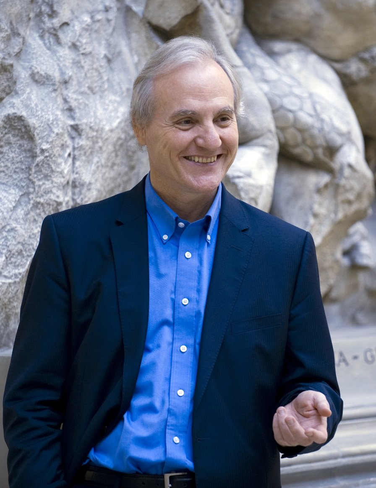
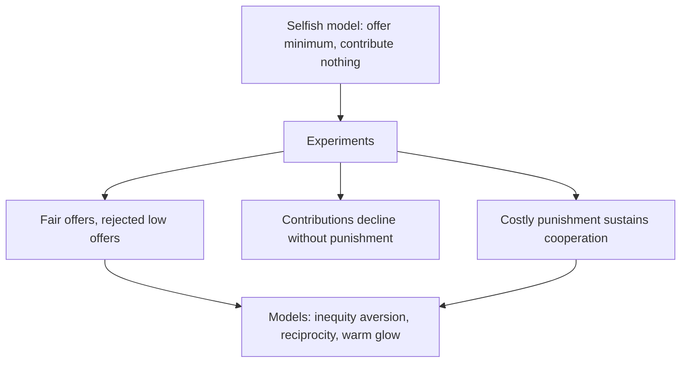

# Social preferences and fairness

**Prerequisites:** [[the-rationality-assumption|The rationality assumption]], [[game-theory-basics|Game theory basics]].

*Ernst Fehr of the University of Zurich, whose experiments documented altruistic punishment and inequity aversion. Credit: Neuroeconomics University of Zurich. License: [CC BY 4.0](https://creativecommons.org/licenses/by/4.0). Source: [File:Fehr Ernst Webbild.jpg](https://commons.wikimedia.org/wiki/File:Fehr_Ernst_Webbild.jpg).*

Standard models often assume people care only about their own material payoffs. Yet people tip in restaurants they will never revisit, donate to strangers, vote, return lost wallets, and punish cheaters at a cost to themselves. **Social preferences** are concerns for the payoffs of others and for fairness. Experimental economics, using simple games played for real money, has measured them carefully since the 1980s.

## The ultimatum game

Werner Güth, Rolf Schmittberger and Bernd Schwarze (1982) introduced the **ultimatum game**. A proposer receives a sum, say 100 dollars, and offers some share to a responder. If the responder accepts, the money is split as proposed. If the responder rejects, both get nothing.

**Standard prediction.** A self-interested responder accepts any positive amount (1 dollar is better than nothing). Knowing this, the proposer offers the minimum. By [[repeated-games-and-strategic-moves|backward induction]], the outcome is about 99/1.

**What actually happens.** Across many studies:

- Most proposers offer 40 to 50 percent.
- Offers below about 20 percent are rejected roughly half the time.

Responders give up real money to punish unfair offers, and proposers anticipate this. Offers are not simply strategic: in the **dictator game**, where the responder cannot reject, many proposers still give something, though less (often around 20 to 30 percent on average, with many giving nothing).

### Cross-cultural evidence

Joseph Henrich and colleagues (2001, 2005) ran ultimatum games in 15 small-scale societies, from hunter-gatherers to pastoralists. Average offers ranged from about 25 percent among the Machiguenga of Peru to over 50 percent among the Lamalera whale hunters of Indonesia. Offers correlated with how much a society's daily life involved market exchange and cooperation, suggesting fairness norms are shaped by culture.

## Public goods games and punishment

In a **public goods game**, each of several players can contribute money to a common pot that is multiplied (say, doubled) and shared equally. Contributing nothing is the dominant strategy for a selfish player, but everyone contributing maximises the group's total (a [[public-goods|public goods]] problem).

### Worked example

Four players each have 20 tokens. Contributions are doubled and split equally.

- If all contribute 20: pot = 80, doubled = 160, each gets **40**.
- If three contribute 20 and one contributes 0: pot = 60, doubled = 120, each gets 30; the free rider keeps 20 + 30 = **50**.
- If none contribute: each keeps **20**.

Each token contributed returns only 0.5 tokens to the contributor, so a selfish player contributes nothing.

Experiments typically find that people start by contributing 40 to 60 percent of their endowment, but contributions decline over repeated rounds as cooperators see others free-ride. Ernst Fehr and Simon Gächter (2000, 2002) added an option to pay to punish low contributors. Many people punished free riders even at a cost to themselves and with no future benefit (**altruistic punishment**), and contributions stayed high or rose.

## Models of social preferences

- **Altruism.** People's utility rises with others' well-being.
- **Warm glow** (James Andreoni, 1990). People get satisfaction from the act of giving itself, not only from its effect.
- **Inequity aversion** (Fehr and Klaus Schmidt, 1999; Gary Bolton and Axel Ockenfels, 2000). People dislike unequal outcomes, especially being behind, and to a lesser extent being ahead.
- **Reciprocity** (Matthew Rabin, 1993). People reward kind intentions and punish unkind ones. Intentions matter: an unfair split chosen by a computer is accepted more often than the same split chosen by a person.

## Fairness in markets

Kahneman, Knetsch and Thaler (1986) surveyed Canadians in Toronto and Vancouver. In one question, a hardware store raises the price of snow shovels from 15 to 20 dollars the morning after a snowstorm. **82 percent** rated this unfair. Such norms may help explain why firms often do not raise prices to market-clearing levels during shortages (for example, concert tickets, or ride-hailing "surge pricing" controversies), and why nominal wage cuts are rare even in recessions (Truman Bewley, *Why Wages Don't Fall during a Recession*, 1999).

**Gift exchange** (George Akerlof, 1982): employers may pay above-market wages, and workers reciprocate with extra effort. Lab experiments support this, though field studies find the effect can fade over time (Uri Gneezy and John List, 2006).

## Crowding out

Monetary incentives can sometimes reduce prosocial behaviour. Gneezy and Aldo Rustichini's "A Fine Is a Price" (2000) studied Israeli day-care centres that introduced a small fine for parents who picked children up late. Late pick-ups **increased**, roughly doubling, and stayed high after the fine was removed. The fine turned a moral obligation into a price.

## Key ideas

- People care about fairness and others' payoffs, not only their own money.
- In ultimatum games, offers are near-equal and low offers are rejected; dictator games show some pure giving.
- Public goods contributions decline without punishment but are sustained by costly altruistic punishment.
- Models include altruism, warm glow, inequity aversion and reciprocity; fairness norms affect pricing and wages.

## Where this leads

- Next: [[nudges-and-choice-architecture|nudges and choice architecture]].
- Related: [[prisoners-dilemma-and-cartels|the prisoners' dilemma]]; philosophy's [[path:philosophy/history/ancient/greek/texts/nicomachean-ethics.md|Nicomachean Ethics]] on justice and reciprocity.
- Glossary: [[g:ultimatum-game|ultimatum game]], [[g:dictator-game|dictator game]], [[g:inequity-aversion|inequity aversion]], [[g:reciprocity|reciprocity]], [[g:warm-glow|warm glow]].
