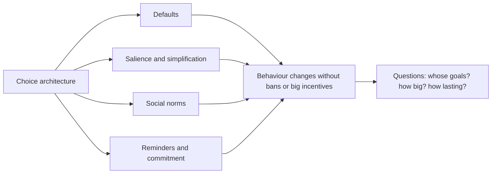

# Nudges and choice architecture

**Prerequisites:** [[time-inconsistency-and-self-control|Time inconsistency and self-control]], [[heuristics-and-biases|Heuristics and biases]].

*Richard H. Thaler at Chatham House; co-author of Nudge (2008) and winner of the 2017 Nobel prize in economics. Credit: Chatham House. License: [CC BY 2.0](https://creativecommons.org/licenses/by/2.0). Source: [File:Richard Thaler Chatham.jpg](https://commons.wikimedia.org/wiki/File:Richard_Thaler_Chatham.jpg).*

If people's choices are affected by defaults, framing and the order in which options appear, then whoever designs those features influences behaviour, whether they intend to or not. Richard Thaler and Cass Sunstein called this design **choice architecture** and introduced the idea of a **nudge** in their book *Nudge* (2008): "any aspect of the choice architecture that alters people's behavior in a predictable way without forbidding any options or significantly changing their economic incentives."

## What counts as a nudge

A nudge must be easy and cheap to avoid. Putting fruit at eye level in a cafeteria is a nudge; banning junk food is not. A small tax changes incentives and so is not, strictly, a nudge either.

Thaler and Sunstein described their philosophy as **libertarian paternalism**: libertarian because choice is preserved; paternalistic because the architecture steers people toward choices that make them better off "as judged by themselves".

## Types of nudge

| Nudge | How it works | Example |
|---|---|---|
| **Defaults** | Pre-set the option people get if they do nothing | Automatic enrolment in pension plans |
| **Simplification** | Reduce paperwork and complexity | Pre-filled tax returns |
| **Salience** | Make relevant information prominent | Calorie counts on menus |
| **Social norms** | Tell people what others do | "Most of your neighbours use less energy" |
| **Reminders** | Prompt people at the right time | Text messages about appointments or bills |
| **Commitment** | Let people bind future selves | Save More Tomorrow |
| **Framing** | Present information in a helpful frame | Annual cost of energy use on appliance labels |

## The power of defaults

**Pension enrolment.** Brigitte Madrian and Dennis Shea (2001) studied a US firm that switched from requiring employees to opt in to its 401(k) retirement plan to enrolling them automatically, with the option to opt out. Participation among new employees rose from about **37 percent to 86 percent**. Many stayed at the default contribution rate and investment fund, showing the default's power for good and ill. The UK introduced automatic enrolment for workplace pensions from 2012, and participation in private-sector workplace pensions rose sharply.

**Organ donation.** Eric Johnson and Daniel Goldstein (2003) compared European countries. In countries where people are donors unless they opt out, consent rates exceeded 85 percent; in opt-in countries, they were far lower (for example, about 12 percent in Germany versus over 99 percent in neighbouring Austria). Actual donation rates differ less than consent rates, because families and medical systems also matter. In Canada, Nova Scotia adopted an opt-out (deemed consent) system in 2021.

### Why defaults work

1. **Inertia and procrastination**: changing requires effort, which present-biased people postpone.
2. **Implied endorsement**: people infer the default is recommended.
3. **Loss aversion**: the default becomes the reference point, and departing from it feels like a loss.

## A worked example: energy reports

The company Opower sent households Home Energy Reports comparing their electricity use with similar neighbours. Hunt Allcott (2011) analysed randomised trials covering about 600,000 households and found the reports cut energy use by about **2 percent** on average.

Is 2 percent worth it? Suppose a household uses 10,000 kWh a year at 15 cents per kWh (1,500 dollars). A 2 percent saving is 200 kWh, or 30 dollars a year. If reports cost about 1 to 2 dollars per household per year to produce and mail, the savings far exceed the cost, making this one of the cheapest ways found to reduce energy use, though the effect per household is small.

## Nudge units

Governments set up behavioural insights teams to apply and test nudges. The UK's Behavioural Insights Team was founded in 2010; the US Social and Behavioral Sciences Team in 2014 (formalised by executive order in 2015); Canada's Impact and Innovation Unit in the Privy Council Office has run behavioural trials. One well-known UK result: adding the sentence that "9 out of 10 people in your area pay their tax on time" to tax reminder letters increased timely payments.

## Effect sizes

Stefano DellaVigna and Elizabeth Linos (2022) compared 126 randomised trials run by two US nudge units with those published in academic journals. Published academic studies reported an average effect of about 8.7 percentage points; the nudge-unit trials, which were not selected for publication, averaged about 1.4 percentage points. Publication bias inflates the apparent effects. Nudges often work, but their effects are usually modest.

## Criticisms

- **Paternalism.** Who decides what is good for people? Critics such as Mario Rizzo and Glen Whitman (*Escaping Paternalism*, 2020) argue that "as judged by themselves" is hard to define when preferences are inconsistent.
- **Manipulation.** Nudges may exploit the same biases that marketers use. Thaler distinguishes nudges from **sludge**: friction designed to make beneficial actions harder (complicated cancellation processes, rebates requiring mail-in forms).
- **Small effects versus big problems.** George Loewenstein and Nick Chater (2022) argued that focusing on individual nudges can distract from structural policies, such as carbon pricing or regulation, that address problems at scale.
- **Heterogeneity.** A default that helps most people may harm some, such as a pension default that is unsuitable for someone with high debt.

## Key ideas

- Choice architecture shapes decisions; a nudge alters behaviour without bans or large incentive changes.
- Defaults are among the most powerful nudges (pension enrolment, organ donation).
- Nudges are cheap and often cost-effective, but effects are usually modest and publication bias inflates them.
- Critics raise concerns about paternalism, manipulation and distraction from structural reforms.

## Where this leads

- Next: [[limits-and-critiques|limits and critiques of behavioural economics]].
- Related: [[government-failure|government failure]].
- Glossary: [[g:nudge|nudge]], [[g:choice-architecture|choice architecture]], [[g:default-option|default option]], [[g:libertarian-paternalism|libertarian paternalism]], [[g:sludge|sludge]].
