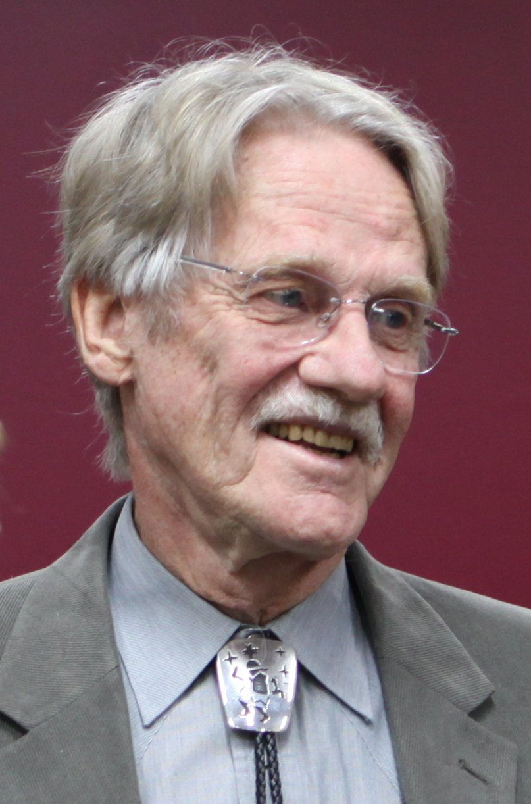
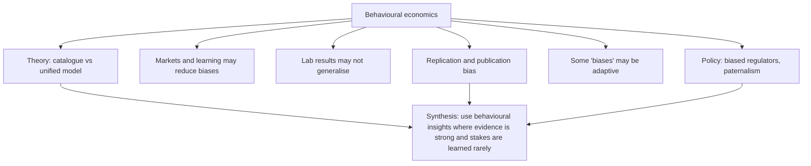

# Limits and critiques of behavioural economics

**Prerequisites:** [The rationality assumption](01-the-rationality-assumption.md), [Nudges and choice architecture](07-nudges-and-choice-architecture.md).

*Vernon L. Smith (centre) at Chapman University in 2011; his market experiments showed how quickly trading can converge to competitive equilibrium. Credit: Dstringer71. License: [CC BY-SA 3.0](https://creativecommons.org/licenses/by-sa/3.0). Source: [File:Vernon L. Smith 2011.jpg](https://commons.wikimedia.org/wiki/File:Vernon_L._Smith_2011.jpg).*

Behavioural economics has changed how economists think about decisions, and its ideas are now used by governments, firms and regulators. But it has also attracted serious criticism, from defenders of standard economics, from psychologists with different views of human judgement, and from within the field itself. Understanding these limits is part of using behavioural insights responsibly.

## 1. "A list of anomalies, not a theory"

Standard economics has one core model: constrained maximisation. Behavioural economics offers many separate effects: loss aversion, present bias, anchoring, overconfidence, inequity aversion, and dozens more. Critics argue this risks becoming a catalogue that can explain anything after the fact but predict little in advance. If people sometimes overreact and sometimes underreact, which will happen in a new situation?

Defenders reply that core models such as prospect theory, β–δ discounting and inequity aversion are formal, testable and parsimonious, and that a realistic theory should not be expected to be as simple as one that is wrong. Thaler has said behavioural economics is simply economics that uses more realistic assumptions where they matter.

## 2. Markets and learning

Gary Becker (1962) showed that some predictions of standard theory, like downward-sloping demand, follow even if individuals behave randomly, because budget constraints force people to buy less of goods whose prices rise. More broadly:

- **Selection.** Firms and traders with costly biases may lose money and leave the market.
- **Arbitrage.** Rational traders can profit from others' mistakes, pushing prices toward fundamentals.
- **Experience.** John List (2003, 2004) found that experienced sports-card traders showed little endowment effect, unlike inexperienced ones.
- **Experimental markets.** In Vernon Smith's experiments (he shared the 2002 Nobel prize with Kahneman), double-auction markets converged quickly toward competitive equilibrium even with few traders.

Responses: arbitrage has limits (Andrei Shleifer and Robert Vishny, 1997); many important decisions, such as choosing a pension or buying a house, are made rarely, so there is little chance to learn; and firms may profit by exploiting consumer biases rather than correcting them (Xavier Gabaix and David Laibson, 2006, on shrouded fees).

## 3. Lab versus field

Experiments typically use students playing for small stakes in artificial settings, observed by researchers. Steven Levitt and John List (2007) argued that behaviour in the lab may not generalise: scrutiny, stakes and self-selection differ in the real world. For example, people may give more in a dictator game when they know they are being studied.

Many behavioural findings have been confirmed in field data (pension defaults, the disposition effect, energy reports). Others have not transferred well, and effect sizes in the field are often smaller.

## 4. Replication and publication bias

Psychology's **replication crisis** affected behavioural economics. The Open Science Collaboration (2015) tried to replicate 100 psychology studies and found that only about 36 percent produced significant results again. Colin Camerer and colleagues (2016) replicated 18 laboratory experiments in economics; about 61 percent replicated (11 of 18), with effects averaging about two-thirds of the original. Some famous results, including several priming effects and "ego depletion", have largely failed to replicate. In 2021, a prominent 2012 study reporting that signing an honesty pledge at the top of a form reduced cheating was retracted after evidence emerged that data in one of its experiments had been fabricated; further retractions of related work followed in 2023.

The field has responded with pre-registration, larger samples, replication studies and data sharing. As noted in [the previous lesson](07-nudges-and-choice-architecture.md), comparing all trials run by nudge units with published studies showed much smaller average effects.

## 5. Are "biases" really errors?

Gerd Gigerenzer and others argue that many so-called biases reflect reasonable responses to the real environment, or artefacts of how questions are posed. Presented as natural frequencies, base-rate problems become much easier. The "hot hand" in basketball, long cited as a cognitive illusion (Thomas Gilovich, Robert Vallone and Tversky, 1985), was re-examined by Joshua Miller and Adam Sanjurjo (2018), who found a statistical bias in the original analysis; correcting it suggests a modest hot hand may exist after all.

## 6. Policy concerns

- **Who is biased?** Policymakers and regulators are human too, subject to the same biases plus political incentives (see [government failure](../07-market-failure/15-government-failure.md)). Behavioural findings do not automatically justify more intervention.
- **Paternalism and welfare.** If preferences are inconsistent, which self's preferences should welfare analysis use? B. Douglas Bernheim and Antonio Rangel (2009) proposed frameworks for welfare analysis with inconsistent choices.
- **Distraction from structural policy.** Some behavioural economists themselves, such as Chater and Loewenstein (2022), argue that focusing on individual biases has diverted attention from regulation, taxes and institutional reform.

## A balanced view

Most economists today accept that people depart from the standard model in some systematic ways that matter, especially in rare, complex, delayed or emotionally charged decisions, such as saving for retirement, choosing insurance or dealing with health. They also accept that the standard model works well in many market settings and remains the benchmark. The practical question is not "rational or irrational?" but which model predicts better in a given situation.

## Key ideas

- Critics say behavioural economics is a list of anomalies; defenders point to formal, testable models.
- Markets, experience and arbitrage can reduce biases, but have limits, and firms can exploit biases.
- Lab findings may not generalise; replication failures and publication bias have shrunk some effects.
- Policy use requires care: regulators are biased too, and welfare with inconsistent preferences is tricky.

## Where this leads

- Next section: [the history of economic thought](../10-history-of-thought/01-before-adam-smith.md).
- Related: [the efficient market hypothesis](../../finance/06-portfolio-theory/04-the-efficient-market-hypothesis.md), [herding, bubbles and manias](../../finance/07-behavioural-finance/04-herding-bubbles-and-manias.md).
- Glossary: [replication crisis](../glossary/replication-crisis.md), [limits to arbitrage](../glossary/limits-to-arbitrage.md), [experimental economics](../glossary/experimental-economics.md).
