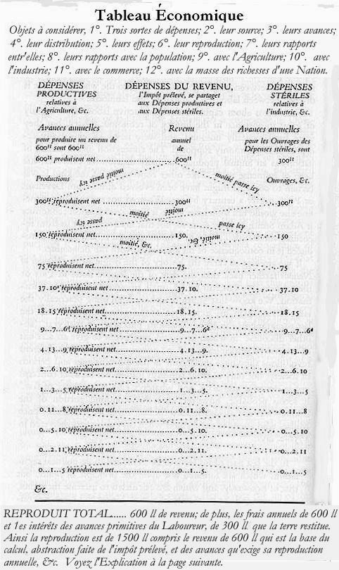
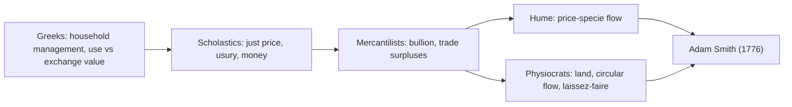

# Before Adam Smith

**Prerequisites:** [Scarcity](../01-foundations/01-scarcity.md), [Markets, prices and property rights](../01-foundations/10-markets-prices-and-property-rights.md).

*François Quesnay's Tableau économique (1758), the first diagram of the economy as a circular flow. Credit: Francois Quesnay. License: Public domain. Source: [File:Quesnay Tableau.jpg](https://commons.wikimedia.org/wiki/File:Quesnay_Tableau.jpg).*

Economics as a separate discipline is usually dated to Adam Smith's *Wealth of Nations* (1776). But people thought hard about exchange, money, prices and wealth for more than two thousand years before that. This lesson surveys the main ideas, from ancient Greece to the French Physiocrats, that Smith inherited and reacted against.

## Ancient Greece

The word "economics" comes from the Greek *oikonomia*, the management of a household (*oikos*). Xenophon's *Oeconomicus* (4th century BCE) is a dialogue about running an estate. In another work, the *Cyropaedia*, Xenophon made an early observation about specialisation: in large cities, where demand is greater, workers can specialise in a single task and do it better.

**Aristotle** (384–322 BCE) made distinctions that shaped European thought for centuries. In the *Politics*, he distinguished:

- *oikonomia*, natural acquisition for the needs of the household, which has a natural limit; and
- *chrematistike*, the pursuit of money for its own sake, which he regarded as unnatural and unlimited.

He also separated a thing's **use value** (wearing a shoe) from its **exchange value** (trading it), a distinction that reappears in Smith, Ricardo and Marx. In the *Nicomachean Ethics* (Book V), he discussed **justice in exchange**: exchange requires a common measure, and money serves that role "by convention" (*nomos*), which is the origin of the Greek word for coin, *nomisma*. He condemned charging interest as making money breed from money. See philosophy's [Aristotle](../../../philosophy/history/ancient/greek/thinkers/aristotle.md) and [Nicomachean Ethics](../../../philosophy/history/ancient/greek/texts/nicomachean-ethics.md).

## Medieval scholastics

Medieval scholars, working within Christian theology, discussed the **just price** and **usury** (lending at interest).

- **Thomas Aquinas** (1225–1274), in the *Summa Theologica*, argued that selling something for more than it is worth is unjust, but accepted that prices could vary with circumstances. Many scholars interpreted the just price as the common market price in the absence of fraud or monopoly.
- **Nicole Oresme** (c. 1320–1382) wrote *De moneta*, a treatise arguing that kings should not debase the coinage, since money belongs to the community.
- **The School of Salamanca** in 16th-century Spain, including Francisco de Vitoria, Domingo de Soto, Martín de Azpilcueta and Luis de Molina, analysed how the flood of silver from the Americas raised prices in Spain. Azpilcueta (1556) gave one of the earliest statements of the **quantity theory of money**: money is worth less where it is abundant. Some, including Joseph Schumpeter, regarded the Salamancans as the founders of scientific economics.

## The Islamic world

**Ibn Khaldun** (1332–1406), in the *Muqaddimah* (1377), analysed the division of labour, the role of supply and demand in setting prices, and the effects of taxation. He argued that moderate taxes encourage economic activity and raise more revenue, while high taxes discourage it and reduce revenue, an idea sometimes compared to the [Laffer curve](../glossary/laffer-curve.md).

## Mercantilism

From the 16th to the 18th century, European statesmen and merchant-writers developed **mercantilism**. It was less a single theory than a set of policies and beliefs:

- National wealth consists largely of gold and silver.
- A country should aim for a **favourable balance of trade**: exports greater than imports, bringing in bullion.
- Governments should promote manufacturing, restrict imports with tariffs, and acquire colonies as sources of raw materials and markets.

Thomas Mun's *England's Treasure by Forraign Trade* (published 1664) was a classic statement. Jean-Baptiste Colbert, finance minister to Louis XIV, applied mercantilist policies in France.

**David Hume**'s "Of the Balance of Trade" (1752) undermined mercantilism with the **price–specie flow mechanism**: if a country accumulates gold through a trade surplus, its money supply and prices rise, making its exports less competitive and imports more attractive, until the surplus disappears. Trying to hoard gold is self-defeating.

## Early analysts

- **William Petty** (1623–1687) pioneered "political arithmetic", the use of numbers to analyse the economy, including early national income estimates.
- **Richard Cantillon** (c. 1680–1734), in his *Essay on the Nature of Trade in General* (written around 1730, published 1755), described the entrepreneur as someone who bears uncertainty, analysed how new money spreads unevenly through an economy (the "Cantillon effect"), and treated the economy as an interconnected system.
- **Bernard Mandeville**'s *The Fable of the Bees* (1714) argued provocatively that private vices, such as vanity and greed, produce public benefits, foreshadowing the idea of unintended social order.

## The Physiocrats

In mid-18th-century France, **François Quesnay** (1694–1774) and his followers, the **Physiocrats**, argued that only agriculture produces a net surplus (*produit net*); manufacturing and trade merely transform or move it. Quesnay's *Tableau économique* (1758) was the first diagram of the economy as a **circular flow** of goods and money between classes. The Physiocrats favoured free trade in grain and a single tax on land. The phrase **laissez-faire** is associated with this circle, notably with Vincent de Gournay. Anne-Robert-Jacques **Turgot**, finance minister under Louis XVI, tried to implement free trade in grain. Smith met Quesnay and Turgot while in France in the 1760s.

## Key ideas

- Aristotle distinguished use value from exchange value and natural from unnatural acquisition.
- Scholastics debated the just price and usury; the Salamancans analysed inflation from American silver.
- Mercantilists equated wealth with bullion and sought trade surpluses; Hume showed this was self-defeating.
- Cantillon, Mandeville and the Physiocrats developed ideas of entrepreneurship, unintended order and the circular flow.

## Where this leads

- Next: [classical economics](02-classical-economics.md).
- Related: [Adam Smith](thinkers/01-adam-smith.md), [comparative advantage](../01-foundations/07-comparative-advantage.md).
- Glossary: [mercantilism](../glossary/mercantilism.md), [physiocracy](../glossary/physiocracy.md), [just price](../glossary/just-price.md), [price–specie flow mechanism](../glossary/price-specie-flow-mechanism.md), [laissez-faire](../glossary/laissez-faire.md).
