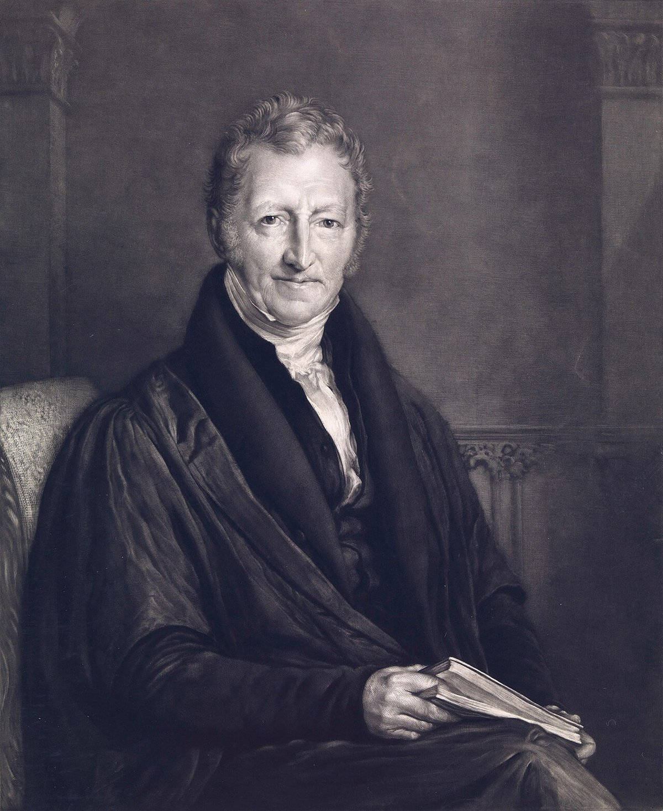
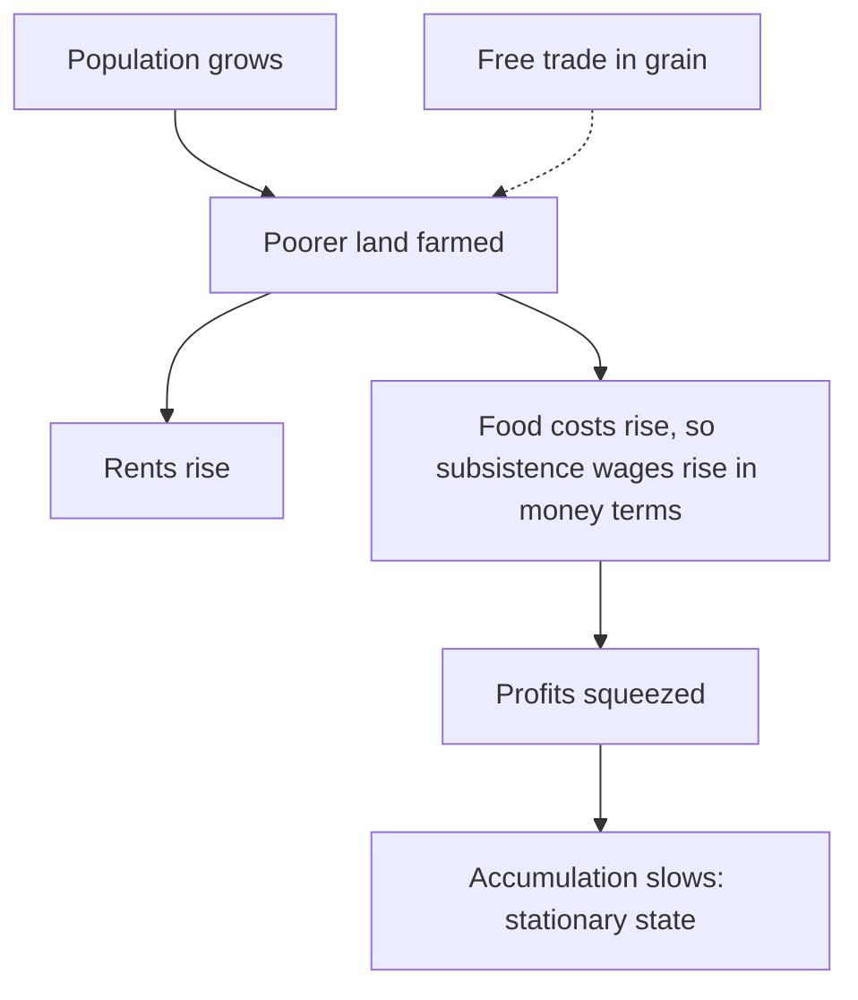

# Classical economics

**Prerequisites:** [[before-adam-smith|Before Adam Smith]], [[comparative-advantage|Comparative advantage]].

*Thomas Robert Malthus, engraving after a portrait by John Linnell; his Essay on the Principle of Population (1798) shaped classical economics. Credit: John Linnell. License: [CC BY 4.0](https://creativecommons.org/licenses/by/4.0). Source: [File:Thomas Robert Malthus Wellcome L0069037 -crop.jpg](https://commons.wikimedia.org/wiki/File:Thomas_Robert_Malthus_Wellcome_L0069037_-crop.jpg).*

**Classical economics** is the tradition running from Adam Smith's *Wealth of Nations* (1776) to John Stuart Mill's *Principles of Political Economy* (1848) and its later editions. Its main figures were British: Smith, Thomas Malthus, David Ricardo, Mill, and, on the continent, Jean-Baptiste Say. Karl Marx built his critique of capitalism on classical foundations. The classical economists asked big questions: what makes nations rich, how income is divided among workers, landlords and capitalists, and whether the economy tends toward growth or stagnation.

## Adam Smith and the wealth of nations

[[adam-smith|Adam Smith]] argued, against mercantilism, that a nation's wealth is not its gold but the goods its people produce and consume ("the annual produce of the land and labour"). Its main source is **productivity**, driven by:

- **The division of labour.** His famous pin factory: one untrained worker alone "certainly could not make twenty" pins a day, while ten workers each specialising in a few operations made about 48,000, or 4,800 each (see [[specialization-and-division-of-labour|specialisation and division of labour]]).
- **The extent of the market.** Specialisation is limited by how large the market is; trade and transport extend it.
- **Capital accumulation**, which funds tools and the employment of labour.

Smith described how self-interested exchange, guided by competition, coordinates production: "It is not from the benevolence of the butcher, the brewer, or the baker, that we expect our dinner, but from their regard to their own interest." He used the phrase "invisible hand" only once in the *Wealth of Nations*. He was also suspicious of merchants who conspire against the public, and supported government roles in defence, justice, public works and education.

## Value and distribution

Classical economists distinguished the **market price**, which fluctuates with supply and demand, from the **natural price**, around which market prices gravitate, set by the costs of production (wages, profits and rents at their natural rates). Most adopted some version of a **labour theory of value**: the value of goods is related to the labour needed to produce them. Smith wavered; Ricardo developed it more consistently; Marx made it central.

The central question was **distribution**: how output is divided into wages (to workers), profits (to capitalists) and rent (to landlords).

## Malthus and population

Thomas Robert Malthus's *An Essay on the Principle of Population* (1798) argued that population tends to grow geometrically (1, 2, 4, 8...) while food supply grows at best arithmetically (1, 2, 3, 4...). Population is therefore held back by "checks": misery and vice (famine, disease) or, in later editions, "moral restraint" (later marriage). In this view, wages tend toward subsistence. History did not follow this path in industrialising countries: productivity growth and falling birth rates allowed living standards to rise. But the "Malthusian trap" is a fair description of much of pre-industrial history (Gregory Clark, *A Farewell to Alms*, 2007).

## Ricardo: rent, trade and the stationary state

[[david-ricardo|David Ricardo]]'s *On the Principles of Political Economy and Taxation* (1817) brought rigour through abstract models:

- **Differential rent.** Rent arises from differences in land fertility; as population grows and poorer land is farmed, rents rise (see [[land-and-rent|land and rent]]).
- **Comparative advantage.** Trade benefits both countries even if one is better at producing everything (see [[comparative-advantage|comparative advantage]]).
- **The stationary state.** Ricardo predicted that rising rents and food costs would squeeze profits, eventually halting capital accumulation and growth, unless free trade (repeal of the Corn Laws) allowed cheap food imports.

## Say's law

Jean-Baptiste Say (*Treatise on Political Economy*, 1803) argued that production creates the income needed to buy output, so a general glut of all goods is impossible: "products are paid for with products." Shortages and surpluses of particular goods could occur, but not of everything at once. This principle, **Say's law**, was debated by Malthus at the time and later attacked by John Maynard Keynes in the 1930s.

## John Stuart Mill

[[john-stuart-mill|John Stuart Mill]]'s *Principles of Political Economy* (1848) was the leading economics textbook for decades. Mill distinguished the **laws of production**, which he thought had the character of physical truths, from the **laws of distribution**, which he said are "a matter of human institution solely" and could be changed by society. He contributed to the theory of international trade (reciprocal demand, which determines the terms of trade) and was sympathetic to cooperatives, women's rights and, in principle, a stationary state where people would pursue culture rather than ever-growing wealth.

## Legacy

Classical economics gave economics many lasting ideas: gains from specialisation and trade, the self-regulating tendencies of competitive markets, the role of capital accumulation, rent theory, comparative advantage and the quantity theory of money. Its labour and cost-based theories of value were replaced in the 1870s by marginal utility (see [[the-marginal-revolution|the marginal revolution]]). Its focus on growth and distribution returned in modern growth theory and in debates about inequality.

## Key ideas

- Smith: wealth comes from productivity, driven by the division of labour, market size and capital.
- Classical economists focused on distribution among wages, profits and rent, with cost-based theories of value.
- Malthus predicted population would keep wages near subsistence; Ricardo developed rent and comparative advantage.
- Say's law and Mill's distinction between production and distribution remain influential and debated.

## Where this leads

- Next: [[the-marginal-revolution|the marginal revolution]].
- Thinkers: [[adam-smith|Adam Smith]], [[david-ricardo|David Ricardo]], [[john-stuart-mill|John Stuart Mill]], [[karl-marx|Karl Marx]].
- Glossary: [[g:classical-economics|classical economics]], [[g:labour-theory-of-value|labour theory of value]], [[g:says-law|Say's law]], [[g:malthusian-trap|Malthusian trap]].
