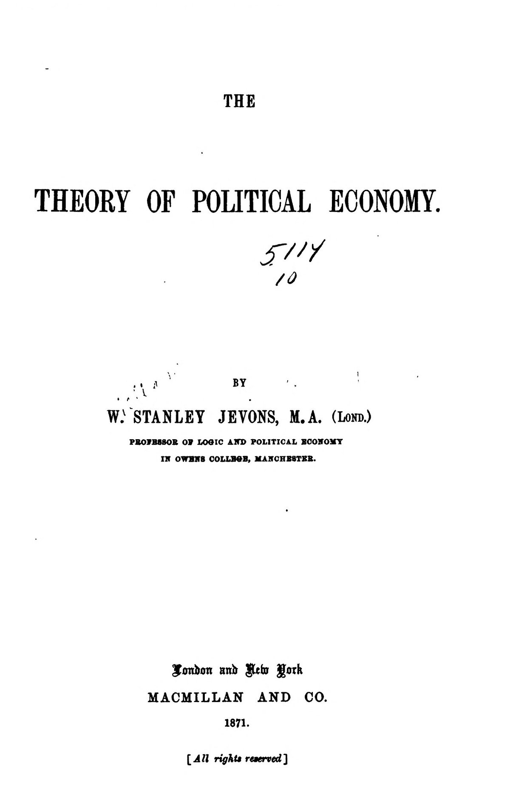

# The marginal revolution

**Prerequisites:** [Classical economics](02-classical-economics.md), [Marginal utility](../03-consumer-theory/02-marginal-utility.md), [Marginal thinking](../01-foundations/05-marginal-thinking.md).

*Title page of the first edition of Jevons's The Theory of Political Economy (1871), one of the three founding texts of the marginal revolution. Credit: William Stanley Jevons. License: Public domain. Source: [File:Jevons - The Theory of Political Economy, 1st edition (1871), title page.jpg](https://commons.wikimedia.org/wiki/File:Jevons_-_The_Theory_of_Political_Economy,_1st_edition_(1871),_title_page.jpg).*

In the early 1870s, three economists working independently in three countries published books that changed the foundations of economics. [William Stanley Jevons](thinkers/05-william-stanley-jevons.md) in England (*The Theory of Political Economy*, 1871), [Carl Menger](thinkers/06-carl-menger.md) in Austria (*Principles of Economics*, 1871) and [Léon Walras](thinkers/07-leon-walras.md) in Switzerland (*Elements of Pure Economics*, 1874) each argued that value comes not from labour or cost of production but from **utility at the margin**. This shift is called the **marginal revolution**, and it marks the transition from classical to **neoclassical** economics.

## The problem with classical value theory

Classical economists struggled with the **diamond–water paradox**: water is essential to life but cheap, while diamonds are frivolous but expensive. Smith noted this but could not resolve it with use value. Cost-of-production theories explained some prices but not others, such as rare wines or paintings whose value far exceeds the labour in them.

## The marginalist answer

The value of a good depends on the utility of the **last unit**, not the total utility of all units. Water is abundant, so the last glass you drink adds little satisfaction; its marginal utility is low. Diamonds are scarce, so the marginal utility of one more is high. Total utility from water is enormous, but price reflects the margin (see [marginal utility](../03-consumer-theory/02-marginal-utility.md)).

### Worked example

Suppose a person's marginal utility from successive litres of water is 100, 50, 20, 5, 1, ... and from successive diamonds is 40, 35, 30, ... If water is plentiful enough that she consumes 5 litres, the marginal utility of water is 1. With only one diamond available, its marginal utility is 40. Total utility from water (176) is far greater than from one diamond (40), but at the margin she would give up much more water for another diamond than the reverse. Prices track marginal, not total, utility.

## Three founders, three styles

| | Jevons | Menger | Walras |
|---|---|---|---|
| Country | England | Austria | France/Switzerland |
| Key work | *The Theory of Political Economy* (1871) | *Grundsätze der Volkswirtschaftslehre* (1871) | *Éléments d'économie politique pure* (1874) |
| Method | Mathematical, utilitarian (calculus of pleasure and pain) | Verbal, causal, focused on individual needs | Mathematical, system of simultaneous equations |
| Legacy | English neoclassical tradition | Austrian school | General equilibrium theory |

Jevons wrote that economics "must be a mathematical science" because it deals with quantities. Menger avoided mathematics and emphasised subjective value, uncertainty and the time structure of production. Walras built the first model of [general equilibrium](../08-welfare-economics/02-general-equilibrium.md).

Precursors had anticipated marginalism: Antoine Augustin Cournot (1838) used demand functions and derived monopoly and duopoly equilibria; Jules Dupuit (1844) developed consumer surplus; Hermann Heinrich Gossen (1854) stated the laws of diminishing marginal utility and equal marginal utility per unit spent, but his book was ignored until Jevons rediscovered it.

## From utility to the whole of economics

Marginal reasoning spread beyond consumer theory:

- **Marginal productivity theory of distribution.** John Bates Clark (*The Distribution of Wealth*, 1899) and Philip Wicksteed argued that, in competitive markets, each factor of production is paid its marginal product (see [labour demand](../06-factor-markets/02-labour-demand.md)). This replaced the classical class-based theory of distribution.
- **Opportunity cost.** Friedrich von Wieser, Menger's follower, developed the concept of opportunity cost.
- **Capital and interest.** Eugen von Böhm-Bawerk explained interest through time preference and the productivity of roundabout production (see [capital and interest](../06-factor-markets/07-capital-and-interest.md)).
- **The Marshallian synthesis.** [Alfred Marshall](thinkers/08-alfred-marshall.md)'s *Principles of Economics* (1890) combined marginal utility (demand) with cost of production (supply), comparing them to the two blades of a pair of scissors: asking whether demand or supply determines price is like asking which blade cuts the paper.

## Consequences

- **A change of focus.** Classical economics studied growth and distribution among classes; neoclassical economics focused on how given resources are allocated among competing uses by individual choices. Lionel Robbins's 1932 definition captured the new emphasis: economics studies "human behaviour as a relationship between ends and scarce means which have alternative uses."
- **Mathematics.** Marginal analysis lends itself to calculus, and economics gradually became more mathematical.
- **Subjectivism.** Value is subjective, rooted in individual preferences.
- **The name.** Political economy became "economics", reflecting a claim to scientific status. Marshall's textbook helped popularise the term.

Later, economists moved away from measurable (cardinal) utility to **ordinal utility** and indifference curves (Pareto, Hicks and Allen in 1934) and then to revealed preference (Samuelson, 1938), keeping marginal reasoning while dropping the idea that utility can be measured like weight (see [preferences and utility](../03-consumer-theory/01-preferences-and-utility.md)).

## Key ideas

- In 1871–1874, Jevons, Menger and Walras independently grounded value in marginal utility.
- Marginal utility resolved the diamond–water paradox: price reflects the value of the last unit.
- Marginalism spread to distribution (marginal productivity), opportunity cost and capital theory.
- Marshall's scissors combined demand and supply; economics shifted toward allocation, mathematics and subjective value.

## Where this leads

- Next: [twentieth-century microeconomics](04-twentieth-century-microeconomics.md).
- Thinkers: [Jevons](thinkers/05-william-stanley-jevons.md), [Menger](thinkers/06-carl-menger.md), [Walras](thinkers/07-leon-walras.md), [Marshall](thinkers/08-alfred-marshall.md).
- Glossary: [marginal revolution](../glossary/marginal-revolution.md), [neoclassical economics](../glossary/neoclassical-economics.md), [diamond–water paradox](../glossary/diamond-water-paradox.md), [marginalism](../glossary/marginalism.md).
