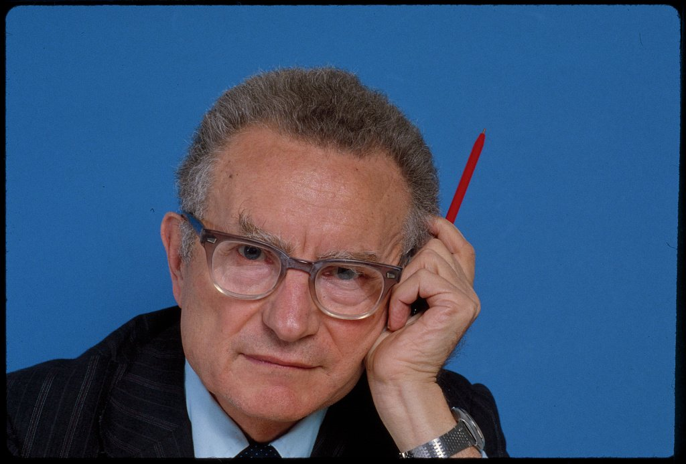
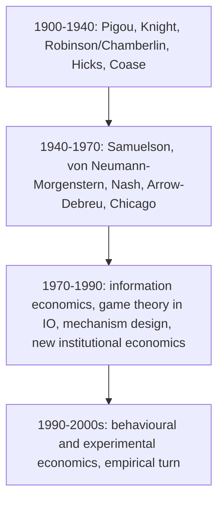

# Twentieth-century microeconomics

**Prerequisites:** [The marginal revolution](03-the-marginal-revolution.md), [General equilibrium](../08-welfare-economics/02-general-equilibrium.md), [Game theory basics](../05-market-structures/10-game-theory-basics.md).

*Paul A. Samuelson, photographed by Bernard Gotfryd; his Foundations of Economic Analysis (1947) made mathematical methods standard. Credit: Gotfryd, Bernard, photographer. License: Public domain. Source: [File:Paul A. Samuelson, economist.jpg](https://commons.wikimedia.org/wiki/File:Paul_A._Samuelson,_economist.jpg).*

Between 1900 and 2000, microeconomics was transformed from Marshall's verbal and diagrammatic tradition into a mathematical discipline covering markets, strategy, information, institutions and, by the end, psychology. This lesson traces the main developments, most of which appear elsewhere in this course.

## 1900–1940: welfare, competition and imperfect markets

- **Welfare economics.** [Arthur Cecil Pigou](thinkers/10-arthur-cecil-pigou.md)'s *The Economics of Welfare* (1920) analysed divergences between private and social costs, the basis of Pigouvian taxes (see [Pigouvian taxes](../07-market-failure/05-pigouvian-taxes-and-subsidies.md)). [Vilfredo Pareto](thinkers/09-vilfredo-pareto.md) had introduced the efficiency criterion that bears his name (1906).
- **Risk and uncertainty.** Frank Knight's *Risk, Uncertainty and Profit* (1921) distinguished measurable **risk** from unmeasurable **uncertainty** and argued that profit is the reward for bearing uncertainty.
- **Imperfect competition.** In 1933, Joan Robinson (*The Economics of Imperfect Competition*) and Edward Chamberlin (*The Theory of Monopolistic Competition*) independently developed models between perfect competition and monopoly. Robinson also coined "monopsony" (see [monopolistic competition](../05-market-structures/08-monopolistic-competition.md), [monopsony](../06-factor-markets/06-monopsony-and-unions.md)).
- **Ordinal utility.** John Hicks and Roy Allen (1934) rebuilt consumer theory using indifference curves; Hicks's *Value and Capital* (1939) separated income and substitution effects (see [income and substitution effects](../03-consumer-theory/08-income-and-substitution-effects.md)).
- **The nature of the firm.** [Ronald Coase](thinkers/12-ronald-coase.md) (1937) asked why firms exist and answered: transaction costs.
- **The socialist calculation debate.** Ludwig von Mises (1920) and [Friedrich Hayek](thinkers/11-friedrich-hayek.md) argued that without market prices rational economic calculation under socialism was impossible; Oskar Lange (1936–37) proposed "market socialism" using trial-and-error prices.

## 1940–1970: mathematics and general equilibrium

- **Samuelson's *Foundations of Economic Analysis*** (1947) recast economic theory as constrained optimisation and equilibrium, making mathematical methods standard. Samuelson also developed revealed preference theory and the theory of public goods (1954).
- **Game theory.** John von Neumann and Oskar Morgenstern's *Theory of Games and Economic Behavior* (1944) founded game theory and gave expected utility an axiomatic basis. [John Nash](thinkers/14-john-nash.md) (1950–51) defined the equilibrium concept for non-cooperative games (see [Nash equilibrium](../05-market-structures/11-nash-equilibrium.md)).
- **General equilibrium and welfare theorems.** [Kenneth Arrow](thinkers/13-kenneth-arrow.md) and Gérard Debreu (1954) proved existence of competitive equilibrium; Debreu's *Theory of Value* (1959) gave the axiomatic treatment. Arrow's impossibility theorem (1951) founded modern social choice theory.
- **Linear programming and activity analysis** (Tjalling Koopmans, Leonid Kantorovich), used to analyse efficient resource allocation.
- **The theory of the second best** (Lipsey and Lancaster, 1956).
- **The Chicago school** (Milton Friedman, George Stigler, Gary Becker) applied price theory widely, from regulation to discrimination and the family. Becker's *Human Capital* (1964) and his economics of crime (1968) and the family extended the reach of microeconomics, sometimes called "economic imperialism".
- **Public choice.** James Buchanan and Gordon Tullock's *The Calculus of Consent* (1962) applied economic reasoning to political decisions (see [government failure](../07-market-failure/15-government-failure.md)).
- **Law and economics.** Coase's "The Problem of Social Cost" (1960) and later Richard Posner's *Economic Analysis of Law* (1973) applied efficiency reasoning to legal rules.

## 1970–1990: information, strategy and institutions

- **Information economics.** Akerlof (1970), Spence (1973) and Rothschild–Stiglitz (1976) analysed markets with asymmetric information (see [asymmetric information](../07-market-failure/10-asymmetric-information.md)).
- **Game theory in industrial organisation.** Reinhard Selten's subgame perfection (1965, 1975) and John Harsanyi's games of incomplete information (1967–68) made game theory the language of oligopoly, entry deterrence and bargaining. Selten, Harsanyi and Nash shared the 1994 Nobel prize. Jean Tirole's *The Theory of Industrial Organization* (1988) synthesised the new approach.
- **Mechanism design.** Leonid Hurwicz, Eric Maskin and Roger Myerson studied how to design rules (auctions, voting, contracts) that achieve goals when participants have private information; they shared the 2007 Nobel prize. William Vickrey (1961) had analysed auctions; this led to modern spectrum auctions.
- **Contract theory.** Principal–agent models (Holmström, Hart) and incomplete contracts (see [principal–agent problem](../07-market-failure/13-principal-agent-problem.md)).
- **New institutional economics.** Oliver Williamson (*Markets and Hierarchies*, 1975) developed transaction-cost economics; Douglass North studied how institutions shape long-run economic performance.
- **Commons.** [Elinor Ostrom](thinkers/15-elinor-ostrom.md)'s field research showed how communities govern shared resources (1990).
- **Contestable markets** (William Baumol, John Panzar and Robert Willig, 1982).

## 1980s onward: psychology, experiments and data

- **Behavioural economics.** Kahneman and Tversky's prospect theory (1979), Thaler's anomalies, and models of present bias and social preferences (see [the rationality assumption](../09-behavioural-economics/01-the-rationality-assumption.md)).
- **Experimental economics.** Vernon Smith and Charles Plott used laboratory markets to test theories.
- **The empirical turn.** From the 1990s, applied microeconomics increasingly relied on natural experiments and randomised trials to identify causal effects, the "credibility revolution" (Joshua Angrist and Jörn-Steffen Pischke, 2010). David Card, Angrist and Guido Imbens shared the 2021 Nobel prize for this work, which includes Card and Alan Krueger's minimum-wage study. Abhijit Banerjee, Esther Duflo and Michael Kremer (Nobel 2019) brought field experiments to development economics.
- **Market design.** Alvin Roth and Lloyd Shapley (Nobel 2012) applied matching theory to kidney exchanges and school choice; Paul Milgrom and Robert Wilson (Nobel 2020) designed auction formats.

## Key ideas

- 1900–1940: welfare economics, imperfect competition, ordinal utility and the theory of the firm.
- 1940–1970: mathematical optimisation, game theory, general equilibrium and the Chicago school.
- 1970–1990: information economics, strategic models, mechanism design and institutions.
- Late 20th century onward: behavioural and experimental economics, causal empirical methods and market design.

## Where this leads

- Next: [schools of thought](05-schools-of-thought.md).
- Thinkers: [Pigou](thinkers/10-arthur-cecil-pigou.md), [Coase](thinkers/12-ronald-coase.md), [Arrow](thinkers/13-kenneth-arrow.md), [Nash](thinkers/14-john-nash.md), [Ostrom](thinkers/15-elinor-ostrom.md), [Kahneman](thinkers/16-daniel-kahneman.md).
- Glossary: [mechanism design](../glossary/mechanism-design.md), [Knightian uncertainty](../glossary/knightian-uncertainty.md), [new institutional economics](../glossary/new-institutional-economics.md), [credibility revolution](../glossary/credibility-revolution.md).
