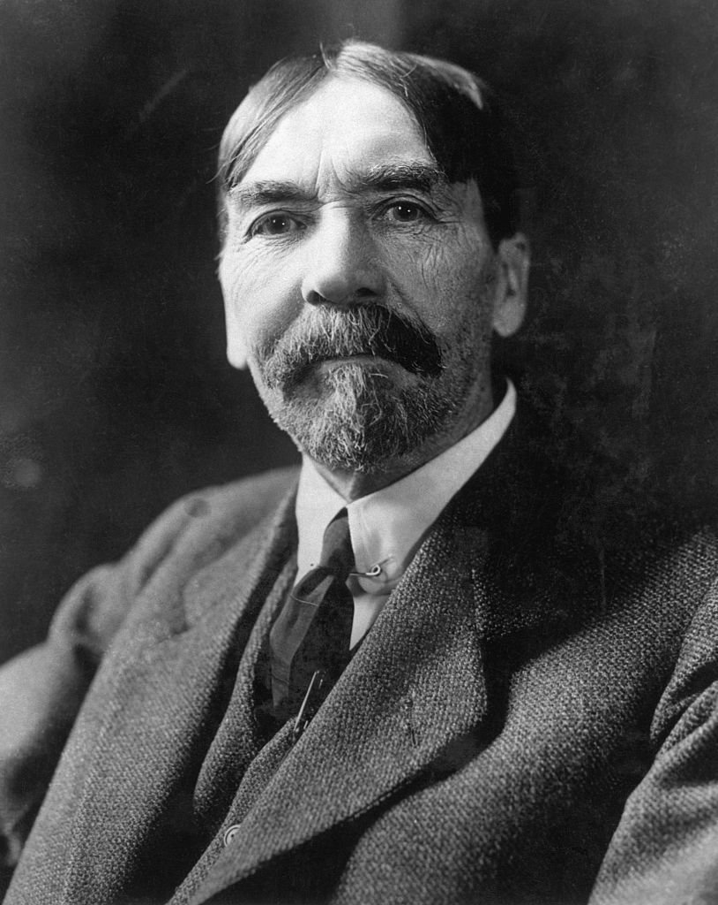
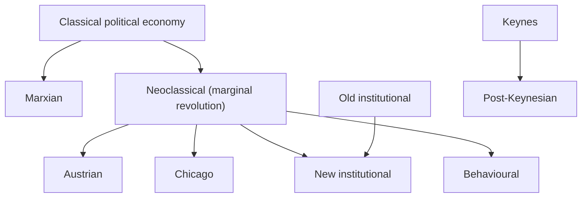

# Schools of thought

**Prerequisites:** [[twentieth-century-microeconomics|Twentieth-century microeconomics]], [[models-and-economic-method|Models and economic method]].

*Thorstein Veblen, founder of old institutional economics and author of The Theory of the Leisure Class (1899). Credit: Credit as given on Wikimedia Commons. License: Public domain. Source: [File:Veblen3a.jpg](https://commons.wikimedia.org/wiki/File:Veblen3a.jpg).*

Economics is not a single settled body of doctrine. Different traditions, or **schools of thought**, emphasise different questions, methods and assumptions. Today most academic microeconomics is broadly **neoclassical** in method, but other schools have shaped it, criticised it, and continue to offer alternatives. This lesson summarises the main ones fairly, noting what each emphasises and what critics say.

## Neoclassical economics

**Core ideas.** Individuals maximise utility and firms maximise profit subject to constraints; outcomes are analysed as equilibria; value is subjective and determined at the margin. Mathematical models and statistical testing are standard.

**Strengths.** Precise, testable predictions; a common language across fields; powerful tools for policy analysis such as cost-benefit analysis and tax incidence.

**Criticisms.** Unrealistic assumptions about rationality and information; a tendency to neglect institutions, power and history; equilibrium focus may miss change and disequilibrium.

Much of modern economics, including information economics, game theory and behavioural economics, grew within or alongside this framework, relaxing its assumptions one at a time. The label "neoclassical" is used less by economists themselves than by critics.

## Marxian economics

**Core ideas.** Building on classical political economy, [[karl-marx|Karl Marx]] (*Capital*, volume 1, 1867) argued that labour is the source of value and that capitalists extract **surplus value** from workers: workers produce more value than they are paid in wages. Capitalism is driven by competition to accumulate capital, which produces technological change, concentration of ownership, recurring crises and class conflict.

**Influence.** Marxian ideas influenced political movements worldwide, the study of economic history, and debates about labour, inequality and power.

**Criticisms.** The labour theory of value struggles to explain prices (the "transformation problem"); predictions of increasing impoverishment of workers in advanced economies did not materialise; centrally planned economies built in Marx's name performed poorly in efficiency and growth and lacked political freedom.

## The Austrian school

**Core ideas.** Founded by [[carl-menger|Carl Menger]] and developed by Eugen von Böhm-Bawerk, Ludwig von Mises and [[friedrich-hayek|Friedrich Hayek]]. Emphasises subjective value, the market as a **process** of discovery rather than a state of equilibrium, the role of entrepreneurs (Israel Kirzner), dispersed knowledge, and the dangers of central planning. Austrians tend to be sceptical of mathematical models and of government intervention. Austrian business cycle theory attributes booms and busts to credit expansion.

**Influence.** Hayek's "The Use of Knowledge in Society" (1945) is among the most cited economics papers; the socialist calculation argument is widely regarded as having been vindicated.

**Criticisms.** Rejection of empirical testing (especially in Mises's method of "praxeology") puts some Austrian claims beyond falsification; mainstream economists are sceptical of Austrian business cycle theory.

## Institutional economics

**Old institutionalists** such as Thorstein Veblen (*The Theory of the Leisure Class*, 1899), John R. Commons and Wesley Mitchell stressed habits, institutions, power and evolution, and criticised abstract theorising. **New institutional economics** (Coase, Williamson, North, Ostrom) uses mostly mainstream tools to analyse how institutions such as property rights, contracts, firms and governments affect outcomes. It is now largely integrated into mainstream economics.

## Keynesian and post-Keynesian economics

These schools are mainly macroeconomic. John Maynard Keynes (*The General Theory*, 1936) argued that economies can remain stuck with high unemployment because of deficient aggregate demand. **Post-Keynesians** (Joan Robinson, Nicholas Kaldor, Hyman Minsky) emphasise fundamental uncertainty, markup pricing by firms with market power, and financial instability. In microeconomics, they reject marginal productivity theory and highlight the role of power in pricing and distribution.

## The Chicago school

Associated with the University of Chicago (Frank Knight, Milton Friedman, George Stigler, Gary Becker, Ronald Coase, Robert Lucas). It emphasises the power of price theory, the efficiency of markets, scepticism about regulation (regulatory capture), and the application of economics to non-market behaviour. The Chicago approach to antitrust, which focuses on consumer welfare and efficiency, strongly influenced US competition policy from the 1970s (see [[competition-policy|competition policy]]).

## Behavioural and evolutionary economics

**Behavioural economics** incorporates psychology (see [[the-rationality-assumption|the rationality assumption]]). **Evolutionary economics**, inspired by Joseph Schumpeter (creative destruction) and developed by Richard Nelson and Sidney Winter (1982), models firms and technologies as evolving through variation and selection rather than optimisation.

## Feminist and ecological economics

**Feminist economics** (Marilyn Waring, Nancy Folbre and others) highlights unpaid household and care work, absent from GDP, and gender in labour markets. Claudia Goldin's research on women's labour market history won the 2023 Nobel prize. **Ecological economics** (Herman Daly, Nicholas Georgescu-Roegen) treats the economy as a subsystem of the biosphere and questions whether indefinite growth is possible on a finite planet.

## Comparing schools

| School | Unit of analysis | Method | View of markets |
|---|---|---|---|
| Neoclassical | Individual optimiser | Mathematical models, statistics | Efficient under conditions; failures identifiable |
| Marxian | Classes | Historical, dialectical | Exploitative, crisis-prone |
| Austrian | Individual acting under uncertainty | Verbal, deductive | Discovery process; intervention distorts |
| Institutional | Institutions, habits | Historical, comparative | Embedded in institutions and power |
| Post-Keynesian | Firms, classes, macro aggregates | Varied | Unstable, demand-driven |
| Behavioural | Real decision-makers | Experiments, field data | Shaped by biases; can be improved by design |

## Key ideas

- Mainstream microeconomics is broadly neoclassical but has absorbed insights from information, institutional and behavioural economics.
- Marxian economics focuses on class, surplus value and capitalist dynamics; Austrian economics on process, knowledge and entrepreneurship.
- Institutional, post-Keynesian, evolutionary, feminist and ecological economics offer further perspectives.
- Each school has strengths and weaknesses; comparing them clarifies the assumptions behind any economic argument.

## Where this leads

- Thinkers: see the [[dir:economics/microeconomics/10-history-of-thought/thinkers|thinkers]] folder, starting with [[adam-smith|Adam Smith]].
- Related: [[path:philosophy/concepts/epistemology/knowledge-and-opinion.md|knowledge and opinion]] (method and evidence).
- Glossary: [[g:austrian-school|Austrian school]], [[g:marxian-economics|Marxian economics]], [[g:institutional-economics|institutional economics]], [[g:surplus-value|surplus value]].
