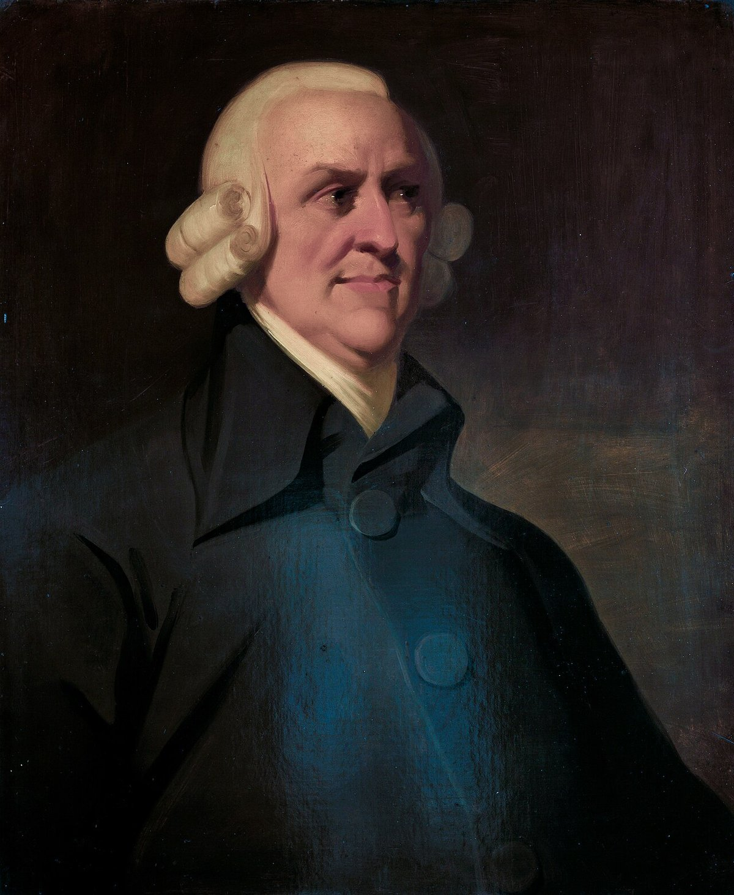
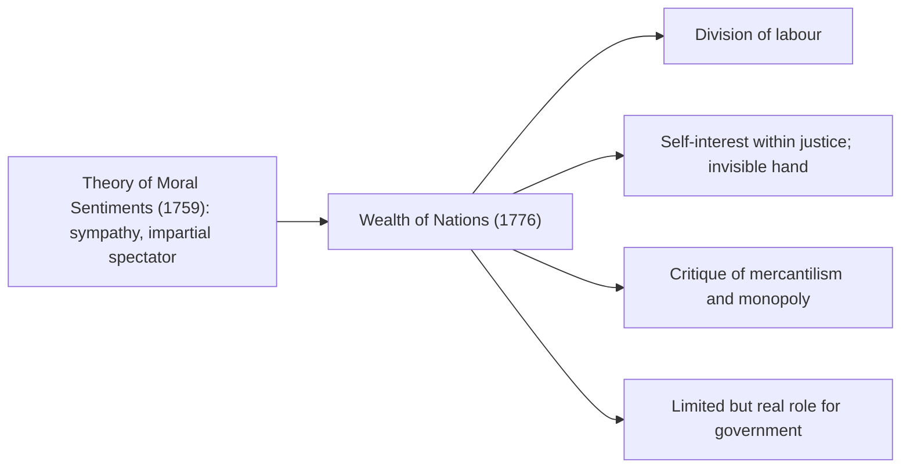

# Adam Smith (1723–1790)

**Prerequisites:** [Before Adam Smith](../01-before-adam-smith.md), [Classical economics](../02-classical-economics.md).

*The Muir portrait of Adam Smith by an unknown artist. Credit: Unknown author. License: Public domain. Source: [File:Adam Smith The Muir portrait.jpg](https://commons.wikimedia.org/wiki/File:Adam_Smith_The_Muir_portrait.jpg).*

Adam Smith was a Scottish moral philosopher whose *An Inquiry into the Nature and Causes of the Wealth of Nations* (1776) is often regarded as the founding text of modern economics. He is popularly remembered as the prophet of self-interest and free markets, but his thought was broader and more nuanced: he was first a moral philosopher, deeply concerned with sympathy, justice and the condition of ordinary workers.

## Life

Smith was born in Kirkcaldy, Fife, in 1723. He studied at the University of Glasgow under the philosopher Francis Hutcheson, then at Balliol College, Oxford, which he found intellectually stagnant. He became Professor of Logic and then of Moral Philosophy at Glasgow (1751–1764). He was a close friend of the philosopher David Hume. From 1764 to 1766 he travelled in France as tutor to the young Duke of Buccleuch, meeting the Physiocrats Quesnay and Turgot, as well as Voltaire. He spent about ten years writing the *Wealth of Nations* and later served as a Commissioner of Customs in Edinburgh, a somewhat ironic post for a critic of trade restrictions. He died in Edinburgh in 1790.

## The Theory of Moral Sentiments (1759)

Smith's first book explained moral judgement through **sympathy**: our capacity to imagine ourselves in another's situation. We judge our own conduct by imagining how an "impartial spectator" would view it. The book opens: "How selfish soever man may be supposed, there are evidently some principles in his nature, which interest him in the fortune of others." Smith revised it throughout his life; the final edition appeared in 1790.

Some 19th-century German scholars posed "Das Adam Smith Problem": how could the author of a book about sympathy also write a book founded on self-interest? Most modern scholars see no contradiction. Self-interest governs commercial dealings with strangers, but operates within a framework of justice, moral norms and social approval.

## The Wealth of Nations (1776)

Key arguments:

- **Wealth is production**, not gold: "the annual produce of the land and labour of the society".
- **The division of labour** raises productivity enormously, as in his pin factory, and is limited by the extent of the market (see [specialisation](../../01-foundations/06-specialization-and-division-of-labour.md)).
- **Self-interest and exchange.** "It is not from the benevolence of the butcher, the brewer, or the baker, that we expect our dinner, but from their regard to their own interest."
- **The invisible hand.** Investors who prefer domestic industry for their own security are "led by an invisible hand to promote an end which was no part of [their] intention". The phrase appears only once in the book, in a discussion of trade restrictions.
- **Natural and market prices.** Competition pushes market prices toward natural prices determined by costs.
- **Critique of mercantilism.** Smith attacked monopolies, trade restrictions and colonial trading privileges such as those of the East India Company.
- **Wariness of business.** "People of the same trade seldom meet together, even for merriment and diversion, but the conversation ends in a conspiracy against the public, or in some contrivance to raise prices."
- **Roles for government**: defence, justice, public works and institutions such as roads, bridges and basic education for the poor.

He also worried that the extreme division of labour could make workers "as stupid and ignorant as it is possible for a human creature to become", and recommended public schooling partly for this reason.

## Legacy

Smith's arguments shaped the movement toward free trade in Britain in the 19th century, culminating in the repeal of the Corn Laws (1846). Ricardo, Malthus and Mill built on his work. Modern economists invoke him in support of the [first welfare theorem](../../08-welfare-economics/03-the-welfare-theorems.md), though Smith never claimed markets were always efficient. He has been claimed by both free-market advocates and their critics; reading him in full shows a thinker who valued commerce for its role in raising living standards and promoting liberty, while being alert to its moral and social costs. His portrait appeared on the Bank of England 20-pound note from 2007 to 2020.

## Key ideas

- Moral philosopher first: sympathy and the impartial spectator underpin his ethics.
- Wealth comes from productive labour, enhanced by the division of labour and the extent of the market.
- Self-interested exchange, under competition and justice, coordinates economic life (the invisible hand).
- Critic of mercantilism and monopoly, wary of business collusion, and supportive of public works and education.

## Where this leads

- Next thinker: [David Ricardo](02-david-ricardo.md).
- Related: [gains from trade](../../01-foundations/08-gains-from-trade.md), [markets and prices](../../01-foundations/10-markets-prices-and-property-rights.md).
- Glossary: [invisible hand](../../glossary/invisible-hand.md), [division of labour](../../glossary/division-of-labour.md), [impartial spectator](../../glossary/impartial-spectator.md).
